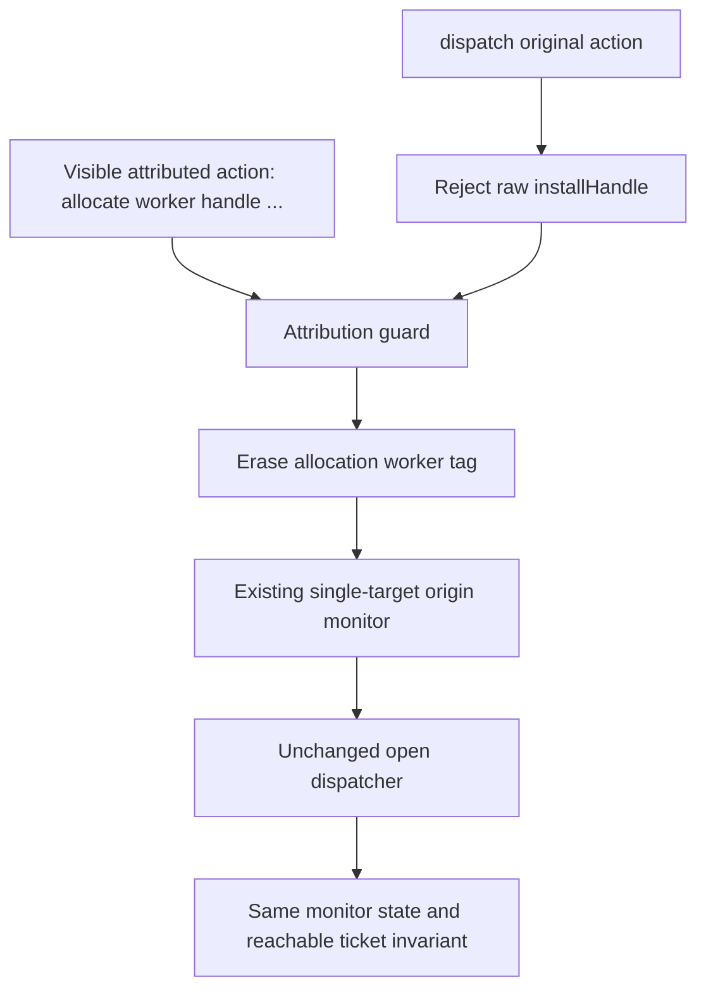

# Explicit allocation attribution

`Rules/AttributedOrigin` introduces a visible `allocate worker handle mux key
protocols flow` event. Erasure maps it to the unchanged machine's
`igStep (installHandle handle mux key protocols flow)`. All other actions use
`dispatch`. A raw `installHandle` inside `dispatch` is always rejected, preventing
an allocation from bypassing the attribution boundary.

This follows the existing [pinned source mapping](HandlerOrigin.md): the forked
handler constructs the mux and handle from local values. Hosting their abstract
objects in the model's IG runtime does not assign source allocation ownership to
IG. The worker tag represents the invoking handler; it is supplied by the observer,
not discovered or authenticated by the model. The source pin is unchanged.

## Architecture



For the fixed selected worker/handle pair, attribution accepts both identities
together and rejects either identity paired with a different one. Pairs involving
neither selected identity pass the attribution guard and remain outside this
single-target contract. They still need the original monitor and dispatcher to
accept. This increment does not validate the ownership, resource evidence or
publication contract of every other worker.

The monitor state, ticket phases and original CSP process are unchanged. The new
CSP process uses its own action channel so that the allocation worker stays
visible. Erasure changes the alphabet explicitly; it is not hiding or a silent
allocation step.

## Formal claims

- `Properties/AttributedOrigin.step-projects` and `exec-projects` erase accepted
  attributed actions into accepted single-target monitor executions, preserving
  the exact state endpoints.
- `selected-owner` and `selected-handle` enforce both directions of the selected
  worker/handle association for any successful allocation step.
- `raw-allocation-refused` excludes unlabelled allocation for every target,
  configuration and phase.
- `reachable` transports the existing ticket/resource invariant from `start c`,
  given initial selected-worker resource evidence. It adds no identity axiom.
- `CSP/AttributedOrigin` supplies finite execution/trace correspondence.
  `trace-projects` identifies each raw attributed trace's action list and proves
  its erased trace belongs to the old monitor. `raw-invariant` retains the actual
  reached process endpoint and its invariant.

These are finite model execution properties. They do not establish source
refinement, failures refinement, fairness, progress, or correct source identity
projection. An arbitrary supplied worker tag is not proof of who allocated the
source object. Rejection diagnoses disagreement with this observer contract.

## Checks

`Negative/AttributedOrigin` includes a positive establishment trace through
allocation, publication, attachment, parent completion and handshake consumption.
Its completed invariant follows from the generic erasure theorem. Three CSP
non-trace controls reject a wrong owner, a selected worker's substituted handle,
and a raw allocation bypass. The wrong-owner allocation succeeds after erasure
in the old monitor, making the additional attribution check observable.
The earlier monitor and invariant controls remain imported.

Run from the library root, one Agda process at a time:

```sh
agda ConnectionManagement/Negative/AttributedOrigin.agda +RTS -M2G -RTS
agda ConnectionManagement/Negative/HandlerDispatcherInterference.agda +RTS -M2G -RTS
```

## Next step

[OriginRegistry](OriginRegistry.md) now creates worker/handle associations at
allocation, checks all registered invocations and preserves their certificates
under per-allocation resource evidence. It includes an overlapping-worker witness
and ownership-swap controls. A further witness now derives both resource premises from actual model admission
selection/fork traces, starting after accepted-socket handoff. Identity recycling,
query/error profiles, interruption and source replay projections remain separate
obligations.
