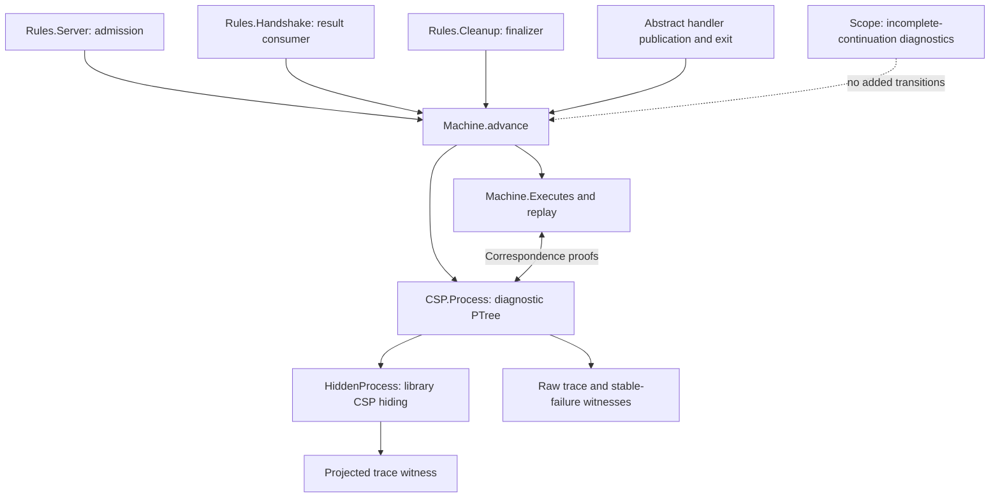

# CSP interpretation of the implemented subsystem

The CSP layer now interprets the source-derived transition rules as a productive
`PTree`, using `csp-ptree-agda`'s LTS, traces, stable failures and hiding semantics.
The implemented subsystem remains partial. IG batches and selected mux/tracer
behavior execute in the machine. [Outbound CM and ordinary-peer OG](../Outbound.md)
now extend it through `OutboundMachine` and `Subsystem`; concrete PRNG replay, full
handler execution and the wider discovery/root/ledger/churn profile remain open. This is not a complete source model.

## Architecture



`Machine.Configuration` holds the existing `State`, a fixed responder mode, and
recorded duplicate-publication faults. `advance` delegates to the existing rules.
It does not reproduce their guards or state updates. The fault record handles the
previous helper's explicit `writerBlocked` outcome: publication throws once, later
publication is disabled, and the abstract handler-exit boundary can enter cleanup.
It does not implement the source's rethrow policy.

The `Action` alphabet has five families:

| Action | Meaning |
| --- | --- |
| `admissionStep worker action` | One implemented Server/CM admission step |
| `handshakeStep worker action` | One implemented inbound-result consumer step |
| `cleanupStep worker action` | One implemented cleanup step |
| `handlerPublication worker result outcome` | Abstract publication boundary, with explicit written/duplicate outcome |
| `handlerExit worker` | Abstract exit of the handler body into cleanup |

Actions are scheduling/diagnostic labels, not extra source rendezvous. The raw
process offers exactly the successful `advance` actions, with no silent steps and
no successful-termination tick. Its visible choice exposes scheduling decisions
for debugging. The process is a single state machine interpreted in CSP; there is
no separately implemented parallel CM/IG/OG/Server composition yet.

## What is proved

- `step-intro` / `step-inv`: exact correspondence between a dispatcher transition
  and a raw process event step, retaining the target configuration.
- `exec-intro` / `exec-inv`: correspondence between finite machine executions and
  raw process runs, retaining the endpoint.
- `trace-intro` / `trace-inv`: machine executions and raw traces agree for encoded
  action lists. `all-exec-inv` also recovers an action list from any raw process
  run; there are no additional tick-bearing traces.
- `singleton-refusal`: a disabled action is a singleton stable refusal of the raw
  process. The theorem does not classify why that action is disabled.
- `hidden-trace`: every machine execution gives a projected trace after hiding,
  via the dependency's `HideTr` and `Hide-trace-intro` laws. `hidden-trace-inv`
  recovers a machine execution and its de-hiding relation from any hidden trace.

These are representation-correspondence results, not a refinement proof against
Haskell, the network specification, or a separately written parallel architecture.
Raw stability and absence of silent steps do not establish liveness of the hidden
process. No divergence-freedom or failures-divergences refinement claim is made.

## Observation policy

`Hiding.internal` explicitly selects the events made silent. It hides map/entry
transactions, promise reads, local allocation, counter reads and IG enqueue.
Fork and socket-close outcomes, handler publication/exit, TIME_WAIT readiness or
interruption, CM return, IG clock/expiry, handle allocation, traffic readiness,
protocol outcomes, shutdown completion and IG-exit labels remain visible.
State-derived startup and queue/cursor/timer allocation operations are hidden. `HiddenProcess` uses the
library's `_∖_` operator, so hidden enabled events become internal choices.

This is an initial diagnostic observation policy, not a validated API abstraction.
Return labels currently identify the worker/action; the returned value is checked
in the endpoint state. Two races with different return values can consequently
have the same projected trace. A later API refinement needs result-bearing
observations and an explicit abstraction argument. Hiding can introduce internal
behavior and divergence; raw-process results must not be transferred silently.

## Concrete checks

`Scenarios.agda` starts from the accepted-socket fixture and runs through the
combined dispatcher:

1. CM commits a successful handshake decision; the handler cleans up; CM then
   enqueues the captured IG notification and returns Connected. Both the raw and
   projected sequences are proved to be process traces; endpoint assertions check
   that the map is empty but the notification remains.
2. Cleanup finishes before result consumption; CM returns Disconnected.
3. After cleanup closes its socket but before it republishes the map, the raw
   process has a stable failure refusing the second caller's map-take event.
   A separate event-step witness shows that the owner can still publish the map;
   this refusal is not a global deadlock.
4. Extending that prefix with the refused take is proved **not** to be a raw trace,
   using trace inversion, deterministic endpoints and execution-prefix splitting.
5. Duplicate publication produces a recorded fault and cannot repeat indefinitely.

The handlers' publication and exit remain environment assumptions. These are
model witnesses, not proofs that the corresponding executions are source-reachable.
The raw negative-trace theorem is not a negative-trace theorem after hiding.

## Partial-model boundaries

`Scope.agda` identifies selected unimplemented continuations: server handling of
CM returns, admission unwinding, accept-loop continuation, handler body/cleanup
return, missing IG handle setup, IG CM-call continuations, shutdown completion
and exception unwinding.
The original `Scope` checker does not classify the new outbound/OG continuations;
see [their explicit boundaries](../Outbound.md).
These diagnostics are separate from the process alphabet. They add neither a tick
nor a self-loop to make an incomplete state appear to progress.

An empty offer set is therefore a deadlock of this **partial process**, not evidence
of a source deadlock. No global deadlock claim is permitted without validity,
coverage, environment and progress arguments. Conversely, absence of a diagnostic
frontier is not proof of completeness. `advance = nothing` still includes malformed
fixtures, wrong-phase attempts and real blocking, as documented in the parent
README. This layer has no finite-carrier bound or explorer cutoff.

The [counter-validity negative control](../Negative/CounterValidity.agda)
constructs a malformed full-map state whose raw process refuses a counter action.
The [counter proof layer](../Properties/Counters.agda) shows that this action is
enabled at the correct admission continuation when its full map has valid entry
references. The refusal theorem alone cannot distinguish malformed fixtures from
source blocking. The state predicate additionally checks saved/proposed maps;
whole-machine validity preservation remains unproved.

[Ownership.agda](Ownership.agda) now transfers ownership preservation for the
successful and failed cleanup socket-close actions and all six admission/cleanup
map acquisition, publication and restoration action families to raw CSP steps. It recovers
a machine endpoint with an exact single-lease claim for a taken map (or no claim
for a full map). Coverage is explicit in `CloseAction` and `MapAction`; arbitrary
machine traces are handled by the complete invariant below; hidden transitions
are not covered by these lemmas. The
[map-action scenarios](../Scenarios/MapOwnership.agda) provide enabled steps for
every map-action family, including the rejection and TIME_WAIT branches. The
[ownership negative controls](../Negative/Ownership.agda) exercise both outcomes
and reject orphaned, duplicate, mismatched and full-map lease claims.

[OwnershipInvariant.agda](OwnershipInvariant.agda) now lifts the full machine
invariant to **every finite raw CSP execution and trace**, recovering an endpoint
configuration with valid lease ownership and its machine execution. The only
state premise is initial ownership. The renderer need not be injective; no
claim is made that every configuration rendering the same process is valid.
The [invariant scenarios](../Scenarios/OwnershipInvariant.agda) apply the theorem
to the existing race, lock and duplicate-publication paths and exclude all four
malformed ownership fixtures from finite machine reachability. This establishes
lease safety for the current partial model, not whole-state validity, eventual
release, source correspondence or hidden-process liveness.

[SupplyInvariant.agda](SupplyInvariant.agda) similarly transfers the complete
entry/promise supply-bound invariant to arbitrary finite raw CSP executions and
traces. Its initial-state premise is `SupplyBounds`, independent of ownership.
The [supply scenarios](../Scenarios/SupplyInvariant.agda) prove that both next IDs
are unused at every state reachable from the accepted-socket start and rule out
the earlier future-entry collision fixture. The result does not certify store
uniqueness, reference validity, worker/handle freshness or finite explorer bounds.

## Validation and next work

From the library root, using Agda 2.8.0, one process at a time:

```sh
agda ConnectionManagement/CSP/Scenarios.agda +RTS -M2G -RTS
agda ConnectionManagement/Negative/CounterValidity.agda +RTS -M2G -RTS
agda ConnectionManagement/Negative/Ownership.agda +RTS -M2G -RTS
agda ConnectionManagement/Scenarios/MapOwnership.agda +RTS -M2G -RTS
agda ConnectionManagement/Scenarios/OwnershipInvariant.agda +RTS -M2G -RTS
agda ConnectionManagement/Scenarios/SupplyInvariant.agda +RTS -M2G -RTS
agda ConnectionManagement/CSP/IGRegistration.agda +RTS -M2G -RTS
agda ConnectionManagement/CSP/IGRuntime.agda +RTS -M2G -RTS
agda ConnectionManagement/CSP/InboundRelease.agda +RTS -M2G -RTS
agda ConnectionManagement/CSP/RemoteState.agda +RTS -M2G -RTS
agda ConnectionManagement/CSP/Pruning.agda +RTS -M2G -RTS
agda ConnectionManagement/CSP/HandlerLifecycle.agda +RTS -M2G -RTS
agda ConnectionManagement/CSP/HandlerOutcomes.agda +RTS -M2G -RTS
```

The whole-replay proof originally exhausted a 3 GB heap. The maintained witnesses
use explicit intermediate configurations in `Fixtures.agda`, checked single-step
equations, and execution composition. They retain the same trace statements and
passed with a 2 GB heap limit. Avoid replacing them with full-run normalization.

This checks the dispatcher, renderer, correspondence, hiding and scope modules,
and their imported admission/handshake witnesses. The separate cleanup and negative
control endpoints remain part of regression validation.

The [IG registration endpoint](IGRegistration.agda) adds a raw and hidden CSP trace
from admission through notification and first-batch registration. It also checks
duplicate preservation, drain/processing separation, premature-start refusal and a
late enqueue. See [the source mapping and contracts](../IGRegistration.md).

The [runtime endpoint](IGRuntime.agda) adds composed responder-start and subsequent-
batch traces, plus transaction/interleaving regressions for partial startup failure,
backpressure, active-flag sampling and overlapping mux identities.

The [inbound release endpoint](InboundRelease.agda) composes admission, registration,
idle timeout and release into a CSP trace. It checks separate counter reads,
cancellation delivery, assertion outcomes and IG publication; see
[the source mapping and limitations](../InboundRelease.md).

The [remote-state endpoint](RemoteState.agda) composes mux startup and promotion,
and checks demotion timer allocation, result-dependent counter reads and scored
pruning; see [the contracts](../RemoteState.md).

The [pruning endpoint](Pruning.agda) checks atomic multi-victim writes, policy
ordering, self-pruning and captured cancellation delivery; see
[its contracts and randomness abstraction](../Pruning.md).

The [handler lifecycle endpoint](HandlerLifecycle.agda) connects release and
pruning delivery to tracked async unwinding, Dead tracing and the existing
finalizer; see [its scope and completion inputs](../HandlerLifecycle.md).

The [handler outcome endpoint](HandlerOutcomes.agda) covers normal shutdown,
synchronous protocol failure, both rethrow-policy branches and tracer failure;
see [its contracts](../HandlerOutcomes.md).

Next: extend runtime validity across outbound/OG writes and replay the combined
source scenarios. Full subsystem
failures/divergence or liveness claims require additional coverage and validity.

The [handler-validity endpoint](HandlerValidity.agda) checks every state in
selected lifecycle witnesses using [CheckedExecution](CheckedExecution.agda).
A continuously tracked startup/error path attaches before monitor execution.
The [contracts](../HandlerValidity.md) distinguish these finite certificates
from a global preservation theorem; the validator never filters the process.

```sh
agda ConnectionManagement/CSP/HandlerValidity.agda +RTS -M2G -RTS
agda ConnectionManagement/Negative/HandlerValidity.agda +RTS -M2G -RTS
```

[HandlerCapture.agda](HandlerCapture.agda) lifts machine-wide capture retention
to finite raw process reachability. Unlike the selected-state validity checks,
this covers arbitrary actions and interleavings, but only preserves the stored
mux identity. See [the statement and limits](../HandlerCapture.md).

```sh
agda ConnectionManagement/CSP/HandlerCapture.agda +RTS -M2G -RTS
agda ConnectionManagement/Negative/HandlerCapture.agda +RTS -M2G -RTS
```

[HandlerUniqueOwnership.agda](HandlerUniqueOwnership.agda) lifts preservation of
unique tracked worker keys and captured mux ownership to raw finite process
reachability. Its [scope](../HandlerUniqueOwnership.md) excludes full reference
validity and coverage of untracked handlers.

```sh
agda ConnectionManagement/CSP/HandlerUniqueOwnership.agda +RTS -M2G -RTS
agda ConnectionManagement/Negative/HandlerUniqueOwnership.agda +RTS -M2G -RTS
```

Reference-chain preservation now covers arbitrary finite sequences of handler
lifecycle actions, including a raw CSP trace lift. See [Handler references](../HandlerReferences.md)
for the exact premises, creation negative controls, and remaining dispatcher coverage.

`HandlerAttachment.agda` derives a tracked chain from raw attachment traces under
explicit resource/coherence premises, then preserves it along lifecycle suffixes.

`HandlerBoundaries.agda` extends reference preservation and conditional
creation to raw traces interleaving lifecycle, publication and handler exit.
`HandlerCleanup.agda` further adds all cleanup steps, including socket-close
failure, map restoration and interrupted TIME_WAIT. Reference existence survives
closure and CM map removal; global runtime validity remains a separate obligation.

`HandlerManagement.agda` also covers inbound release and remote operations,
including scored pruning and cancellation delivery. `HandlerIGBoundary` now adds
IG decision publication and fresh handle/mux installation to the same theorem.
The extensions below complete coverage of the implemented dispatcher.
See the action coverage table in the handler reference documentation.

`HandlerIGStartup` adds responder startup/restart and the failed-start stop
request, including partial bundle failure. `HandlerIGMux` adds monitor, job and
tracer execution, including error outcomes and blocking negative controls.
`HandlerIGLoop` covers the remaining event-loop operations, and `HandlerIG`
combines all IG actions into an exhaustive reference-preservation theorem and
raw CSP trace lift. It requires an existing tracked chain, but no IG action
coverage certificate. `HandlerAdmission` and `HandlerHandshake` now cover Server
admission and handshake consumers. [`HandlerAll`](HandlerAll.agda) lifts preservation to arbitrary finite raw dispatcher traces and
conditional attachment followed by any suffix. This is existing-reference safety,
not full runtime validity or source completeness.


[`HandlerEstablishment`](HandlerEstablishment.agda) derives a new tracked chain through
selection/fork, matched installation, publication and attachment, then preserves
it through any dispatcher suffix. The caller need not provide the earlier
`CreationPremises`; resource evidence is derived from selection/fork in the
concrete witness. A negative CSP trace installs the wrong key and still attaches,
proving that arbitrary abstract boundary inputs cannot guarantee coherence.
See [the reference-safety analysis](../HandlerReferences.md) for the exact scope and remaining source-boundary obligation.

[`HandlerInterference`](HandlerInterference.agda) carries resource, prepared-handle and
published-chain evidence across parent map publication/counter reads and all
handshake-consumer actions before attachment. The raw CSP theorem permits these
interleavings around result publication and retains arbitrary suffixes after
attachment. Coverage is explicit; preserved evidence does not guarantee that
publication or attachment remains enabled.

[`HandlerRuntimeInterference`](HandlerRuntimeInterference.agda) extends that alphabet with all ten
mux monitor/job/tracer forms, handler exit and every cleanup action. Shared
retention proofs keep the earlier chain APIs intact. Pre-attachment evidence
survives socket closure, map removal and mux stopping, while negative CSP checks
exclude publication after cleanup and attachment to a stopped mux. The next layer below adds IG
startup and loop actions; fresh installation and decision publication remain pending.

[`HandlerIGInterference`](HandlerIGInterference.agda) extends pre-attachment runtime interference
with all ten IG loop actions and all three startup/restart actions. It transports
preparation through registration and responder execution, and through a local
partial-start failure fixture. Its negative control rejects a stale clock sample
after batch completion. Fresh installation and decision publication remain outside
this pre-attachment alphabet; the existing tracked-chain theorem still covers them.

[`HandlerAllIGInterference`](HandlerAllIGInterference.agda) adds fresh installation and decision
publication, completing pre-attachment coverage of all 25 current IG action forms.
It uses preservation of old handle lookups so tables may grow; the earlier
handle-table equality API remains unchanged. CSP witnesses cover fresh insertion
before original publication/attachment and a local decision removing membership.
Negative controls reject occupied IDs and repeated out-of-phase publication.
Other dispatcher families and source correspondence remain separate obligations.

[`HandlerGovernorInterference`](HandlerGovernorInterference.agda) further covers all release and remote-state
actions before attachment, including scored pruning. Shared effects preserve
resource identities through atomic entry edits and retain the IG engine. CSP
witnesses transport preparation through release, promotion and local pruning
fixtures; negative controls retain cancellation, phase and generation guards.
The following layer adds lifecycle interference; admission and publication remain.

[`HandlerLifecycleInterference`](HandlerLifecycleInterference.agda) adds all handler lifecycle actions to
the governor-interference alphabet, using existing exhaustive mux-anchor proofs.
Preparation survives attachment, cancellation unwind and cleanup, including a
closed socket and removed map binding. It does not imply the handler stays
unattached or can attach again. Negative controls preserve join and unwind order.
The following layer adds the remaining admission and result-publication actions.

[`HandlerDispatcherInterference`](HandlerDispatcherInterference.agda) completes preservation across every
current dispatcher action, with no action-subset or lifecycle-frame premise.
Fresh handler/result writes retain older lookups; resources, preparation and
untracked chains survive arbitrary successful finite executions and raw CSP traces.
The second-admission witness runs without lifecycle frames, and negative controls
reject reused child IDs, result overwrites and retries after a writer fault.
This proves preservation of existing evidence, not coherent creation or progress.
The matched installation/publication source contract is the next obligation.

[Handle-origin contract](../HandlerOrigin.md) maps the pinned handler's shared mux,
application and agreed-options values to matched installation/publication inputs.
`HandlerOrigin` certifies the exact installed bundle and flow and retains them
across arbitrary dispatcher traces. A negative CSP witness installs unidirectional
flow but publishes duplex: attachment and reference coherence still succeed, while
the matching origin certificate is impossible. This is an open-boundary mismatch,
not a source bug or a Haskell refinement theorem.

[Executable origin monitor](../OriginMonitor.md) checks one selected worker/handle pair around
the unchanged dispatcher. It accepts the good establishment trace and rejects
key, flow, handle and ordering mismatches. Accepted allocation derives an origin
certificate given resource evidence, and every finite monitored CSP trace projects
to the open process. Multi-worker attribution, error profiles and source scheduling
constraints remain outside this first success profile.

`Properties/OriginMonitorInvariant` now certifies every ticket reached from a
fresh observation with initial worker resource evidence. Its CSP counterpart
retains the actual endpoint of every finite raw execution. A forged published
phase before allocation is proved unreachable; source identity attribution and
multi-worker coverage remain separate obligations.

[Explicit allocation attribution](../AttributedOrigin.md) adds a visible worker tag,
rejects raw allocation bypasses, and projects accepted traces into the existing
single-target monitor. The reachable invariant is preserved; the dynamic
registry below extends this boundary to multiple invocations.

[Dynamic invocation registry](../OriginRegistry.md) registers fresh worker/handle pairs
at allocation and checks every registered invocation. Accepted traces erase to
the open machine; per-allocation resource evidence establishes the all-entry
invariant. The two-worker fixture publishes in reverse order and rejects handle
swaps. `CSP/RegistryAdmission` now also derives both resource premises from
selection/fork traces starting at the accepted-socket fixture, preserving the
first ticket through the second admission. `Negative/RegistryAdmission` checks
swap and repeated-allocation refusals after those reachable prefixes.

`Properties/RegistryUnique` proves separate worker-ID and handle-ID uniqueness
for every finite execution from an empty registry, without resource premises.
Its CSP theorem retains the actual endpoint; generic duplicate-identity controls
exclude both worker and handle forgeries. Descriptor origin still needs the
separate per-allocation resource evidence.

`Properties/RegistryPublication` connects accepted successful publication to its
unique pending registry entry, matching handle/flow, published successor and
exact descriptor origin before and after the step. Its CSP theorem retains both
actual endpoints and the prefix resource premise. Both admission-derived
publications instantiate the theorem; repeated-success certificates are excluded.

`Properties/RegistryAttachment` connects a supported publication to successful
attachment across arbitrary accepted interleavings, retaining the exact ticket
mux in the lifecycle frame and preserving origin through the suffix. Its CSP
counterpart retains actual endpoints. The two-handler witness includes another
attachment during the delay and a CM read afterward; readiness is not inferred.

`Properties/RegistryCleanup` preserves an attachment certificate across every
successful dispatcher or registry continuation. A checked registry shutdown
witness ends with a failed mux, closed socket, terminated entry and removed map
binding while retaining the certificate. This local fixture is conditional; the
separate composition below supplies an admission-to-cleanup prefix.

`CSP/RegistryShutdown` now connects one allocation-first admission to IG
registration, inbound release and cleanup in a 45-action registry trace.
Its terminal attachment certificate comes from selection/fork and publication,
without a pre-seeded certificate. Full-prefix negative controls reject premature
exit and reattachment. Cancellation and timeout readiness remain explicit inputs.

`CSP/RegistryReturn` adds a 48-action admission-to-cleanup trace in which the
release caller returns and IG removes registration before pool closure. The
remaining tracer and cleanup steps are rechecked after unregistration; the
admission-derived attachment certificate survives. Negative controls separate
registration removal from handler exit and socket closure. The subsequent batch is checked below.

`CSP/RegistryBatch` extends that trace to 54 actions: IG drains the queued
mux-finished notification, skips its absent registration, and returns to the
batch boundary without another CM call. The identity certificate survives;
`Negative/RegistryBatch` rejects replay and checks the distinct queue, read and
batch-completion boundaries. This is a finite witness, not universal progress.

`CSP/RegistryRegisteredFinish` checks the complementary registered-event fixture:
IG captures the current mux, polls a stopped or failed status, then publishes
removal. Negative CSP controls reject ready/stopping polls and skipped polling.
This local fixture assumes an already-selected notification. `RegistryProducer`
now checks its admission-derived producer/consumer counterpart in 57 actions,
with startup notifications consumed through CM promotion before failure.

## Outbound and combined governor processes

`Outbound.Process` renders `OutboundMachine.advance`; `Subsystem.Process` renders
`Subsystem.advance`. Both provide step/run/trace introduction and inversion,
exclude raw tick/tau steps and prove refused-extension results. They use the same
shared inbound machine and library process semantics. No separate parallel
composition equivalence or hidden-subsystem liveness theorem is asserted.

`GovernorLifecycle` supplies a 146-action ordinary-peer trace with actual CM
acquire/release and IG registration. `Negative/Subsystem` checks its endpoint and
a child-before-parent-registration interleaving. `OutboundAdmission`,
`OutboundReleaseScenarios` and `OutboundOpenFailure` supply acquisition, conditional
release and socket-open-failure traces. See [coverage and validation](../Outbound.md)
for source mappings, fixture qualifications and the unconfirmed source candidate.
