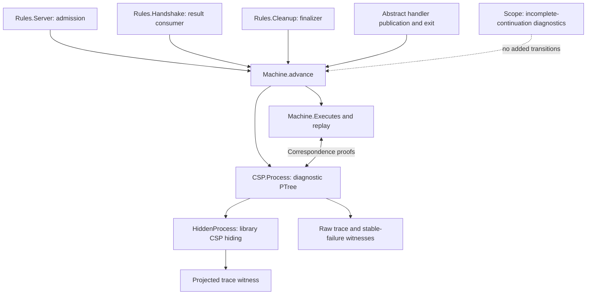

# CSP interpretation of the implemented subsystem

The CSP layer now interprets the source-derived transition rules as a productive
`PTree`, using `csp-ptree-agda`'s LTS, traces, stable failures and hiding semantics.
The implemented subsystem remains partial: handler execution, IG and OG are still
abstract or missing. This is a CSP model of the implemented slice, not a complete
model of the network source.

## Architecture



`Machine.Configuration` holds the existing `State`, a fixed responder mode, and
recorded duplicate-publication faults. `advance` delegates to the existing rules.
It does not reproduce their guards or state updates. The fault record handles the
previous helper's explicit `writerBlocked` outcome: publication throws once, later
publication is disabled, and the abstract handler-exit boundary can enter cleanup.
It does not implement the source's rethrow policy.

The `Action` alphabet has five families:

| Action | Meaning |
| --- | --- |
| `admissionStep worker action` | One implemented Server/CM admission step |
| `handshakeStep worker action` | One implemented inbound-result consumer step |
| `cleanupStep worker action` | One implemented cleanup step |
| `handlerPublication worker result outcome` | Abstract publication boundary, with explicit written/duplicate outcome |
| `handlerExit worker` | Abstract exit of the handler body into cleanup |

Actions are scheduling/diagnostic labels, not extra source rendezvous. The raw
process offers exactly the successful `advance` actions, with no silent steps and
no successful-termination tick. Its visible choice exposes scheduling decisions
for debugging. The process is a single state machine interpreted in CSP; there is
no separately implemented parallel CM/IG/OG/Server composition yet.

## What is proved

- `step-intro` / `step-inv`: exact correspondence between a dispatcher transition
  and a raw process event step, retaining the target configuration.
- `exec-intro` / `exec-inv`: correspondence between finite machine executions and
  raw process runs, retaining the endpoint.
- `trace-intro` / `trace-inv`: machine executions and raw traces agree for encoded
  action lists. `all-exec-inv` also recovers an action list from any raw process
  run; there are no additional tick-bearing traces.
- `singleton-refusal`: a disabled action is a singleton stable refusal of the raw
  process. The theorem does not classify why that action is disabled.
- `hidden-trace`: every machine execution gives a projected trace after hiding,
  via the dependency's `HideTr` and `Hide-trace-intro` laws. `hidden-trace-inv`
  recovers a machine execution and its de-hiding relation from any hidden trace.

These are representation-correspondence results, not a refinement proof against
Haskell, the network specification, or a separately written parallel architecture.
Raw stability and absence of silent steps do not establish liveness of the hidden
process. No divergence-freedom or failures-divergences refinement claim is made.

## Observation policy

`Hiding.internal` explicitly selects the events made silent. It hides map/entry
transactions, promise reads, local allocation, counter reads and IG enqueue.
Fork and socket-close outcomes, handler publication/exit, TIME_WAIT readiness or
interruption, and CM return labels remain visible. `HiddenProcess` uses the
library's `_∖_` operator, so hidden enabled events become internal choices.

This is an initial diagnostic observation policy, not a validated API abstraction.
Return labels currently identify the worker/action; the returned value is checked
in the endpoint state. Two races with different return values can consequently
have the same projected trace. A later API refinement needs result-bearing
observations and an explicit abstraction argument. Hiding can introduce internal
behavior and divergence; raw-process results must not be transferred silently.

## Concrete checks

`Scenarios.agda` starts from the accepted-socket fixture and runs through the
combined dispatcher:

1. CM commits a successful handshake decision; the handler cleans up; CM then
   enqueues the captured IG notification and returns Connected. Both the raw and
   projected sequences are proved to be process traces; endpoint assertions check
   that the map is empty but the notification remains.
2. Cleanup finishes before result consumption; CM returns Disconnected.
3. After cleanup closes its socket but before it republishes the map, the raw
   process has a stable failure refusing the second caller's map-take event.
   A separate event-step witness shows that the owner can still publish the map;
   this refusal is not a global deadlock.
4. Extending that prefix with the refused take is proved **not** to be a raw trace,
   using trace inversion, deterministic endpoints and execution-prefix splitting.
5. Duplicate publication produces a recorded fault and cannot repeat indefinitely.

The handlers' publication and exit remain environment assumptions. These are
model witnesses, not proofs that the corresponding executions are source-reachable.
The raw negative-trace theorem is not a negative-trace theorem after hiding.

## Partial-model boundaries

`Scope.agda` identifies selected unimplemented continuations: server handling of
CM returns, admission unwinding, accept-loop continuation, handler body/cleanup
return, and IG registration. OG remains unimplemented throughout this slice.
These diagnostics are separate from the process alphabet. They add neither a tick
nor a self-loop to make an incomplete state appear to progress.

An empty offer set is therefore a deadlock of this **partial process**, not evidence
of a source deadlock. No global deadlock claim is permitted without validity,
coverage, environment and progress arguments. Conversely, absence of a diagnostic
frontier is not proof of completeness. `advance = nothing` still includes malformed
fixtures, wrong-phase attempts and real blocking, as documented in the parent
README. This layer has no finite-carrier bound or explorer cutoff.

The [counter-validity negative control](../Negative/CounterValidity.agda)
constructs a malformed full-map state whose raw process refuses a counter action.
The [counter proof layer](../Properties/Counters.agda) shows that this action is
enabled at the correct admission continuation when its full map has valid entry
references. The refusal theorem alone cannot distinguish malformed fixtures from
source blocking. The state predicate additionally checks saved/proposed maps;
whole-machine validity preservation remains unproved.

[Ownership.agda](Ownership.agda) now transfers ownership preservation for the
successful and failed cleanup socket-close actions and all six admission/cleanup
map acquisition, publication and restoration action families to raw CSP steps. It recovers
a machine endpoint with an exact single-lease claim for a taken map (or no claim
for a full map). Coverage is explicit in `CloseAction` and `MapAction`; arbitrary
machine traces are handled by the complete invariant below; hidden transitions
are not covered by these lemmas. The
[map-action scenarios](../Scenarios/MapOwnership.agda) provide enabled steps for
every map-action family, including the rejection and TIME_WAIT branches. The
[ownership negative controls](../Negative/Ownership.agda) exercise both outcomes
and reject orphaned, duplicate, mismatched and full-map lease claims.

[OwnershipInvariant.agda](OwnershipInvariant.agda) now lifts the full machine
invariant to **every finite raw CSP execution and trace**, recovering an endpoint
configuration with valid lease ownership and its machine execution. The only
state premise is initial ownership. The renderer need not be injective; no
claim is made that every configuration rendering the same process is valid.
The [invariant scenarios](../Scenarios/OwnershipInvariant.agda) apply the theorem
to the existing race, lock and duplicate-publication paths and exclude all four
malformed ownership fixtures from finite machine reachability. This establishes
lease safety for the current partial model, not whole-state validity, eventual
release, source correspondence or hidden-process liveness.

## Validation and next work

From the library root, using Agda 2.8.0, one process at a time:

```sh
agda ConnectionManagement/CSP/Scenarios.agda +RTS -M2G -RTS
agda ConnectionManagement/Negative/CounterValidity.agda +RTS -M2G -RTS
agda ConnectionManagement/Negative/Ownership.agda +RTS -M2G -RTS
agda ConnectionManagement/Scenarios/MapOwnership.agda +RTS -M2G -RTS
agda ConnectionManagement/Scenarios/OwnershipInvariant.agda +RTS -M2G -RTS
```

The whole-replay proof originally exhausted a 3 GB heap. The maintained witnesses
use explicit intermediate configurations in `Fixtures.agda`, checked single-step
equations, and execution composition. They retain the same trace statements and
passed with a 2 GB heap limit. Avoid replacing them with full-run normalization.

This checks the dispatcher, renderer, correspondence, hiding and scope modules,
and their imported admission/handshake witnesses. The separate cleanup and negative
control endpoints remain part of regression validation.

Next: strengthen whole-state validity, implement handler execution and IG/OG under
the same dispatcher, and refine the observation alphabet before asserting full
subsystem failures/divergence or liveness properties. A parallel component
presentation requires its own correspondence proof against this authoritative
machine.
