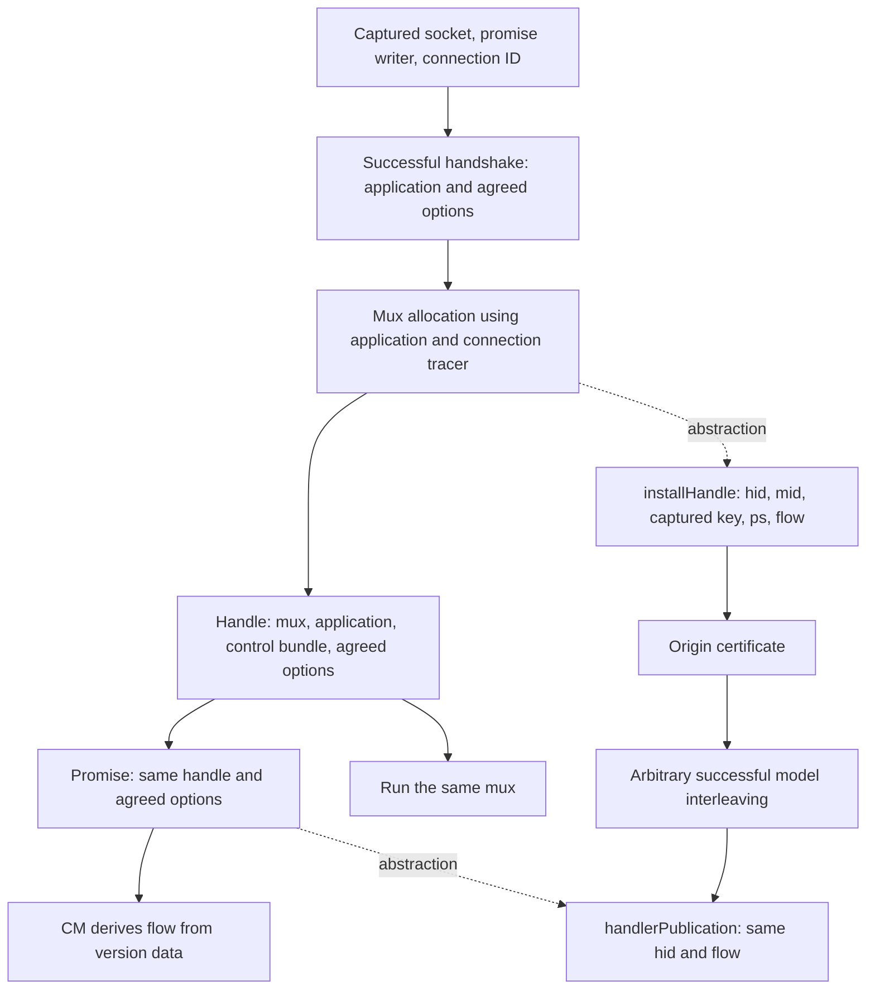

# Handle origin and successful-publication contract

The open dispatcher accepts installation and publication as independent inputs.
The pinned Haskell handler constructs and publishes a handle from the same local
values. This document records that source data flow, the corresponding model
contract, and the obligations that still separate the model from the source.

## Source evidence

Reviewed network revision `96ee6e0e689770b5a3d664c59f2d13b05c5d9c4d`, the existing
model pin from consensus `585a86117618ff86d7d5b541f9d23b03356d4c3a`. This review does
not update the pin or claim these are the current branch heads.

| Source location | Observed behavior | Model interpretation |
| --- | --- | --- |
| [Core.hs:579–592](https://github.com/IntersectMBO/ouroboros-network/blob/96ee6e0e689770b5a3d664c59f2d13b05c5d9c4d/ouroboros-network/framework/lib/Ouroboros/Network/ConnectionManager/Core.hs#L579-L592) | The forked handler receives the socket, writer and connection ID from its caller. | The handler's captured key/socket/promise must identify that invocation. |
| [Core.hs:796–814](https://github.com/IntersectMBO/ouroboros-network/blob/96ee6e0e689770b5a3d664c59f2d13b05c5d9c4d/ouroboros-network/framework/lib/Ouroboros/Network/ConnectionManager/Core.hs#L796-L814) | Inbound inclusion allocates the reader/writer pair for the accepted connection. | Promise allocation belongs to this admission instance. |
| [ConnectionHandler.hs:429–452](https://github.com/IntersectMBO/ouroboros-network/blob/96ee6e0e689770b5a3d664c59f2d13b05c5d9c4d/ouroboros-network/framework/lib/Ouroboros/Network/ConnectionHandler.hs#L429-L452) | The inbound success branch creates control TVars and a mux, builds a handle from that mux, application and agreed options, publishes it with those options, then runs that mux. | Key, mux identity, bundle and negotiated-flow projection must have a common origin. |
| [ConnectionHandler.hs:352–380](https://github.com/IntersectMBO/ouroboros-network/blob/96ee6e0e689770b5a3d664c59f2d13b05c5d9c4d/ouroboros-network/framework/lib/Ouroboros/Network/ConnectionHandler.hs#L352-L380) | The outbound success branch has the same handle/publication data sharing, with mode/flow-dependent tracer setup. | Outbound acquisition now executes through the same `installHandle` boundary; the origin theorems here remain scoped to the inbound `Machine` and do not establish the outbound allocation/publication contract. |
| [Core.hs:897–908](https://github.com/IntersectMBO/ouroboros-network/blob/96ee6e0e689770b5a3d664c59f2d13b05c5d9c4d/ouroboros-network/framework/lib/Ouroboros/Network/ConnectionManager/Core.hs#L897-L908) | CM reads the promise and computes data flow from the published version data. | `flow` must be the same projection of agreed options represented by the installed handle. |

The files were read directly at this revision. SHA-256 digests of downloaded raw
contents: `ConnectionHandler.hs` =
`4cb3b27ef8b783b6352ce986c5b04989127fc7e356e0a7eddaa48d7336292487`;
`Core.hs` = `9b111c20565ee24713b3f2a4a05249516348bda8f13ab7edca868aaef9aed314`.

## Mapping and contract



`installHandle` is an abstraction of allocation, not a separate Haskell IG API
call. The model's IG runtime currently hosts the handle and mux tables; that
storage location does not mean IG creates the source handle. Numeric `hid`/`mid`
are abstract identities for source objects. `ps` projects the application bundle;
`flow` projects version data. The control TVars and full version data are not
represented by the new certificate.

The success contract uses the captured handler key at installation and the same
`hid` and `flow` at publication. It also requires the installation and publication
steps to succeed. The existing resource evidence is derived from selection/fork
in the positive fixture. A successful later attachment is still a separate premise.
The open `Machine.advance` rules are unchanged; arbitrary supplied boundaries
remain possible for negative testing.

## Formal coverage

`Properties/HandlerOrigin.Origin w hid mid ps flow c` contains:

- Existing `Prepared` evidence: captured resources, installed handle/mux and key
  coherence.
- An exact handle lookup to `handleState mid ps flow`, recording the bundle and
  flow that the reference-only property did not constrain.

`install-origin` derives it from successful installation using the captured key.
`origin-exec` retains it across every successful finite dispatcher execution,
including fresh allocations, cleanup and mux failure. It describes allocation
provenance, not current readiness.

`CSP/HandlerOrigin.raw-origin` uses the same flow and handle parameters for
installation and successful publication, permits arbitrary dispatcher actions
between installation/publication and publication/attachment, and permits an
arbitrary suffix. Its result includes both a tracked reference chain and the
retained origin certificate. This is a theorem about traces satisfying the
contract, **not a proof that every source execution projects to such a trace**.
The positive instance derives its certificate from allocation and transports it
along the existing establishment witness.

## Negative control and interpretation

`Negative/HandlerOrigin` installs a unidirectional handle, publishes a duplex
result for that handle, and attaches. Every step succeeds in the open model.
The old `TrackedChain` property still holds: all references and the connection
key agree. But no duplex `Origin` exists for the installed descriptor. Therefore
reference preservation alone cannot justify agreement of negotiated data.

This does not exhibit a source bug: the inspected success branch shares the
agreed-options value. The trace instead demonstrates why boundary provenance must
be checked before reporting a model counterexample against the source. The older
wrong-key trace in `Negative/HandlerEstablishment` remains another such control.

## Remaining obligations

1. Define the source-to-model identity mapping for connection IDs, socket objects,
   promise pairs, handles and muxes, including freshness and reuse across incarnations.
2. Define application/version-data projections and justify ordered/supported
   protocol assumptions. The descriptor certificate does not prove projection correctness.
3. The [single-target success monitor](OriginMonitor.md) now checks selected
   allocation/publication boundaries and has a reachable ticket/origin invariant.
   [Explicit allocation attribution](AttributedOrigin.md) preserves that invariant;
   [OriginRegistry](OriginRegistry.md) extends it to multiple invocations with
   explicit resource evidence at each allocation. It is not a complete
   executable filter for source-admissible behavior.
4. Account for masking, exceptions and interruption between handshake success,
   allocation, promise publication and mux execution. The theorem preserves
   references under arbitrary successful interleavings; that overapproximation
   does not claim all such interleavings are source-admissible.
5. Keep query/error branches, publication faults, `forcePromise`, and progress
   assumptions separate from the successful-origin contract. Outbound acquisition
   is executable in `OutboundMachine`; extending origin establishment and
   preservation through that dispatcher remains a separate obligation.

## Validation

From the standalone library root, one Agda process at a time:

```sh
agda ConnectionManagement/Negative/HandlerOrigin.agda +RTS -M2G -RTS
agda ConnectionManagement/Negative/HandlerEstablishment.agda +RTS -M2G -RTS
agda ConnectionManagement/Negative/HandlerDispatcherInterference.agda +RTS -M2G -RTS
```
