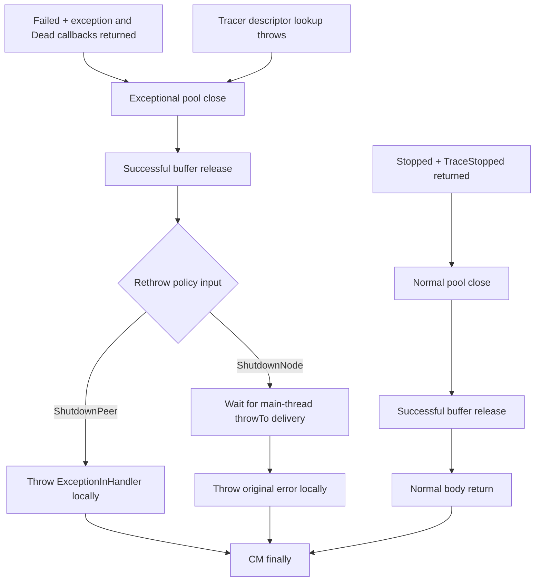

# Normal and synchronous handler exits

This extends [tracked async cancellation](HandlerLifecycle.md) in the same opt-in
runtime. It connects the existing mux monitor outcomes to pool closure, buffer
release, exception classification and the CM finalizer. Untracked handlers retain
the earlier abstract exit boundary.

## Source ordering

Source pin: `96ee6e0e689770b5a3d664c59f2d13b05c5d9c4d`.

- [Mux.hs](https://github.com/IntersectMBO/ouroboros-network/blob/96ee6e0e689770b5a3d664c59f2d13b05c5d9c4d/network-mux/src/Network/Mux.hs#L254-L278): the pool bracket surrounds the monitor; the outer catch handles only async exceptions.
- [Monitor branches](https://github.com/IntersectMBO/ouroboros-network/blob/96ee6e0e689770b5a3d664c59f2d13b05c5d9c4d/network-mux/src/Network/Mux.hs#L460-L570): mini-protocol failure writes Failed, traces the exception and Dead, then throws; CmdShutdown writes Stopped and traces TraceStopped before returning.
- [Exception classifier](https://github.com/IntersectMBO/ouroboros-network/blob/96ee6e0e689770b5a3d664c59f2d13b05c5d9c4d/ouroboros-network/framework/lib/Ouroboros/Network/ConnectionHandler.hs#L286-L309): ShutdownPeer throws ExceptionInHandler; ShutdownNode first delivers that wrapper to the main thread, then throws the original error locally.
- [Handler buffer scope](https://github.com/IntersectMBO/ouroboros-network/blob/96ee6e0e689770b5a3d664c59f2d13b05c5d9c4d/ouroboros-network/framework/lib/Ouroboros/Network/ConnectionHandler.hs#L401-L452): buffer teardown is inside the classifier and follows mux execution.

| Path | Before pool closure | After pool closure and buffer release |
|---|---|---|
| Normal CmdShutdown | Stopped, TraceStopped callback | Body return, CM finally |
| Synchronous protocol failure | Failed, exception callback, Dead callback | Policy, rethrow, CM finally |
| Synchronous tracer failure | Existing callback throws; status may remain Ready | Policy, rethrow, CM finally |
| Async cancellation | Delivery; abandon old continuation | Async catch writes Failed and traces Dead **after pool closure**, then buffer unwind and finally |



## Rules and boundaries

`monitorReturned` requires a tracked monitoring handler, Stopped status and a
returned callback. `monitorThrew` requires Failed status and a returned callback.
It retains the original error identity. These are derived control-flow steps,
not arbitrary exit declarations. Existing monitor rules prevent command or
completion processing after terminal status; lifecycle guards disable the old
continuation once pool unwinding starts.

`tracerThrew err` requires the existing `tracerFailed` callback marker. The error
identity is supplied explicitly. This path neither writes Failed nor invents a
Dead notification: the mux catch excludes synchronous exceptions. The marker
currently represents a missing protocol descriptor; arbitrary tracer failures
are not injected by this rule.

`jobPoolClosed` acknowledges completion of remaining job joins. `finishBuffer`
acknowledges successful buffer teardown. Only then can normal execution return,
or synchronous failure enter `classifying`. `choosePolicy` supplies the result of
`runRethrowPolicy` for the original handler's context and error. It does not model
the concrete policy function or claim both choices are available in a fixed
source deployment. The policy's diagnostic tracer is assumed total/nonblocking.

ShutdownPeer enters a separate rethrow step. ShutdownNode first enters a delivery
wait; `nodeExceptionDelivered` acknowledges `throwTo`, without assuming main-thread
termination or successful node shutdown. Only after that acknowledgment may the
handler rethrow. `peerBodyExited err` denotes the local ExceptionInHandler wrapper
(with the captured handler's remote address); `nodeBodyExited err` denotes the
original local exception. Both enable the existing CM finalizer. The phase records
this distinction before finalization, but no downstream exception observer is yet
modeled. No fresh global error identity is allocated for the wrapper.

Pool/buffer completion, policy selection, tracer exception identity and node
delivery stay visible under CSP hiding. Monitor return/throw and local rethrow
are internal. `handlerExit` remains visible as in the earlier lifecycle model.

## Evidence and limits

[CSP/HandlerOutcomes.agda](CSP/HandlerOutcomes.agda) supplies:

- Normal shutdown through finalizer entry from an explicit queued-shutdown fixture.
- A protocol-error path composed from admission, IG registration and responder
  startup, followed by both policy branches through finalizer entry.
- Raw/hidden trace witnesses and refusals of premature pool close, classification,
  node rethrow and cleanup; queue-backpressure checks for normal and failed muxes.
- A local failed-tracer fixture preserving mux status and queue contents.

These are finite model traces under explicit inputs. The normal shutdown command
fixture and failed-tracer fixture are not asserted reachable from admission.
Pool joins, buffer release and main-thread delivery need not finish. Buffer-release
exceptions, diagnostic-tracer exceptions, full masking/repeated interruption,
transport-job failures and the concrete rethrow policy remain outside this slice.
The existing mux shutdown-completion boundary still abstracts mini-protocol
cancellation and egress draining. Tracking is not yet mandatory.

```sh
agda ConnectionManagement/CSP/HandlerOutcomes.agda +RTS -M2G -RTS
agda ConnectionManagement/CSP/HandlerLifecycle.agda +RTS -M2G -RTS
```

[Every-state validity certificates](HandlerValidity.md) now cover selected paths,
including a scenario tracked before monitor startup. Global preservation and
broader tracking coverage remain required before integrating outbound acquisition
and OG jobs. No complete source refinement, source defect,
deadlock-freedom or universal cleanup-progress theorem follows from these traces.
