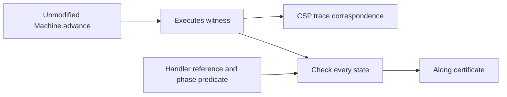

# Tracked-handler validity and execution certificates

This diagnostic layer checks the [handler lifecycle](HandlerLifecycle.md) and
[handler outcome](HandlerOutcomes.md) scenarios. It does **not** guard or filter
`Machine.advance`. An invalid successor remains observable rather than being
silently removed from the process.

## What is checked

[Properties/HandlerValidity.agda](Properties/HandlerValidity.agda) defines `valid`:

- Tracked worker keys are unique, and two tracked workers cannot own one mux.
- Each frame resolves its original handler registration, negotiated promise,
  published handle and captured mux. Handle/mux identity and connection keys agree.
- The original entry and socket still exist. Their current map binding and socket
  state are not constrained by this check; the existing ownership proof is separate.
- A tracked finalizing handler has a cleanup continuation; other tracked phases
  do not. Missing cleanup state cannot pass as completed finalization.
- Closed-pool phases have no running jobs or on-demand waits. Normal terminal
  phases require Stopped and a returned callback; synchronous error phases retain
  the error or a failed-tracer marker. Async Dead tracing has the expected error
  and callback form; async body exit requires the callback to have returned.

These checks intentionally use the original promise and resources, not the current
CM connection binding or current IG registration. A replacement connection entry
must not invalidate the old handler's captured references.

`fullyTracked` additionally requires every installed mux to have a tracked owner.
An empty tracking table alone therefore cannot validate a running-mux scenario.
Coverage is a requirement of selected post-attachment execution segments, not of
every state during handle allocation and attachment.

## Every-state evidence

[CSP/CheckedExecution.agda](CSP/CheckedExecution.agda) is a small generic layer over
an existing `Executes` witness. `checkAlong` evaluates a predicate at every state,
including the initial and final states. `checked` proves that a successful result
yields `Along`, a conjunction of individual state checks. It does not change the
witness, its actions, its endpoint, or its CSP interpretation.

[CSP/HandlerValidity.agda](CSP/HandlerValidity.agda) certifies the existing async,
pruning, normal, synchronous-policy and failed-tracer paths. It also introduces a
source-composed prefix that attaches tracking **before the first mux monitor
action**. The resulting responder-startup, protocol-error and ShutdownNode path
has continuous `fullyTracked` evidence from attachment through finalizer entry.
The explicit attachment and completion inputs retain their earlier meaning.



## Negative controls and limits

[Negative/HandlerValidity.agda](Negative/HandlerValidity.agda) rejects missing
handlers, promises, entries and sockets; wrong mux capture or connection key;
duplicate worker/mux owners; premature cleanup; incomplete pool closure;
mismatched synchronous errors; and finalization without cleanup state. It also
checks that untracked running muxes fail coverage and current-entry replacement
preserves captured-handler validity. These are deliberately mutated snapshots,
not reachable source-defect witnesses.

The complete validity predicate is **not a machine-wide inductive invariant**.
A separate [capture-retention theorem](HandlerCapture.md) now proves that arbitrary
finite executions neither remove nor retarget existing stored mux captures.
[Unique tracked ownership](HandlerUniqueOwnership.md) is now also preserved
machine-wide, using the exact `uniqueOwners` predicate above. It does not establish validity
for arbitrary interleavings or arbitrary actions. `monitoring` and `poolClosing`
permit intermediate mux states, finalization forgets the exact body-exit reason,
and failed-tracer exception identities remain inputs. Uniqueness of other stores,
protocol/job consistency, counter validity, complete masking and supervision,
concrete policy evaluation and mandatory tracking in all scenarios remain open.

Validation, one Agda process at a time:

```sh
agda ConnectionManagement/CSP/HandlerValidity.agda +RTS -M2G -RTS
agda ConnectionManagement/Negative/HandlerValidity.agda +RTS -M2G -RTS
```

Next extend global preservation to reference-chain validity, and extend tracking
to more source scenarios.
These obligations remain separate from outbound acquisition and OG integration.
