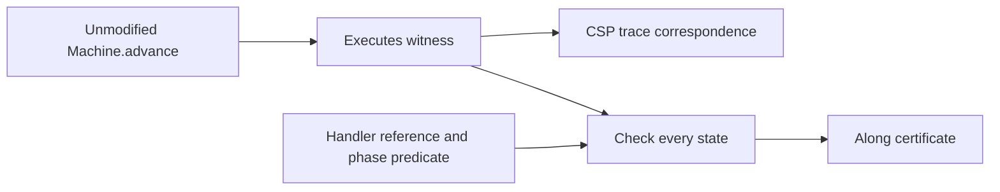

# Tracked-handler validity and execution certificates

This diagnostic layer checks the [handler lifecycle](HandlerLifecycle.md) and
[handler outcome](HandlerOutcomes.md) scenarios. It does **not** guard or filter
`Machine.advance`. An invalid successor remains observable rather than being
silently removed from the process.

## What is checked

[Properties/HandlerValidity.agda](Properties/HandlerValidity.agda) defines `valid`:

- Tracked worker keys are unique, and two tracked workers cannot own one mux.
- Each frame resolves its original handler registration, negotiated promise,
  published handle and captured mux. Handle/mux identity and connection keys agree.
- The original entry and socket still exist. Their current map binding and socket
  state are not constrained by this check; the existing ownership proof is separate.
- A tracked finalizing handler has a cleanup continuation; other tracked phases
  do not. Missing cleanup state cannot pass as completed finalization.
- Closed-pool phases have no running jobs or on-demand waits. Normal terminal
  phases require Stopped and a returned callback; synchronous error phases retain
  the error or a failed-tracer marker. Async Dead tracing has the expected error
  and callback form; async body exit requires the callback to have returned.

These checks intentionally use the original promise and resources, not the current
CM connection binding or current IG registration. A replacement connection entry
must not invalidate the old handler's captured references.

`fullyTracked` additionally requires every installed mux to have a tracked owner.
An empty tracking table alone therefore cannot validate a running-mux scenario.
Coverage is a requirement of selected post-attachment execution segments, not of
every state during handle allocation and attachment.

## Every-state evidence

[CSP/CheckedExecution.agda](CSP/CheckedExecution.agda) is a small generic layer over
an existing `Executes` witness. `checkAlong` evaluates a predicate at every state,
including the initial and final states. `checked` proves that a successful result
yields `Along`, a conjunction of individual state checks. It does not change the
witness, its actions, its endpoint, or its CSP interpretation.

[CSP/HandlerValidity.agda](CSP/HandlerValidity.agda) certifies the existing async,
pruning, normal, synchronous-policy and failed-tracer paths. It also introduces a
source-composed prefix that attaches tracking **before the first mux monitor
action**. The resulting responder-startup, protocol-error and ShutdownNode path
has continuous `fullyTracked` evidence from attachment through finalizer entry.
The explicit attachment and completion inputs retain their earlier meaning.



## Negative controls and limits

[Negative/HandlerValidity.agda](Negative/HandlerValidity.agda) rejects missing
handlers, promises, entries and sockets; wrong mux capture or connection key;
duplicate worker/mux owners; premature cleanup; incomplete pool closure;
mismatched synchronous errors; and finalization without cleanup state. It also
checks that untracked running muxes fail coverage and current-entry replacement
preserves captured-handler validity. These are deliberately mutated snapshots,
not reachable source-defect witnesses.

The complete validity predicate is **not a machine-wide inductive invariant**.
A separate [capture-retention theorem](HandlerCapture.md) now proves that arbitrary
finite executions neither remove nor retarget existing stored mux captures.
[Unique tracked ownership](HandlerUniqueOwnership.md) is now also preserved
machine-wide, using the exact `uniqueOwners` predicate above. It does not establish validity
for arbitrary interleavings or arbitrary actions. `monitoring` and `poolClosing`
permit intermediate mux states, finalization forgets the exact body-exit reason,
and failed-tracer exception identities remain inputs. Uniqueness of other stores,
protocol/job consistency, counter validity, complete masking and supervision,
concrete policy evaluation and mandatory tracking in all scenarios remain open.

Validation, one Agda process at a time:

```sh
agda ConnectionManagement/CSP/HandlerValidity.agda +RTS -M2G -RTS
agda ConnectionManagement/Negative/HandlerValidity.agda +RTS -M2G -RTS
```

Next extend global preservation to reference-chain validity, and extend tracking
to more source scenarios.
These obligations remain separate from outbound acquisition and OG integration.

## Scope in the current supervised stack (10 November 2026)

`valid`, `fullyTracked` and `TrackedChain` read the legacy lifecycle store
`Machine.handlerLifecycles`. Only a raw `Machine.handlerStep` adds a frame to it.
In the supervised stack that store stays empty, so `valid` holds trivially,
`fullyTracked` fails once any mux is installed, and `TrackedChain` holds of
nothing. These predicates therefore say nothing about current runs. Handler
phase is now tracked by `HandlerSupervision` threads, `MuxHandlerSupervision`
frames, `MuxStartupUnwind`, `MuxGroupShutdown` and `MuxHandlerExit` exit frames.

[LegacyLifecycleEmpty](Properties/LegacyLifecycleEmpty.agda) proves the empty
store at the layers that can forward source operations:

- `machine-preserves`: every `Machine.advance` except `handlerStep` keeps an
  empty store empty; `outbound-preserves` lifts this to every
  `OutboundMachine.advance` except an inbound `handlerStep`.
- `Raw.from-initial`: every initialized `HandlerSupervision` run keeps it empty.
  The initializer requires an empty store and `rawAllowed` refuses raw
  `handlerStep`, `handlerExit`, `cleanupStep` and publication.
- `Physical.from-initial`: the same for every initialized
  `OutboundHandlerSupervision` run, which refuses raw inbound operations on its
  outbound side.

Above these two layers the claim rests on an audit, not a proof. A search of the
non-test modules for `O.inbound (`, `Sub.core (` and `O.advance <variable>`
shows that the upper layers reach the source only through the supervised layers
or through fixed operations: `igStep` (mux, protocol-job, monitor, group and
unwind layers), `handlerPublication` (mux supervision), `handlerExit` and
`cleanupStep` (handler exit) and outbound acquire/release calls. Their generic
`machine` plans are built only from those constants. The peer side cannot issue
raw core operations (`ServerPeers.rawPeerAllowed (Sub.core _) = false`). Each of
these operations is covered by `outbound-preserves`. A per-layer proof up to the
top-level runtime is deferred to the phase/cleanup validity work, which needs
the same layer chain.

### Phase/cleanup validity of physical handler threads

[CleanupWriters](Properties/CleanupWriters.agda) proves that only two source
operations write the shared cleanup store. `Machine.handlerExit` creates the
exiting worker's record at `cleanupAcquire` (`exit-effect`). `Machine.cleanupStep`
rewrites only the stepping worker's existing, unfinished record (`cleanup-effect`),
so `cleanupDone` is terminal. Every other machine and outbound-machine operation
leaves the whole store unchanged (`machine-same`, `outbound-same`). The quiet
cases adapt the admission-table proofs of `InboundOriginCore`.

[HandlerPhaseCleanup](Properties/HandlerPhaseCleanup.agda) relates each
`HandlerSupervision` thread to its worker's cleanup record:

| Thread phase | Cleanup record |
| --- | --- |
| `maskedSetup` to `bodyExited` | none |
| `finalizing` | some record |
| `cleanupComplete`, `resultAvailable` with outcome `o` | `cleanupDone o` |
| untracked worker | none |

`Raw.from-initial` and `Physical.from-initial` prove that every initialized
`HandlerSupervision` and `OutboundHandlerSupervision` run keeps this agreement.

[MuxPhaseCleanup](Properties/MuxPhaseCleanup.agda) extends it through the mux,
protocol-job, result-monitor and group layers to `MuxHandlerExit`.
`Exit.from-initial` proves for every initialized handler-exit run:

- Each exit frame's phase determines its worker's cleanup record: none from
  `bufferScope` to `bodyExited`, some record while `finalizing`, and
  `cleanupDone o` at `cleanupComplete`/`resultAvailable` with outcome `o`.
- A worker with an exit frame has a mux frame.
- A framed worker keeps a `handshaking` physical thread. Without an exit frame
  it has no cleanup record.
- Unframed workers satisfy the physical-thread agreement above.

The handler-level step proof is relativized (`Relative` in HandlerPhaseCleanup):
handler operations whose target is unframed leave every framed worker's thread
and cleanup record intact, which the mux layer's `unframed` guard guarantees.
The frame-presence and layer structure adapt the skeleton of `HandlerAuxBacking`.

The same module covers exit cancellation (which only rewrites phases before the
finalizer) and startup unwind. There a worker with a startup fault stays framed
(`Unwind.Valid` uses the faulted workers as the kept set), so a handoff adopts an
exit frame before the finalizer only for a framed worker without a cleanup record.
[FrontendPhaseCleanup](Properties/FrontendPhaseCleanup.agda) lifts the result
through DeltaQ, catch and publication unwind, server admission, server IG exit,
the shared server/peer layer and the top-level runtime (`ServerPeers.Protocols`);
`Frontend.from-initial` holds for every initialized runtime run.
[CleanupPeers](Properties/CleanupPeers.agda) shows that every permitted peer
action leaves the cleanup store unchanged. It adapts `InboundOriginPeers` and
uses that module's permission, which refuses raw peer-side core operations. The
adapted skeletons are those of `HandlerAuxFrontend`.

This closes the phase/cleanup part of CM-I4c. Reference validity of the live
trackers (handler, promise, handle and mux references) is a separate obligation.
It is false under the same unrestricted initializer premises as C3; see
[Supervision increment 79](Supervision.md#seventy-ninth-increment-live-tracker-reference-validity-and-the-initializer).

[LiveTrackerReferences](Properties/LiveTrackerReferences.agda) states a necessary
component, `Frontend.PhysicalReferences`: every stored physical thread's captured
handler agrees with its shared registration, its original entry and socket
exist, and its original promise is allocated. A promise need not have a result
before publication. This is required even for a live `maskedSetup` thread;
it does not require current CM map membership, an open socket, or the entry's
current constructor to name that worker. A full live-tracker invariant would
also relate the mux, exit and startup-fault trackers and their references to
these same resources, with handle/mux and negotiated-result requirements at
the appropriate allocation/publication phases.

[LiveTrackerReferencesCounterexample](Properties/LiveTrackerReferencesCounterexample.agda)
checks an initialized one-event run of `ServerPeers.Protocols`. The supplied
configuration has an outbound acquisition continuation already at
`forkHandler entry99 promise88 key`, but neither resource is allocated. The
unchanged initializer accepts it. The enabled `forkOK` creates an actual
physical `maskedSetup` thread, matching handler registration and socket, while
entry99 and promise88 remain absent. `not-universal` refutes the necessary
component for arbitrary initialized runs. The same run satisfies C3's
phase/cleanup theorem (`phase-cleanup-valid`).

This is an explicit over-approximation of the initializer, not a source-defect
claim. `O.initial core` removes the supplied acquisition continuation, and the
same immediate fork is then refused (`ordinary-fork-refused`). For that explicit
profile, [LiveTrackerReferencesInitialized](Properties/LiveTrackerReferencesInitialized.agda)
now proves `Frontend.from-initial`: every state reached by `T.Runs` from a
successful `T.initialize (O.initial c₀) g` satisfies the full
`PhysicalReferences` predicate. Birth discovery and the existing resource
retention theorems establish the exact registration and original entry/socket;
new promise-retention lemmas carry allocation membership through every gap and
later event. There are no extra supply bounds or current-ownership premises.

[LiveTrackerOwnersInitialized](Properties/LiveTrackerOwnersInitialized.agda)
also returns physical owners and their resource certificates for mux-frame,
exit-frame and startup-fault keys and acknowledged CM collection members,
together with C3 phase/cleanup validity. The
[positive fixture](Negative/LiveTrackerReferencesInitialized.agda) applies the
combined certificate to the initialized scheduled-close run through Server
return.

[LiveTrackerSnapshotsInitialized](Properties/LiveTrackerSnapshotsInitialized.agda)
now proves exact snapshot agreement for every state reached from
`T.initialize (O.initial c₀) g`. Its `Frontend.from-initial` returns `Validity s`,
including all prior certificates and `DescriptorReferences w h s` for each
mux, exit and startup-fault row's own captured descriptor `h`. This gives an
actual physical thread whose capture equals `h`, the exact shared registration,
the original entry/socket and current promise allocation. The proof covers
all traversal rows internally, including hypothetical shadowed rows, and never
compares mutable continuations. Capture agreement itself holds from the broad
initializer; the resource part uses `O.initial`. The fixture explicitly applies
the theorem to the nonempty exit and fault rows after cleanup and Server return.

[LiveTrackerChainSteps](Properties/LiveTrackerChainSteps.agda) proves that actual
supervised allocation (`allocated`) establishes the handle's complete negotiated
bundle/flow and mux reference, plus mux existence and the captured connection
key. This includes inbound, outbound responder and outbound initiator profiles.
`FixedAnchor` preserves that content through arbitrary outbound source runs.
`publication-result` and `published` establish the exact original-promise write
at successful publication. [LivePromiseResultFrontend](Properties/LivePromiseResultFrontend.agda)
preserves any already recorded result through arbitrary frontend runs. The
scheduled-close fixture checks its concrete handle/mux chain and transports
its negotiated result through the actual cleanup/CM/Server suffix.

[LiveTrackerChainsInitialized](Properties/LiveTrackerChainsInitialized.agda) now
proves both universal current-frame obligations. For every state reached by
`T.Runs` from `T.initialize (O.initial c₀) g`, its `Frontend.from-initial` returns
`Validity s`: all previous snapshot/resource/phase certificates, plus the unchanged
`AllocationReferences` and `PublicationReferences` predicates. Every allocated or
published frame has its complete negotiated handle descriptor and a mux with the
original connection key. Every `promisePublished` frame's original promise holds
`negotiated hid (flow f)`.

The proof keeps an all-row content record for each current frame. Allocation
establishes its anchor; publication records the actual immutable registration
read by the writer and its exact result. Initialized capture agreement identifies
that registration with the frame's original descriptor. Startup, setup and pool
replacement preserve the immutable profile; source, Server, caller, peer and
frontend writers preserve its references. No history oracle, resource certificate,
supply bound or current-ownership assumption was added. The
[split scheduled-close extension](Negative/LiveTrackerChainsInitialized.agda)
applies this combined theorem to the existing initialized run.

[LiveTrackerFailuresInitialized](Properties/LiveTrackerFailuresInitialized.agda)
also proves reference/content validity of every saved publication-failure row
through all initialized frontend runs. Its `Frontend.from-initial` returns, for
each row's own saved frame, exact physical capture and original resources,
`AllocationAt`, and `PublicationAt`. Selection establishes the saved content;
all later writers retain it, including source changes and direct frontend
births. This compares neither complete saved/current frames nor their mutable
continuations. A [separate scheduled-close application](Negative/LiveTrackerFailuresInitialized.agda)
keeps the fixture checks split.

The remaining auxiliary obligation is still open. Controls and monitor PCs need
all-row coverage of actual owners; tickets need backing for their captured typed
payloads; protocol jobs need preserved owner/mux/generation and physical-handle
backing. [LiveTrackerAuxContent](Properties/LiveTrackerAuxContent.agda) defines the
remaining records and checks owner-context selection, actual fork establishment
and typed payload extraction at a real dequeue conditional on `PoolContent`.
Its all-row `Coverage` and `PoolContent` preservation remain unproved. Default
`frameAt`/`pcAt` values and one successful dequeue do not supply these invariants. No initialized counterexample to these remaining claims has
been checked. CM-I4c remains partly open, and the original unrestricted resource
claim remains false.
