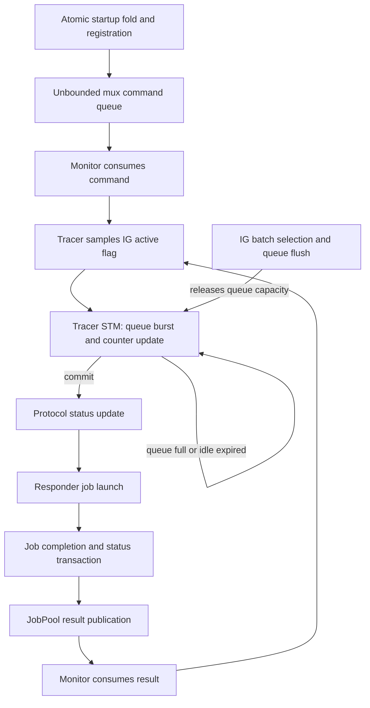

# IG events, registration and mux/tracer execution

The model now carries the full source IG event union and executes repeated batch
selection, registration, responder startup outcomes and synchronous mux tracer
transactions. This replaces the earlier success-only, first-batch prefix.
Promotion pruning and OG are still incomplete; this is not a full subsystem
model or a source-conformance proof.

## Modules and source mapping

| Module | Responsibility |
|---|---|
| [IGTypes.agda](IGTypes.agda) | All ten source event families; captured termination descriptors and mux identities |
| [Rules/MuxRuntime.agda](Rules/MuxRuntime.agda) | Mux/protocol states, startup fold and atomic tracer queue/counter effects |
| [Rules/IGRegistration.agda](Rules/IGRegistration.agda) | IG continuation, published state, timers, handles/muxes, monitor callbacks and repeated batch selection |
| [CSP/IGRegistration.agda](CSP/IGRegistration.agda) | Admission-to-registration traces and earlier duplicate/late-enqueue checks |
| [CSP/IGRuntime.agda](CSP/IGRuntime.agda) | Runtime/interleaving regressions and composed startup/subsequent-batch CSP traces |

The source baseline remains network
`96ee6e0e689770b5a3d664c59f2d13b05c5d9c4d`. The focused recheck used:

- [InboundGovernor.hs](https://github.com/IntersectMBO/ouroboros-network/blob/96ee6e0e689770b5a3d664c59f2d13b05c5d9c4d/ouroboros-network/framework/lib/Ouroboros/Network/InboundGovernor.hs): exit deactivation/flush (197–205), batch selection (242–278), registration (280–398), event handling (400–612), synchronous tracer (635–728), maturity (796–804), event payloads (871–944), and peer-commit readiness (949–959).
- [Network/Mux.hs](https://github.com/IntersectMBO/ouroboros-network/blob/96ee6e0e689770b5a3d664c59f2d13b05c5d9c4d/network-mux/src/Network/Mux.hs): stopped/stop (121–180), protocol completion (310–365), monitor selection and callbacks (424–618), and `runMiniProtocolSTM` (749–789).
- [InboundGovernor/State.hs](https://github.com/IntersectMBO/ouroboros-network/blob/96ee6e0e689770b5a3d664c59f2d13b05c5d9c4d/ouroboros-network/framework/lib/Ouroboros/Network/InboundGovernor/State.hs): unregister (201–215), remote states and updates (224–283).

## Startup outcomes from state

`installHandle` is an explicit handle-allocation boundary. It installs a distinct
handle/mux pair with an ordered protocol bundle, idle protocol statuses and zero
tracer counters. It is not yet wired into the actual handler allocation code.

`runResponders` looks up that handle and runs the source-ordered startup fold.
Unknown protocol, non-Ready mux, and non-idle protocol status produce named errors.
Success commits armed protocol statuses, start commands, IG registration and
duplex freshness in one transaction. Presence in the registry means submitted
responders, not executing protocol workers.

If a later invocation fails, earlier successful invocations remain in the returned
mux state. The enclosing fold catches the failed invocation; it does not roll back
the preceding successful starts. IG leaves its registry unchanged and separately
enqueues shutdown. A stop request is not a stopped mux. `pollStopped` waits on
its captured mux until that mux is Stopped or Failed, then prepares the captured
unregister decision for a separate publication step.

## Tracer and monitor boundaries



The retry arrow describes an unavailable transaction, not an executable self-loop
or a divergence claim. While a callback is pending, that monitor cannot process
another command/completion. Other protocol jobs may finish and publish results.
Job completion, result publication and monitor consumption are separate steps.
Monitor completions precede commands; commands precede on-demand traffic starts.

An active flag is sampled before the tracer transaction. The transaction uses the
sample even if IG deactivates meanwhile. Deactivation and the final queue flush
are separate steps in the source exception handler. A previously sampled callback
can write after that flush. The model records this interleaving without asserting
that it constitutes a source defect.

Tracer counters are signed integers, matching source Int behavior below
machine-word overflow; decrementing zero is not saturated. They belong to the
originating mux. The current IG registration,
looked up by connection key, supplies the protocol descriptor, version data and
captured mux placed in `MiniProtocolTerminated`. These may belong to a replacement
connection. The model deliberately preserves that source distinction. Missing
protocol descriptors become an explicit tracer-exception continuation; they are
not misreported as queue retry.

Clean last-hot completion atomically writes termination, demotion and idle events
with the counter decrement. Exceptional completion writes termination and clears
counters; the later dead-mux trace writes `MuxFinished` separately. Full queues
block the whole transaction. Expired RemoteIdle blocks start tracing even with
queue capacity available.

## Subsequent batches and event coverage

`finishBatch` returns to clock capture and inactivity-timer registration. Selection
uses the existing ordered batch kernel with readiness derived from stored state:

1. Captured time partitions fresh peers at `observedAt + 900 ≤ time`.
2. The minimum expired RemoteIdle connection key supplies `CommitRemote`.
3. A nonempty information queue is flushed.
4. An expired inactivity token supplies `InactivityTimeout`.

The first two alternatives prepend their generated event to the entire queue
flush. Batch processing re-reads published state for each event. Timer expiry is
an explicit untimed input; timestamps are nondecreasing natural seconds. There is
no elapsed-time or fairness theorem. The minimum-key computation is independent
of association-list insertion order, using an explicit abstract lexicographic
address order; concrete replay must match the source address ordering.

The event union includes NewConnection, MuxFinished, MiniProtocolTerminated,
WaitIdleRemote, RemotePromotedToHot, RemoteDemotedToWarm, CommitRemote,
AwakeRemote, MaturedDuplexPeers and InactivityTimeout. The queue now stores this
union; handshake producers wrap their notifications in NewConnection.

Implemented event handlers cover registration/duplicates, maturity, inactivity,
hot/warm updates, captured-mux stopping waits, and clean/error termination with
restart outcomes. `CommitRemote` enters the [caller-run inbound release](InboundRelease.md)
path and publishes only after CM returns. `AwakeRemote` and `WaitIdleRemote` enter
[caller-run promotion/demotion](RemoteState.md); over-limit promotion remains an
explicit pruning frontier. Successful demotion allocates a fresh idle timer before
publication.

## Profile and remaining abstractions

- The runtime profile supports eager and independent on-demand responders.
  `installHandle` explicitly rejects StartOnDemandAny bundles until grouped
  scheduling is modeled. The startup kernel still represents that status.
- On-demand traffic readiness is a boundary input naming one ready channel;
  the model does not implement ingress bytes or simultaneous-ready channel order.
- Job completion represents the clean egress-drained boundary or a supplied
  exceptional outcome. JobPool ownership, cancellation and completion promises
  are not fully modeled. No overlapping jobs of the same protocol number are
  assumed in the selected profile.
- Shutdown completion represents cancellation/egress completion. The model does
  not derive this readiness from those resources. Handle allocation, transport,
  protocol execution and exception unwinding remain abstract.
- The existing handler-exit boundary still does not derive exit from the mux
  runtime. Whole-handler wedge/deadlock claims must wait for that integration.
- IG version data is referenced through immutable handles. Diagnostic counter
  caches and total/nonblocking diagnostic tracing are abstracted; the real
  queue-writing tracer is modeled explicitly.
- Existing ownership and entry/promise supply theorems retain their statements
  over every machine action. They do not prove IG timer/registry/mux validity.
- Local fixtures with injected queues or overlapping incarnations are branch
  checks, not source-reachability witnesses. No bounded search or source replay
  has been performed, and no source defect or subsystem liveness is claimed.

## Validation and next work

From the library root, with Agda 2.8.0, one process at a time:

```sh
agda ConnectionManagement/CSP/IGRuntime.agda +RTS -M2G -RTS
agda ConnectionManagement/Negative/CleanupAtomicity.agda +RTS -M2G -RTS
agda ConnectionManagement/Negative/StaleHandshake.agda +RTS -M2G -RTS
agda ConnectionManagement/Negative/HeapRollback.agda +RTS -M2G -RTS
```

The runtime endpoint covers registration and real responder startup traces,
subsequent maturity batches, startup failure with partial effects, queue/counter
atomicity, drain-unblocks-tracer traces, expired-idle blocking, active-sample/exit
ordering, and old-callback/current-registration captures. It imports the ownership
and supply endpoints transitively.

Validation of this increment: the runtime endpoint and its affected dependency
closure freshly elaborated successfully; cleanup atomicity, stale-handshake and
heap-rollback checks passed separately. The final runtime check emitted no
warnings. The 14-file local static audit reported only the `?` characters in
standard decidable comparison operators, which were inspected; it found no actual
holes or unsafe options. Local documentation links and `git diff --check` passed.
This is not a term-level axiom audit of external dependencies.

Next implement promotion pruning and its cancellation sequence, then connect mux termination and tracer failure to handler cleanup. OG
jobs and completion processing remain required for the combined lifecycle gate.
