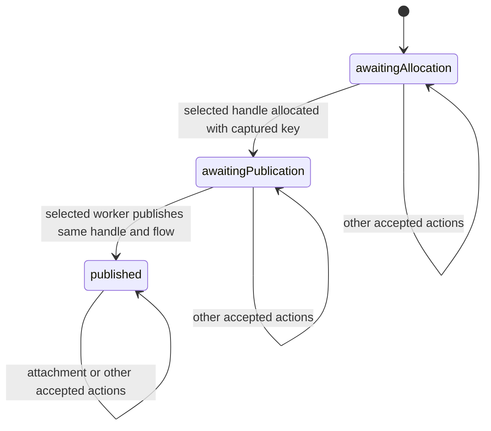

# Executable success-origin monitor

`Rules/OriginMonitor` adds an executable filter around `Machine.advance`. It checks
one explicitly selected `(worker, handle)` pair. The open machine and its CSP
process are unchanged, so mismatch traces remain available as negative controls.
The [source-origin analysis](HandlerOrigin.md) motivates this contract.

## State and behavior

Start with `start c`, whose phase is `awaitingAllocation`. Supply a fixed `Target`
throughout execution. The target association is observer input: `installHandle`
has no worker field, so the monitor cannot discover allocation ownership from the
raw event alone. It recognizes allocation by the selected handle ID and checks
that allocation's key against the selected worker's current captured handler key.



The ticket records the allocated mux ID, protocol bundle and flow. After the
contract check, the original dispatcher must also succeed. Both endpoints are
committed together. A failed check or refused machine step returns `nothing`;
there is no invented transition and no silent phase advance.

| Event for the selected target | Contract check |
| --- | --- |
| Installation | Only before allocation; selected worker exists; supplied key equals its captured key. Freshness and supported protocols are still checked by the machine. |
| Successful negotiated publication | Only after allocation; handle equals selected handle; flow equals recorded flow. |
| Attachment | Only after the matching publication has been observed; ordinary machine guards still apply. |
| Repeated installation/publication | Rejected by the success profile. |
| Query, error, duplicate-write outcomes | Rejected for the selected worker; separate outcome profiles are not implemented. |
| Other actions | Passed to the unchanged dispatcher; their source scheduling admissibility is not asserted. |

In particular, another worker's publication is outside this monitor's scope.
Allocations for other handle IDs are also outside scope. A forged initial
`observed c (published ticket)` is not evidence that allocation/publication occurred;
use `start` and a checked execution prefix when making history claims.

## Proofs and CSP connection

- `Properties/OriginMonitor.step-projects` and `exec-projects`: every accepted step
  and finite monitored execution projects to the same actions and endpoints in the
  open machine.
- `allocation-checked` and `accepted-publication`: the executable checks enforce
  the captured key and phase, and the selected publication enforces handle/flow
  agreement with its ticket.
- `accepted-allocation`: given actual resource evidence for the selected worker,
  an accepted allocation derives `HandlerOrigin.Origin` for its exact descriptor.
  The monitor does not itself validate entry/socket existence.
- `origin-retained`: that certificate survives every accepted continuation by
  projection and the existing exhaustive preservation theorem.
- `CSP/OriginMonitor`: a process tree over the original action channel, exact
  finite-trace/execution correspondence, and inclusion of **every finite monitored
  trace** in the open process's traces, including exclusion of unexpected ticks.

This is trace inclusion, not failures refinement, equivalence, or a source
simulation. Adding a filter can add refusals. Contract rejection is neither source
blocking nor a source deadlock, and the monitor does not establish liveness.
`Properties/OriginMonitorInvariant.reachable-invariant` now identifies every
stored ticket in a reachable state with its exact **model** handle descriptor.
It starts at `start c` with resource evidence for the selected worker and permits
any accepted finite execution. Both `awaitingPublication` and `published` carry
`Origin` for the ticket's mux, bundle and flow; `awaitingAllocation` requires no
handle. Resource evidence is retained throughout. The proof first identifies the
actual selected allocation action, then uses origin creation and exhaustive
preservation across subsequent actions.

`CSP/OriginMonitorInvariant.raw-invariant` lifts this to every finite raw CSP
execution, retaining the actual process endpoint and its certified monitor state.
`trace-invariant` gives the existential endpoint version for finite traces.
These theorems do not assume an origin certificate at the initial state. They do
assume initial worker resources and the observer-supplied target association.
They do not identify model objects with source objects, validate every source
invocation, or establish mux readiness. The source-to-model identity/projection
map remains a separate obligation.

## Witnesses and negative controls

`CSP/OriginMonitorWitness` checks the existing establishment sequence through
allocation, publication, attachment, parent completion and handshake consumption.
The phase advances around the same concrete machine snapshots. Its accepted
allocation derives an origin certificate from selection/fork resource evidence;
the certificate is transported to the final state. The monitored CSP trace is
then projected to the open process using the generic theorem.

`Negative/OriginMonitor` retains the earlier open-model mismatch witnesses and
rejects their relevant monitored prefixes:

- Wrong connection key at allocation.
- Unidirectional allocation followed by duplex publication.
- Substitution of a different handle during publication.
- Publication before observed allocation; attachment before observed publication.
- Repeated allocation, and allocation refused by the open machine's freshness guard.

The wrong-key, wrong-flow and wrong-handle checks include CSP non-trace proofs;
the wrong-flow check covers the accepted allocation prefix followed by the refused
publication. The remaining ordering/freshness controls are step-equality proofs.

`Negative/OriginMonitorInvariant` derives both the allocated and completed
witness states from the generic invariant. A forged `published` phase before
allocation has no invariant and is unreachable from the resource-backed fresh
observation, for **any** finite action list. The module also imports the existing
monitor mismatch controls.

## Next obligations

[AttributedOrigin](AttributedOrigin.md) now adds explicit worker-labelled allocation
with erasure to this monitor and preserves its reachable-state invariant. The
runtime registry for that boundary is implemented by [OriginRegistry](OriginRegistry.md), with
per-allocation resource premises. Next, connect its overlapping-worker witness
to actual admission selection/fork traces. Add query/error
profiles and interruption/masking constraints without treating excluded outcomes
as source bugs. Concrete source replay still needs identity and version/application
projections. The present monitor is an executable subset of the documented success
contract, not a complete source-admissibility oracle.

## Validation

Run from the standalone library root, sequentially:

```sh
agda ConnectionManagement/Negative/OriginMonitorInvariant.agda +RTS -M2G -RTS
agda ConnectionManagement/Negative/OriginMonitor.agda +RTS -M2G -RTS
agda ConnectionManagement/Negative/HandlerOrigin.agda +RTS -M2G -RTS
agda ConnectionManagement/Negative/HandlerDispatcherInterference.agda +RTS -M2G -RTS
```
