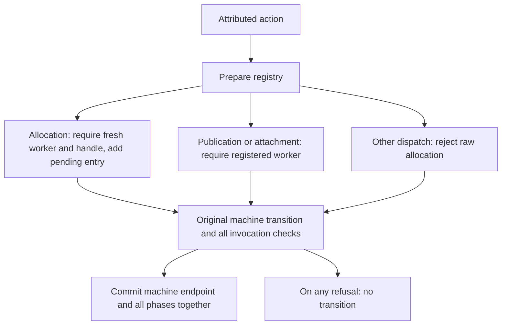
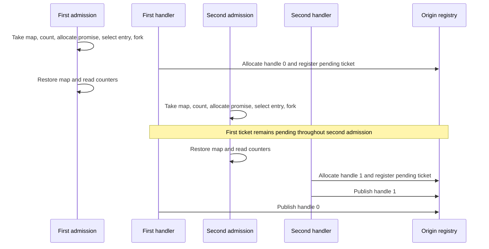

# Dynamic success-invocation registry

`Rules/OriginRegistry` extends the [attributed action boundary](AttributedOrigin.md)
to a list of dynamically registered worker/handle pairs. There is no fixed target
parameter. `start c` begins with an empty registry; successful allocation creates
a new entry and advances it to `awaitingPublication`. Each subsequent action is
checked against every registered invocation using the existing attributed
single-target monitor.

## Runtime behavior



Allocation tags are still observer inputs representing the invoking handler. Each
new entry checks the captured connection key. Publication must use the registered
handle and flow, and attachment must follow observed publication. Another worker's
allocation cannot consume an existing worker or handle identity. Registration and
phase changes are committed only when the underlying machine and every monitor
accept. All monitors inspect the same pre-action configuration; they do not apply
the machine transition sequentially to each other's outputs.

The registry retains entries permanently. This success profile does not support
worker-ID or handle-ID recycling, deregistration, query/error publications or a
new successful invocation under an old worker ID. It permits ordinary admission
and cleanup actions without requiring those workers to be registered. Other
source scheduling constraints remain outside the monitor.

## Proof scope

`Properties/OriginRegistry.step-projects` and `exec-projects` erase accepted actions
into successful transitions of the unchanged open machine, preserving endpoints.
These projection theorems require no resource evidence.

`Invariant` is an `All` predicate over registry entries. Each entry carries the
existing single-target invariant: worker resources plus exact ticket origin in
both allocated and published phases. `drive-certified` uses deterministic machine
projection to establish that every local monitor's endpoint is the same shared
machine endpoint, then reuses the existing invariant-preservation proof.

`reachable` proves the invariant for executions from the empty registry with
`Supported` evidence. `Supported` requires `Resources` for the invoking worker
**at each allocation**, including allocations after later forks. Non-allocation
actions need only the trivial premise. This is a proof premise, not an executable
entry/socket-existence check. It neither authenticates the worker tag nor proves
source-to-model identity correspondence. It also does not require all workers to
exist at the initial state.

`CSP/OriginRegistry` reuses the visible attributed action channel. It proves finite
execution/trace correspondence and erasure of every finite raw trace to an open
machine trace. `raw-invariant` returns the actual reached process endpoint and
execution, together with the implication from `Supported` evidence for that exact
execution to its registry invariant. It does not claim unconditional origin for
arbitrary malformed initial machine states.

These results establish finite model safety under the stated resource premises.
They do not establish source refinement, failures refinement, progress, readiness,
or source deadlock. A monitor rejection is a contract disagreement. No global
source ownership theorem or identity-reuse policy is inferred from freshness
checks in this success profile.

## Overlapping-worker witness

`Negative/OriginRegistry` starts from an explicit machine fixture with two handler
records, distinct sockets/promises, and a shared connection key and CM entry.
It does not claim a two-admission source-reachable prefix.

The checked schedule is:

1. Allocate worker 1's handle and register its ticket.
2. Allocate worker 2's distinct handle while worker 1 awaits publication.
3. Publish worker 2's result.
4. Publish worker 1's result.

Both allocations have explicit resource evidence at their respective steps.
`two-published` checks the exact final two-entry registry, and `all-certified`
applies the generic theorem to both entries. The accepted schedule has a CSP trace.

CSP non-trace controls reject unregistered publication and cross-worker handle
substitution after both allocations. The substitution control uses the same
captured key for both workers, so key agreement alone cannot explain rejection.
Step-equality controls reject worker reuse, handle reuse, raw allocation even with
an empty registry, and a negotiated-flow mismatch. Earlier attributed and
single-target controls are imported transitively.

## Admission-derived witness

`CSP/RegistryAdmission` removes the hand-supplied handler/resource fixture from a
second witness. It begins at `CSP/Fixtures.start`, after two accepted sockets have
been handed to admission workers, with no handler records or registry entries.
This is model reachability from that fixture, not a source `accept()` trace.



The complete 18-action registry execution has a CSP trace and an erased open
machine trace. Both resource certificates come from `selection-fork-resources`;
the second certificate is transported through parent map restoration and the
counter read. `Supported` is discharged for the complete execution without a
hand-built resource record. `first-retained` certifies the first registry entry
after the second admission, and `all-certified` covers both final entries.
Exact phase checks confirm that both entries are pending before either publication
and both are published at the endpoint.

This witness uses the two distinct connection keys from the admission fixture.
The earlier synthetic shared-key witness remains valuable: its swap control
shows that key agreement alone cannot substitute for worker/handle attribution.
Neither witness extends the registry's success-only scope or models attachment,
mux execution, or handshake-result consumption in this new schedule.

`Negative/RegistryAdmission` proves CSP non-traces for a swapped publication after
the complete two-allocation prefix and repeated allocation after the second
admission. It imports the earlier registry negative controls.

## Reachable identity uniqueness

`Properties/RegistryUnique.Unique` uses the standard library's `AllPairs` over
registry targets. Each earlier target differs from every later target in **both**
worker ID and handle ID. This is stronger than uniqueness of worker/handle pairs:
two different handles cannot share a worker, and two different workers cannot
share a handle.

The proof connects the executable freshness checks to pairwise inequality.
`prepare-unique` permits only a fresh target to be prepended; `drive-targets`
proves that successful phase updates preserve the entire target list in order.
`step-unique` and `exec-unique` retain uniqueness, and `reachable-unique` derives
it from an empty registry for every accepted finite execution.

This theorem has **no** `Supported`, resource, heap-validity or finite-carrier
premise. It holds for `start c` with arbitrary machine configuration `c`.
Descriptor origin still requires the separate per-allocation resource evidence;
identity uniqueness does not supply it. Nor does uniqueness authenticate observer
tags, establish source object identity, or justify recycling an old worker ID.

`CSP/RegistryUnique.raw-unique` retains the exact process endpoint and its unique
registry for every finite raw CSP execution from `start`. `trace-unique` gives
the corresponding existential endpoint for finite traces. Both reuse the existing
execution correspondence; the runtime rules and event alphabet are unchanged.

`Negative/RegistryUnique` derives uniqueness for both the synthetic overlapping
fixture and the admission-derived witness. Separate generic contradictions exclude
a repeated worker even with different handles, and a repeated handle even with
different workers. Two forged endpoint registries are proved unreachable from
any `start c`, for every finite action list. Arbitrarily pre-seeded registries
are not certified by the theorem.

## Publication soundness

`Properties/RegistryPublication.publication-sound` relates an accepted successful
publication to the pre-state origin invariant and identity uniqueness. Its `Sound`
record names an actual registry member and proves:

- Its worker is the publishing worker, and every other member with that worker
  equals the selected entry.
- Its phase was `awaitingPublication` with a particular ticket.
- The published handle and flow equal the selected handle and ticket flow.
- The corresponding entry is present in the post-state with phase `published`.
- The exact handle origin, including ticket mux and protocol bundle, holds both
  before and after the publication.

`worker-member` obtains existence from the executable registration guard;
`owner-unique` obtains uniqueness from pairwise identity separation. `drive-member`
recovers the selected entry's successful single-target monitor transition, so the
handle/flow and phase checks reuse `accepted-publication`. Origin comes from the
pre-state certificate and is retained through the underlying publication action.

`reachable-publication` discharges identity uniqueness from any accepted prefix
starting at an empty registry, and discharges origin from `Supported` evidence for
that prefix. A successful monitor step alone still does not authenticate an
observer tag or supply missing heap-resource evidence.

`CSP/RegistryPublication.raw-publication` lifts this to an arbitrary finite raw
CSP prefix followed by a visible successful publication event. It retains the
actual pre- and post-process endpoints and the recovered prefix execution. The
soundness result remains conditional on resource support for that exact prefix.
It is not a failures-refinement or source-implementation correspondence theorem.

`Negative/RegistryPublication` instantiates the theorem for both publications in
the reverse-order admission-derived schedule. It also proves that the final state
cannot support another `Sound` certificate for any publishing worker, handle,
flow or endpoint: both registry entries are already published, so no pending
entry exists. Earlier ownership-swap and duplicate-identity controls are imported.
This excludes a repeated success in this monitor profile, not every source
publication-fault or query/error outcome.

## Publication-to-attachment identity

`Properties/RegistryAttachment.publication-attachment` starts with a supported
registry prefix and an accepted successful publication. It permits arbitrary
accepted interleavings before a successful attachment and arbitrary accepted
suffix actions afterward. Its result retains the publication's `Sound` certificate
and an `Attached` certificate at the final machine state.

`Attached` names the actual lifecycle frame, proves its lookup, and equates its
captured mux with the publication ticket's mux. It also retains the reference chain
for that mux and the exact allocated handle descriptor. `chain-mux` derives mux
identity from functional handler, promise and handle lookups: two chains for the
same worker cannot silently choose different muxes.

The construction reuses `publication-creates`, exhaustive chain preservation,
`attach-established`, tracked-chain preservation and origin preservation. It does
not require fresh resource premises for unrelated allocations in the interleaving;
it protects the already-certified invocation. Registry and open-machine guards
still check every action. The theorem does not certify all other invocations
without their own resource evidence.

`CSP/RegistryAttachment.raw-attachment` recovers the concrete registry prefix and
publication/attachment schedule from visible CSP executions, retaining both
actual process endpoints. The result is conditional on support for the recovered
prefix. A successful attachment is an explicit premise, not a conclusion of
origin validity. Neither readiness nor eventual attachment is proved.

`Negative/RegistryAttachment` uses the admission-derived prefix for the second
handler's publication. During its delay, the first handler publishes and attaches.
After the second handler attaches, CM reads the first handler's handshake result.
The theorem retains the second handler's exact mux identity through this nonempty
delay and suffix. A negative proof excludes a certificate naming the other
handler's mux; a step control confirms that another attachment is refused even
while origin and tracked-reference evidence remain valid.

## Exit and cleanup preserve identity, not activity

`Properties/RegistryCleanup.open-preserves` retains an existing `Attached`
certificate across every successful finite dispatcher execution.
`registry-preserves` obtains the same result by erasing a registry execution.
The proof reuses tracked-chain, reference-chain and origin preservation, and
reconstructs the exact ticket-mux equality. It requires an initial attachment
certificate, not a promise that the handler remains active.

`CSP/RegistryCleanup.raw-preserves` retains the actual endpoint and its attachment
certificate for any finite raw registry CSP execution. It accepts a certified
initial state; it does not infer certification from a pre-seeded phase or require
that initial state to be `start c`.

`Negative/RegistryCleanup` wraps the existing asynchronous lifecycle fixture with
one published registry entry. Its initial attachment certificate is checked by
explicit lookups. The complete 14-action continuation is rechecked through the
registry: cancellation delivery, job-pool closure, mux failure publication,
synchronous tracer sampling/commit, rethrow completion, handler exit, map take,
cleanup selection, socket close, map publication, TIME_WAIT readiness, finalization
and cleanup counter read.

At the final endpoint, the attachment certificate coexists with:

- Mux status `failed` and a socket recorded as `closed`.
- A retained CM heap entry recorded as `terminated` and an empty CM map.
- Cleanup PC `cleanupDone cleanupNormal`.
- A retained lifecycle frame with phase `finalizing` and the original captured mux.

Negative controls rule out `ready` mux status and `handling` socket ownership at
that endpoint. Both reattachment and repeated handler exit are refused. These
facts show why the certificate must not be used as a readiness or progress test.
The source-model profile retains its lifecycle frame and registry entry; this
increment adds neither frame reclamation nor identity recycling.

This cleanup instance is conditional on the existing certified lifecycle fixture.
It does **not** connect the two-admission publication witness to that fixture: the
intervening IG registration and inbound-release trace is supplied for one
invocation by the separate composition below. TIME_WAIT readiness is an untimed event, and job-pool/tracer boundary
completions are explicit inputs; the witness is not a universal cleanup-liveness
proof or a source implementation refinement theorem.

## Admission-to-cleanup composition

`CSP/RegistryShutdown` closes the concrete prefix gap for **one invocation**.
It starts at `CSP/Fixtures.start` with an empty registry, derives resource evidence
from selection/fork, allocates the attributed handle, and only then publishes it.
It continues through CM result consumption and inbound notification, six IG
registration steps, a subsequent timer batch, release transaction/counter read,
cancellation request, attachment, cancellation delivery, unwind and CM cleanup.
The complete registry schedule has exactly 45 visible actions and projects to a
trace of the unchanged open machine.

The older `CSP/IGRegistration.lifecycle` trace published before abstract handle
allocation, so it was not reused wholesale. The new trace uses the allocation-first
admission prefix and rechecks the remaining registration snapshots after allocation.
Parent/handshake snapshots are also rechecked without prematurely attached
lifecycle frames. No generic commutation or erasure law is assumed for those
snapshot transformations.

`result` applies `publication-attachment` to this supported admission prefix and
the complete intervening registration/release schedule. The final `Attached`
certificate at `Life.doneCleanup` is derived, not supplied as an initial lookup
record. The earlier conditional cleanup witness remains useful as a small local
control, but its pre-seeded certificate is not a premise of this composition.

`Negative/RegistryShutdown` proves full-prefix CSP non-traces for premature handler
exit immediately after cancellation delivery and reattachment after the complete
shutdown. It also derives final registry uniqueness from reachability and checks
the closed socket, empty map and completed cleanup at the actual endpoint.

This is an existential finite execution from an **accepted-socket** fixture. It
does not model the source `accept()` prefix, does not join both handlers from the
two-admission witness, and does not prove eventual cancellation or cleanup. Timer
readiness, cancellation delivery, pool closure, tracer completion and TIME_WAIT
readiness remain explicit modeled boundaries. The originating success-profile
assumptions and source identity/projection obligations remain unchanged.

## Release returns before unwind

`CSP/RegistryReturn` adds a second admission-derived shutdown schedule with 48
visible actions. After cancellation delivery, the caller checks its assertion,
returns to IG, and IG commits its registration-removal decision **before** the
handler closes its job pool. The remaining unwind and cleanup transitions are
rechecked with the returned caller state and the updated IG publication. These
snapshot substitutions are not assumed to commute with arbitrary execution.

The schedule is a registry CSP trace and projects to an open-machine trace.
Its terminal attachment certificate is derived from the same supported admission
and publication prefix. Removal from IG's current connection table does not erase
the historical origin certificate or the registry entry.

`Negative/RegistryReturn` checks the separate boundaries: return alone retains
registration; IG's commit removes it while the pool is still closing, the socket
is owned, and cleanup has not started. Handler exit at that reachable prefix is
refused. The subsequent mux tracer successfully enqueues `muxFinished` despite
the missing IG registration, and the final endpoint has an empty CM map, closed
socket and completed cleanup. This is a finite possible interleaving, not a
universal progress theorem or an implementation refinement proof.

## Validation and next step

Run sequentially from the standalone library root:

```sh
agda ConnectionManagement/Negative/RegistryReturn.agda +RTS -M2G -RTS
agda ConnectionManagement/Negative/HandlerDispatcherInterference.agda +RTS -M2G -RTS
```

The first admission-derived draft used recursively computed snapshots and exhausted
the 2 GB Agda heap. The checked version uses explicit snapshots and local transition
equalities; it passes with the same heap limit. No checker limit or theorem premise
was relaxed.

Next, follow IG into its subsequent batch and check consumption of the queued
`muxFinished` event after unregistration, separately from retained origin identity.
Lifecycle/reuse policies, query/error profiles, interruption constraints and
concrete source replay remain separate obligations.
