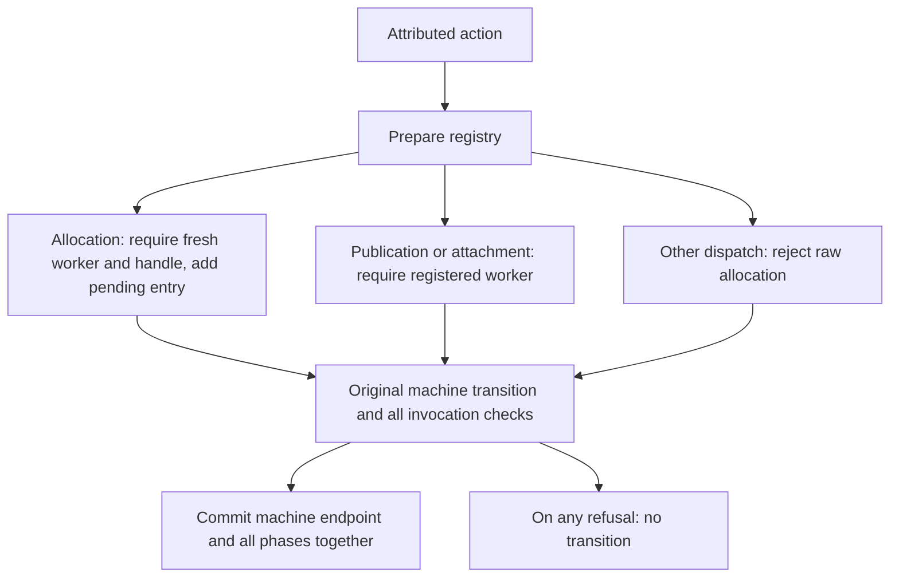

# Dynamic success-invocation registry

`Rules/OriginRegistry` extends the [attributed action boundary](AttributedOrigin.md)
to a list of dynamically registered worker/handle pairs. There is no fixed target
parameter. `start c` begins with an empty registry; successful allocation creates
a new entry and advances it to `awaitingPublication`. Each subsequent action is
checked against every registered invocation using the existing attributed
single-target monitor.

## Runtime behavior



Allocation tags are still observer inputs representing the invoking handler. Each
new entry checks the captured connection key. Publication must use the registered
handle and flow, and attachment must follow observed publication. Another worker's
allocation cannot consume an existing worker or handle identity. Registration and
phase changes are committed only when the underlying machine and every monitor
accept. All monitors inspect the same pre-action configuration; they do not apply
the machine transition sequentially to each other's outputs.

The registry retains entries permanently. This success profile does not support
worker-ID or handle-ID recycling, deregistration, query/error publications or a
new successful invocation under an old worker ID. It permits ordinary admission
and cleanup actions without requiring those workers to be registered. Other
source scheduling constraints remain outside the monitor.

## Proof scope

`Properties/OriginRegistry.step-projects` and `exec-projects` erase accepted actions
into successful transitions of the unchanged open machine, preserving endpoints.
These projection theorems require no resource evidence.

`Invariant` is an `All` predicate over registry entries. Each entry carries the
existing single-target invariant: worker resources plus exact ticket origin in
both allocated and published phases. `drive-certified` uses deterministic machine
projection to establish that every local monitor's endpoint is the same shared
machine endpoint, then reuses the existing invariant-preservation proof.

`reachable` proves the invariant for executions from the empty registry with
`Supported` evidence. `Supported` requires `Resources` for the invoking worker
**at each allocation**, including allocations after later forks. Non-allocation
actions need only the trivial premise. This is a proof premise, not an executable
entry/socket-existence check. It neither authenticates the worker tag nor proves
source-to-model identity correspondence. It also does not require all workers to
exist at the initial state.

`CSP/OriginRegistry` reuses the visible attributed action channel. It proves finite
execution/trace correspondence and erasure of every finite raw trace to an open
machine trace. `raw-invariant` returns the actual reached process endpoint and
execution, together with the implication from `Supported` evidence for that exact
execution to its registry invariant. It does not claim unconditional origin for
arbitrary malformed initial machine states.

These results establish finite model safety under the stated resource premises.
They do not establish source refinement, failures refinement, progress, readiness,
or source deadlock. A monitor rejection is a contract disagreement. No global
source ownership theorem or identity-reuse policy is inferred from freshness
checks in this success profile.

## Overlapping-worker witness

`Negative/OriginRegistry` starts from an explicit machine fixture with two handler
records, distinct sockets/promises, and a shared connection key and CM entry.
It does not claim a two-admission source-reachable prefix.

The checked schedule is:

1. Allocate worker 1's handle and register its ticket.
2. Allocate worker 2's distinct handle while worker 1 awaits publication.
3. Publish worker 2's result.
4. Publish worker 1's result.

Both allocations have explicit resource evidence at their respective steps.
`two-published` checks the exact final two-entry registry, and `all-certified`
applies the generic theorem to both entries. The accepted schedule has a CSP trace.

CSP non-trace controls reject unregistered publication and cross-worker handle
substitution after both allocations. The substitution control uses the same
captured key for both workers, so key agreement alone cannot explain rejection.
Step-equality controls reject worker reuse, handle reuse, raw allocation even with
an empty registry, and a negotiated-flow mismatch. Earlier attributed and
single-target controls are imported transitively.

## Validation and next step

Run sequentially from the standalone library root:

```sh
agda ConnectionManagement/Negative/OriginRegistry.agda +RTS -M2G -RTS
agda ConnectionManagement/Negative/HandlerDispatcherInterference.agda +RTS -M2G -RTS
```

Next, derive the two-worker resource premises from actual admission selection/fork
traces and carry the first registered invocation through the second admission.
That will connect the dynamic registry to the existing Server/CM proof layer.
Formal registry uniqueness and lifecycle/reuse policies, query/error profiles,
interruption constraints and concrete source replay remain separate obligations.
