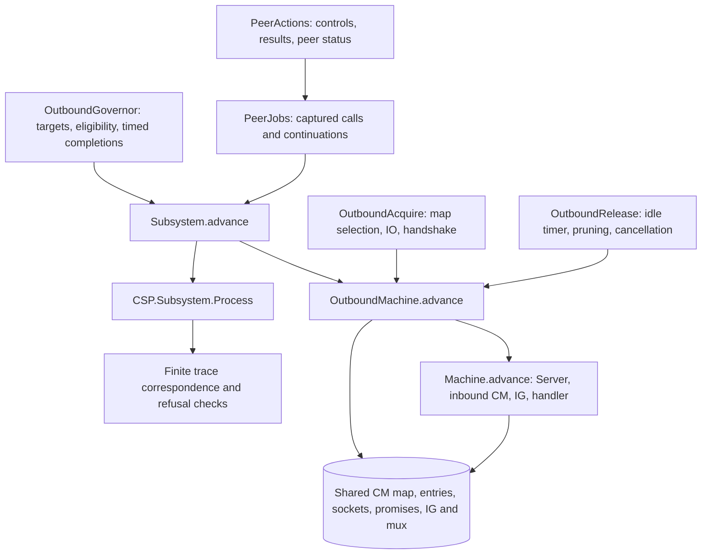

# Outbound CM and ordinary-peer governor

Implementation review: 16 October 2026. This extends the standalone model with
outbound acquisition/release, an executable ordinary-peer OG, peer-action jobs,
completion races and background monitoring. It keeps the design's fixed initial
known-peer configuration. Discovery, local-root groups, big-ledger peers and churn
are outside this profile; known peers can be forgotten or removed after failures.

The authority is network commit
`96ee6e0e689770b5a3d664c59f2d13b05c5d9c4d`, pinned by consensus commit
`585a86117618ff86d7d5b541f9d23b03356d4c3a`. This is not a claim about the latest
branch. See [SourceLedger.md](SourceLedger.md) for source links.

## Architecture and state ownership



`OutboundMachine` embeds the existing `Machine.Configuration`; it does not copy
CM or IG state. `Subsystem` adds private/public OG state, the completion FIFO,
job pool, peer handles, monitor continuations, targets and clock samples. Each
source thread advances through its own continuation. The dispatcher allows their
steps to interleave. The CSP renderer exposes accepted actions as visible events.
It is one operational machine rendered as a productive `PTree`, not yet a
separately composed parallel CSP architecture with a refinement theorem.

`PeerConnectionId` is distinct from `HandleId`, `JobId` and `WorkerId`. A peer
connection retains its negotiated CM handle and mux, controls, published result
actions, status and promotion time. Initiator result cells are separate from IG's
responder cells; mux failure/stop connects them through the shared mux runtime.
The new alphabet is not wrapped by the inbound origin registry. Its existing
certificates and machine-wide invariants have not been extended to these new writes.

No static `linkConfig` is used. The CM entry state, negotiated flow and peer
controls determine reuse, initiation and release dynamically. Outbound release
may leave an inbound duplex bearer alive; peer temperature and physical socket
lifetime are different state components.

## Source-to-module mapping

| Source operation | Executable module | Preserved boundaries |
| --- | --- | --- |
| Core `requestOutboundConnection` | `Rules/OutboundCases`, `Rules/OutboundAcquire` | Selection STM, counter read, socket IO, fork, captured promise result, commit and return |
| Core `unregisterOutboundConnection` | `Rules/OutboundRelease` | Release STM, assertions/counters, pruning, timer choice, later terminating write and cancellation delivery |
| Governor main loop | `Subsystem` | Public snapshot, time sample, ordered selection, timer cancellation, timed application, publication/tracing, individual job forks |
| EstablishedPeers / ActivePeers | `Rules/OutboundGovernor` | Eligibility, quotas, four in-progress sets, captured jobs, current-state completion interpretation |
| Monitor connections/jobs | `Subsystem`, `Rules/OutboundGovernor` | Async demotion priority, completion FIFO, target updates, cooling exclusions |
| PeerStateActions | `Rules/PeerActions`, `Rules/PeerJobs` | Status/control STM, sequential protocol starts, separate result publication, first/all-result waits, CM release |
| JobPool | `Subsystem` | Child execution before parent registration, enqueue once, deregister only after registration |

### Acquisition

The case table covers every CM state constructor. An unknown-local reservation
has priority over the concrete entries for the remote address. Otherwise the
environment selects a member of that remote bucket. Successful selection advances
a random-generation marker; concrete PRNG state/distribution is abstract.

An absent outbound peer reserves an entry before socket creation. The caller
allocates a promise, opens/configures/binds/connects the socket, obtains its local
address, updates the map key and forks the handler. Updating a colliding concrete
key removes the unknown-local reservation, matching the map helper. A separate
transaction commits the unnegotiated state after the fork.

Duplex inbound entries can be reused; an unnegotiated inbound entry is captured
and waited on. Initial lookup of a terminal entry retries, whereas a captured
inbound wait can return disconnected. Existing outbound acquisition and forbidden
flow/state branches retain their distinct exception outcomes and counter order.

Successful fresh outbound duplex negotiation updates the entry and enqueues IG
notification in the same STM transaction. A full queue blocks the whole commit.
The inbound consumer's separate enqueue ordering is unchanged. Error/query
handling retains captured-entry writes even when the map now names a replacement;
map deletion remains identity-sensitive. The handler publication itself is still
an explicit environment boundary with installed handle/mux data.

### Release

The case table includes unsupported, forbidden, no-op and supported states.
Outbound unidirectional and expired duplex entries become outbound-idle, then
wait on an idle timer or entry change. A simultaneous entry change wins over a
ready timeout. Timeout selection and the later unconditional terminating write
are separate steps, preserving that race. Counters precede cancellation; delivered
cancellation does not imply the handler has joined or cleaned up.

Ticking outbound duplex becomes inbound-idle, with capacity checking and scored
pruning; duplex-active becomes inbound-active. Pruning uses the existing policy
kernel and explicit victim cancellation order. Timer expiry and delivery remain
untimed environment readiness inputs.

## OG, peer jobs and monitoring

The ordinary-peer profile executes forgetting, establishment, activation, close
and hot demotion. Targets must be sane. Selection derives quotas and eligible
peers from the current known/established/active and in-progress sets. A policy
input must select a nonempty, unique subset within the eligible quota; it cannot
choose an alternative ahead of a ready higher-priority alternative.

The selection order is monitor changes, queued job completion, changed targets,
known-peer forgetting, established promotion/close, then active promotion/demotion.
Time samples advance known-peer failure clearing and readiness. Future connect
and activation deadlines determine the wakeup timer. Timer cancellation and timed
decision application are separate actions. Applying a wakeup requires a sample at
or after its captured deadline.

Completions capture job arguments and outcome, then update **current** private
state. They never restore a state snapshot from job launch. Late activation
completion has source-specific aborted paths. Demotion timeout clears progress
while retaining active/established membership; completed failed demotion can
remove it. Successful hot-demotion completion checks the source established-peer
assertion. `completionAssertionFailed` is an explicit exception boundary; node
supervision/unwinding from that boundary is not implemented.

Failure accounting preserves the pre-increment maximum-failure check, readiness
and scheduled failure clearing. Establishment backoff uses the current failure
count and exponential cap. This discrete-time profile permits integral jitter
from -2 to +2 (encoded 0..4); the source's continuous jitter is not reproduced.
Other policy delay values remain inputs, including per-peer monitor delays.

Establishment calls outbound CM, initializes controls/results, starts warm then
established protocols, publishes result actions, publishes Warm and forks the
monitor. Activation changes status/controls before sequential hot starts and
records promotion time afterward. Deactivation waits for all hot results; close
terminates every temperature and calls outbound CM on a clean result. Operation
timeout, mux stop, cooling, and the governor job's later wait for Cold are distinct.
The demotion timeout is separate from the operation timeout.

Protocol starts freeze the previous published result action until the new action
is published; a restart cannot silently retarget an older reader. First-result
polling follows protocol order. A selected NotRunning/NotStarted result retries
the whole temperature action. All-result waiting uses its different source
semantics. The background monitor checks established, warm, then hot results;
clean results run the corresponding close/deactivate job without an OG completion,
and cooling waits for CM's outbound-demoted condition before publishing Cold.

Child jobs may run and enqueue a completion before the parent's pool insertion.
Deregistration then retries until that insertion exists. The model keeps completed
job records for diagnostics and prevents repeated enqueue/deregister actions.
Asynchronous exceptions across arbitrary job-pool masking/fork windows, pool
shutdown and full node supervision are not implemented.

## Checked witnesses and their limits

| Endpoint | Evidence |
| --- | --- |
| `CSP/RegistryProducer` | 57 actions from accepted-socket admission through responder startup, consumed awake/hot events and CM promotion, synchronous failure, ordered error/mux-finished notifications, registered-mux poll and IG removal |
| `Negative/RegistryProducer` | Notification order, captured mux, final unregistration, handler still present, no earlier handler exit |
| `CSP/OutboundAdmission` | 18-action fresh duplex outbound acquisition through installed handle, publication, atomic notification and return |
| `CSP/GovernorLifecycle` | 146-action OG establish → activate → deactivate → close execution, with outbound CM and IG registration; ends with no OG established/active peers and the inbound duplex side retained |
| `Negative/Subsystem` | Lifecycle endpoint, duplicate completion refusal, child completion before parent registration, required registration before deregistration; local completion-priority and assertion controls |
| `CSP/OutboundReleaseScenarios` | Conditional unidirectional idle-timeout release and duplex over-limit self-pruning traces |
| `Negative/Outbound` | Full-queue atomicity, replaced-entry error write, address collision, reservation preference and timeout-winner distinctions |
| `Negative/OutboundGovernor` | Progress exclusions, late completion/timeout behavior, cooling, target validity and result-action identity |
| `CSP/OutboundOpenFailure` | 10-action reservation/open-failure/retry trace, now reproduced at the CM level in IOSim |
| `CSP/GovernorOpenFailure` | 64-action OG failure completion, backoff, fresh establishment job, rejected retry and second failure completion |
| `Negative/GovernorOpenFailure` | Reachable premature-retry refusal, deadline check, retained reservation, two failure counts and duplicate-completion exclusion |
| `CSP/GovernorFailureLimit` | 211-action extension through six failed attempts and public-state publication after forgetting the peer |
| `Negative/GovernorFailureLimit` | Fifth failure retains the peer, sixth forgets it; CM reservation persists and no further ordinary promotion/timer is enabled |

The 57-action witness derives the attachment certificate from admission and
publication, then preserves it through the producer and consumer. Startup
notifications are consumed by actual CM promotion steps before the failure batch;
they are not erased to make the fixture fit. It projects to the open machine.
It does not establish that every failure eventually reaches IG.

The 146-action lifecycle uses one ordinary peer, empty warm/established protocol
bundles and one hot protocol. The rule definitions support lists of protocols;
this witness does not provide exhaustive coverage of partial startup, all reuse
branches or concurrent peers. Release scenarios that edit a starting fixture are
identified as conditional, not admission-derived reachability results.

`CSP/Outbound` and `CSP/Subsystem` prove raw step/run/finite-trace correspondence,
including inversion and refused extensions, for their respective dispatchers.
These are model representation theorems. They do not prove Haskell refinement,
universal progress, deadlock freedom or hidden-process divergence freedom.

### Reproduced CM behavior: socket-open failure leaves a reservation

Core reserves the unknown-local entry before `openToConnect`. Its `bracketOnError`
cleanup is entered only after socket acquisition succeeds. The checked trace
supplies an exception during open, returns the failure, and attempts acquisition
again. The map still contains ReservedOutbound and the second call returns
ConnectionExists; there is no acquired socket or forked handler to clean it up.

An [IOSim replay of the pinned CM](SourceReplay/README.md) now reproduces this
local reservation leak. It checks the entire map and open/close call counts; a
configuration-failure control confirms cleanup after successful acquisition.
This is direct CM execution, not full OG/rethrow-policy/diffusion supervision.
The next obligation is the integrated retry path and deployment impact; inbound
admission or node shutdown could alter the outcome.

### Governor consequence in the Agda model

[`CSP/GovernorOpenFailure.agda`](CSP/GovernorOpenFailure.agda) now connects the
failure to actual modeled governor decisions and job completions in 64 actions.
It shares the initial establishment prefix with `GovernorLifecycle`, then fails
socket acquisition. The selected ShutdownPeer branch completes the job; OG
consumes it against its current state, records failure count 1 and connect time 5
(using zero jitter), and waits on its wakeup timer. At time 5, OG launches a new
job with fresh caller/child/socket identities. CM rejects that acquisition from
the retained reservation. The second completion records failure count 2 and
connect time 15. Both jobs deregister and both completions are consumed.

```mermaid
sequenceDiagram
  participant OG
  participant Job
  participant CM
  OG->>Job: Establish peer
  Job->>CM: Acquire, reserve, attempt open
  CM-->>Job: IOException; reservation retained
  Job-->>OG: Failed completion
  Note over OG: failures = 1, connectAt = 5
  OG->>OG: Wakeup, cancel timer, sample time 5
  OG->>Job: New establishment job
  Job->>CM: Acquire same remote
  CM-->>Job: ConnectionExists; no socket open
  Job-->>OG: Failed completion
  Note over OG: failures = 2, connectAt = 15
```

`Negative/GovernorOpenFailure` proves the premature-promotion extension of the
reachable prefix is not a raw CSP trace. It also checks that a wakeup cannot be
applied with time 4, the reservation persists, neither outbound socket exists,
no peer is established, and repeated completion enqueue is unavailable after
the full trace. These are finite model results under the explicit policy/time
inputs. They do not establish an infinite retry loop, permanent node wedge or
source reachability of the entire governor schedule. In particular, the failure
limit can eventually remove a known peer; concurrent admission is absent here.

The actual Haskell replay still stops at the CM interface. It corroborates the
CM failure/retry segment, not the entire 64-action governor trace.

### Failure-limit consequence

[`CSP/GovernorFailureLimit.agda`](CSP/GovernorFailureLimit.agda) extends the
64-action prefix through four additional establishment attempts, all using fresh
job/caller identities and the actual CM rejection/completion path. It checks
211 actions from the original initial configuration to the settled governor
selection point. The configured `maxRetries = 5` is a model setting, not a claim
about a protocol-wide or deployment default.

The pinned `KnownPeers.reportFailures` tests the original `allPeers` count while
incrementing a separate updated state. For ordinary, forgettable peers, this
means the fifth failure is retained and the sixth is forgotten. The source
backoff uses the incremented count minus one, matching this model's use of the
previous count. With zero jitter, the checked attempt times are:

| Attempt | Time | Known-peer state after completion |
| --- | --- | --- |
| 1 | 0 | Failures 1; retry at 5 |
| 2 | 5 | Failures 2; retry at 15 |
| 3 | 15 | Failures 3; retry at 35 |
| 4 | 35 | Failures 4; retry at 75 |
| 5 | 75 | Failures 5; retry at 155 |
| 6 | 155 | Forgotten |

`Negative/GovernorFailureLimit` checks that both private and published OG state
forget the peer, no job or completion remains outstanding, and there is no next
ordinary promotion or retry timer. Nevertheless, CM still holds exactly the
unknown-local reservation and ReservedOutbound entry. Forgetting a peer in OG
is not a CM release operation.

The two refused extensions are proved against the full reachable raw CSP prefix.
This is not a global deadlock or permanent-outage theorem: the process remains
open to environment/inbound actions, and the fixed-known-peer profile excludes
rediscovery. Root/extra peers can be protected against forgetting by the source's
`unforgetable` predicate and are outside this witness. Full Haskell OG/supervision
replay is still outstanding; the source replay remains CM-level only.

## Validation and remaining obligations

Run from the library root, one Agda process at a time:

```sh
agda ConnectionManagement/Negative/RegistryProducer.agda +RTS -M2G -RTS
agda ConnectionManagement/Negative/Outbound.agda +RTS -M2G -RTS
agda ConnectionManagement/Negative/OutboundGovernor.agda +RTS -M2G -RTS
agda ConnectionManagement/Negative/Subsystem.agda +RTS -M2G -RTS
agda ConnectionManagement/CSP/OutboundReleaseScenarios.agda +RTS -M2G -RTS
agda ConnectionManagement/CSP/OutboundOpenFailure.agda +RTS -M2G -RTS
agda ConnectionManagement/Negative/GovernorOpenFailure.agda +RTS -M2G -RTS
agda ConnectionManagement/Negative/GovernorFailureLimit.agda +RTS -M2G -RTS
```

`Negative/GovernorFailureLimit` and its new CSP dependency also passed with
Agda 2.8.0 and the 2 GB heap limit. Both new modules have zero proof-audit
findings; no transition rules or earlier theorem types were changed.

The original six endpoints passed with Agda 2.8.0 after the implementation changes.
The added `Negative/GovernorOpenFailure` endpoint and its 64-action CSP dependency
also passed with the same 2 GB heap limit. Its two new modules had zero findings
in the local proof audit; no transition rules or prior theorem types were changed.
The producer check also rechecked its affected inbound proof dependencies. The
combined lifecycle and refusal endpoints were elaborated after the final rule
changes; no whole-cache purge or unrelated network proof rebuild was performed.
`git diff --check` passed. The heuristic audit scanned all 20 changed/new Agda
files; its 14 question-mark findings were inspected and are comparison operators.

The new files retain guardedness and introduce no postulates, holes or unsafe
termination options. This is a local source audit, not a term-level audit of all
external library assumptions. Long witnesses use explicit snapshots and checked
local transitions to keep elaboration within the 2 GB heap limit.

Remaining work includes combined runtime-validity and identity-supply invariants,
source replay, bounded exploration with explicit cutoffs, full handler/transport
execution, general exception unwinding and supervision, and Server's accept/rate
control front end. Valid symbolic identities, admissible IO/policy inputs and
coherent installed descriptors remain environment obligations. Rejected malformed
inputs are not evidence of a source deadlock. The old `CSP.Scope` diagnostics do
not classify every new outbound/OG boundary. G2 is not declared complete merely
because these finite lifecycle witnesses pass.
