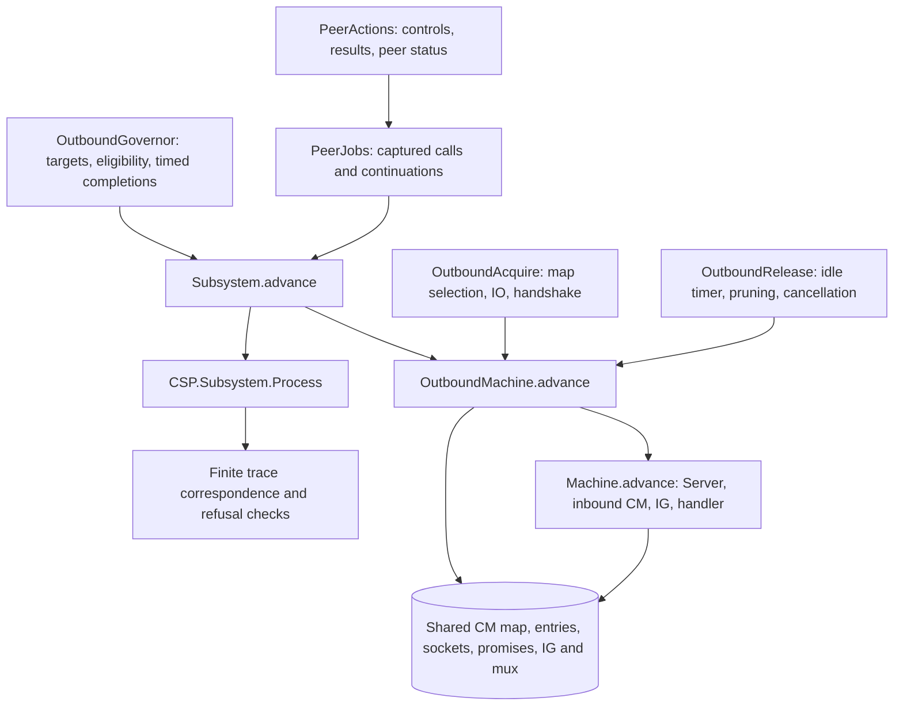

# Outbound CM and ordinary-peer governor

Implementation review: 16 October 2026. This extends the standalone model with
outbound acquisition/release, an executable ordinary-peer OG, peer-action jobs,
completion races and background monitoring. It keeps the design's fixed initial
known-peer configuration. Discovery, local-root groups, big-ledger peers and churn
are outside this profile; known peers can be forgotten or removed after failures.

The authority is network commit
`96ee6e0e689770b5a3d664c59f2d13b05c5d9c4d`, pinned by consensus commit
`585a86117618ff86d7d5b541f9d23b03356d4c3a`. This is not a claim about the latest
branch. See [SourceLedger.md](SourceLedger.md) for source links.

## Architecture and state ownership



`OutboundMachine` embeds the existing `Machine.Configuration`; it does not copy
CM or IG state. `Subsystem` adds private/public OG state, the completion FIFO,
job pool, peer handles, monitor continuations, targets and clock samples. Each
source thread advances through its own continuation. The dispatcher allows their
steps to interleave. The CSP renderer exposes accepted actions as visible events.
It is one operational machine rendered as a productive `PTree`, not yet a
separately composed parallel CSP architecture with a refinement theorem.

`PeerConnectionId` is distinct from `HandleId`, `JobId` and `WorkerId`. A peer
connection retains its negotiated CM handle and mux, controls, published result
actions, status and promotion time. Initiator result cells are separate from IG's
responder cells; mux failure/stop connects them through the shared mux runtime.
The new alphabet is not wrapped by the inbound origin registry. Its existing
certificates and machine-wide invariants have not been extended to these new writes.

No static `linkConfig` is used. The CM entry state, negotiated flow and peer
controls determine reuse, initiation and release dynamically. Outbound release
may leave an inbound duplex bearer alive; peer temperature and physical socket
lifetime are different state components.

## Source-to-module mapping

| Source operation | Executable module | Preserved boundaries |
| --- | --- | --- |
| Core `acquireOutboundConnection` | `Rules/OutboundCases`, `Rules/OutboundAcquire` | Selection STM, counter read, socket IO, fork, captured promise result, commit and return |
| Core `releaseOutboundConnection` | `Rules/OutboundRelease` | Release STM, assertions/counters, pruning, timer choice, later terminating write and cancellation delivery |
| Governor main loop | `Subsystem` | Public snapshot, time sample, ordered selection, timer cancellation, timed application, publication/tracing, individual job forks |
| EstablishedPeers / ActivePeers | `Rules/OutboundGovernor` | Eligibility, quotas, four in-progress sets, captured jobs, current-state completion interpretation |
| Monitor connections/jobs | `Subsystem`, `Rules/OutboundGovernor` | Async demotion priority, completion FIFO, target updates, cooling exclusions |
| PeerStateActions | `Rules/PeerActions`, `Rules/PeerJobs` | Status/control STM, sequential protocol starts, separate result publication, first/all-result waits, CM release |
| JobPool | `Subsystem` | Child execution before parent registration, enqueue once, deregister only after registration |

### Acquisition

The case table covers every CM state constructor. An unknown-local reservation
has priority over the concrete entries for the remote address. Otherwise the
environment selects a member of that remote bucket. Successful selection advances
a random-generation marker; concrete PRNG state/distribution is abstract.
In the pinned source, splitting the generator and selecting the bucket member
occur in the same STM transaction (`Core.hs:1276–1279`). A terminal-state `retry`
rolls back that split (`Core.hs:1379–1388`), so unchanged transaction inputs select
the same member on a retry. The model permits a new admissible environment
selection on every attempt and therefore over-approximates this behavior. Other
threads can change the source's `stdGenVar`, so a changed selection need not mean
that the CM map changed.

An absent outbound peer reserves an entry before socket creation. The caller
allocates a promise, opens/configures/binds/connects the socket, obtains its local
address, updates the map key and forks the handler. Updating a colliding concrete
key removes the unknown-local reservation, matching the map helper. A separate
transaction commits the unnegotiated state after the fork.

Duplex inbound entries can be reused; an unnegotiated inbound entry is captured
and waited on. Initial lookup of a terminal entry retries, whereas a captured
inbound wait can return disconnected. Existing outbound acquisition and forbidden
flow/state branches retain their distinct exception outcomes and counter order.

Successful fresh outbound duplex negotiation updates the entry and enqueues IG
notification in the same STM transaction. A full queue blocks the whole commit.
The inbound consumer's separate enqueue ordering is unchanged. Error/query
handling retains captured-entry writes even when the map now names a replacement;
map deletion remains identity-sensitive. The handler publication itself is still
an explicit environment boundary with installed handle/mux data.

### Release

The case table includes unsupported, forbidden, no-op and supported states.
Outbound unidirectional and expired duplex entries become outbound-idle, then
wait on an idle timer or entry change. A simultaneous entry change wins over a
ready timeout. Timeout selection and the later unconditional terminating write
are separate steps, preserving that race. Counters precede cancellation; delivered
cancellation does not imply the handler has joined or cleaned up.

Ticking outbound duplex becomes inbound-idle when capacity permits. Over limit,
the pinned source prunes selected victims but does not write the prospective
inbound-idle state to a surviving self: it remains outbound-duplex ticking.
`Negative/Outbound.over-limit-release-retains-surviving-self` checks this branch
in a conditional two-entry fixture. The [Haskell release replay](SourceReplay/README.md#verified-over-limit-outbound-release-replay)
now reproduces that outcome through public CM calls, with self-pruning and
within-capacity controls. Duplex-active becomes inbound-active.
Pruning uses the existing policy kernel and explicit victim cancellation order.
Timer expiry and delivery remain untimed environment readiness inputs.

## OG, peer jobs and monitoring

The ordinary-peer profile executes forgetting, establishment, activation, close
and hot demotion. Targets must satisfy `active ≤ established ≤ known` and the
ordinary-source ceilings of 100 active, 1000 established and 10000 known peers. The
[ordinary target profile](#ordinary-target-bounds-and-external-updates) below
states the omitted root/big-ledger and signed-input scope. Selection
derives quotas and eligible peers from the current known/established/active and in-progress sets. A policy
input must select a nonempty, unique subset within the eligible quota; it cannot
choose an alternative ahead of a ready higher-priority alternative.

The selection order is monitor changes, queued job completion, changed targets,
known-peer forgetting, established promotion/close, then active promotion/demotion.
Time samples advance known-peer failure clearing and readiness. Future connect
and activation deadlines determine the wakeup timer. Timer cancellation and timed
decision application are separate actions. Applying a wakeup requires a sample at
or after its captured deadline.

Completions capture job arguments and outcome, then update **current** private
state. They never restore a state snapshot from job launch. Late activation
completion has source-specific aborted paths. Demotion timeout clears progress
while retaining active/established membership; completed failed demotion can
remove it. Successful hot-demotion completion checks the source established-peer
assertion. `completionAssertionFailed` is an explicit exception boundary; node
supervision/unwinding from that boundary is not implemented.

Failure accounting preserves the pre-increment maximum-failure check, readiness
and scheduled failure clearing. Establishment backoff uses the current failure
count and exponential cap. This discrete-time profile permits integral jitter
from -2 to +2 (encoded 0..4); the source's continuous jitter is not reproduced.
Other policy delay values remain inputs, including per-peer monitor delays.

Establishment calls outbound CM, initializes controls/results, starts warm then
established protocols, publishes result actions, publishes Warm and forks the
monitor. Activation changes status/controls before sequential hot starts and
records promotion time afterward. Deactivation waits for all hot results; close
terminates every temperature and calls outbound CM on a clean result. Operation
timeout, mux stop, cooling, and the governor job's later wait for Cold are distinct.
The demotion timeout is separate from the operation timeout.

Protocol starts freeze the previous published result action until the new action
is published; a restart cannot silently retarget an older reader. First-result
polling follows protocol order. A selected NotRunning/NotStarted result retries
the whole temperature action. All-result waiting uses its different source
semantics. The background monitor checks established, warm, then hot results;
clean results run the corresponding close/deactivate job without an OG completion,
and cooling waits for CM's outbound-demoted condition before publishing Cold.

Child jobs may run and enqueue a completion before the parent's pool insertion.
Deregistration then retries until that insertion exists. The model keeps completed
job records for diagnostics and prevents repeated enqueue/deregister actions.
Asynchronous exceptions across arbitrary job-pool masking/fork windows, pool
shutdown and full node supervision are not implemented.

## Profile differences from pinned production

The ordinary-peer profile currently retains the following abstractions. The
source comparisons use the fixed network pin above, not a current-branch default.
These notes document the existing executable behavior; they do not correct the
remaining semantic differences.

### Ordinary target bounds and external updates

`Rules/OutboundGovernor.sane` now checks the ordinary-source projection: natural
nonnegative targets with `active ≤ established ≤ known`, plus ceilings of 100, 1000
and 10000 respectively. The pinned
[`sanePeerSelectionTargets`](https://github.com/IntersectMBO/ouroboros-network/blob/96ee6e0e689770b5a3d664c59f2d13b05c5d9c4d/ouroboros-network/lib/Ouroboros/Network/PeerSelection/Governor/Types.hs#L265-L285)
also checks root and big-ledger targets. The ordinary embedding fixes those
omitted target fields and root sets to zero/empty; the model does not represent
negative source Int inputs, root clamping or a custom target-action hook.
This is not a predicate over every full production target configuration.

`Subsystem.setTargets` always overwrites the input, including ordering-invalid or
oversized values. It changes neither private nor public governor targets. The
source wires
[`readPeerSelectionTargets` to a TVar](https://github.com/IntersectMBO/ouroboros-network/blob/96ee6e0e689770b5a3d664c59f2d13b05c5d9c4d/ouroboros-network/lib/Ouroboros/Network/Diffusion.hs#L625-L635).
Its default
[`targetPeers`](https://github.com/IntersectMBO/ouroboros-network/blob/96ee6e0e689770b5a3d664c59f2d13b05c5d9c4d/ouroboros-network/lib/Ouroboros/Network/PeerSelection/Governor/Monitor.hs#L55-L95)
reads the current value and selects it only if changed and sane. Consequently,
`noTargets` means no *ready* target update, not merely equal values: an invalid
input disables target selection without blocking otherwise-ready policy or
wakeup alternatives. Monitor/completion priorities remain unchanged.

A sane input overwritten before selection is not applied. Selection, however,
captures the chosen target inside the source STM decision; a later overwrite
does not invalidate that already-selected value, including during wakeup-timer
cancellation. `applyAt` therefore applies its capture without rereading input.
`Negative/TargetInputs` checks boundaries, both overwrite orders, actual
alternative readiness/priority and the before/after-selection distinction.
These input corrections do not establish private-target sanity from arbitrary
injected initial states or forged pending target decisions.

A4 was implemented after A2 commit `4268692`. The target-input acceptance
endpoint passed 31 concrete equations and two finite write traces; fourteen
governor/failure/structural/A1–A3 regression endpoints also passed sequential
Agda 2.8.0 checks with the 2 GB heap limit. Final readiness/lifecycle invocations
reused already checked interfaces; other batch endpoints rechecked affected
modules. The five-file local audit's 21 findings were inspected comparison
operators, with no new holes, axioms, unsafe flags or weakened theorem statements.
Whitespace checks passed. No replay or source-pin change was performed. Detailed
commands/scope: [A4 execution report](../review/connection-management-correction-plan-2026-10-27.md#a4-execution-results).
The A4 increment was validated on top of A2 commit `4268692`.

### Retry policy values

| Setting | Model default and integrated replay | Pinned production policy |
| --- | --- | --- |
| Maximum connection retries | 5 | 5 |
| Failure-count clearing delay | 60 | 120 seconds |

The model values are in `Subsystem.initial`; the replay sets them explicitly in
[`GovernorCMReplay.patch`](SourceReplay/GovernorCMReplay.patch). The production
values come from
[`Diffusion/Policies.hs:170–171`](https://github.com/IntersectMBO/ouroboros-network/blob/96ee6e0e689770b5a3d664c59f2d13b05c5d9c4d/ouroboros-network/lib/Ouroboros/Network/Diffusion/Policies.hs#L170-L171).
The clearing delay of 60 matches the replay profile, not the production default.
No production-default claim follows from a witness checked with those parameters.

### Exception policy and node delivery

The open `Rules/PeerJobs` model retains both `choosePeerPolicy` and
`chooseNodePolicy` after a raised acquisition result. Its policy and delivery PCs
now capture the returned `OutboundCases.Fault`; later CM result-table writes do
not replace that exception. The final governor failure outcome still erases it.

`Rules/ProductionPolicy.Profile` adds the pinned **peer-state-action** policy as
an explicit wrapper around `Subsystem`. Named CM faults are peer-only. For
`ioFailure e`, an immutable `isIOManagerError : ErrorId → Bool` parameter supplies
the exception-class projection: only a true classification admits the node
branch, and only a false classification admits the peer branch. The parameter
must agree with the source exception represented by that error identity; this
is an input contract, not a theorem reconstructing Haskell exception types.
The acquisition boundary tries `SomeException`, so interpreting every opaque
`ioFailure` as an ordinary `IOException` would lose fatal cases.

The pinned diffusion wiring supplies its local
[`rethrowPolicy`](https://github.com/IntersectMBO/ouroboros-network/blob/96ee6e0e689770b5a3d664c59f2d13b05c5d9c4d/ouroboros-network/lib/Ouroboros/Network/Diffusion.hs#L286-L322)
to peer-state actions (`Diffusion.hs:582–593`): only `IOManagerError` is fatal.
The connection handler separately receives a configurable policy extension; the
wrapper does not filter that policy or claim to supervise handler-originated
fatal exceptions.

The source's
[`ShutdownNode`](https://github.com/IntersectMBO/ouroboros-network/blob/96ee6e0e689770b5a3d664c59f2d13b05c5d9c4d/ouroboros-network/lib/Ouroboros/Network/PeerSelection/PeerStateActions.hs#L785-L805)
performs `throwTo` on the diffusion thread (`spsMainThreadId`) and then
rethrows locally. The wrapper
records the first successful `deliverNodeException`, including actor and fault,
while continuing to admit subsystem interleavings. Delivery moves the sender to
`nodeRethrow fault`; the separate `rethrowNodeException` performs local failure
cleanup. Supervision may therefore complete before that sender continuation.
Its separate `completeShutdown` action marks an **externally supplied
completed-supervision boundary** and then freezes dispatch. This boundary is enabled only after a
recorded fatal peer-job delivery. It neither implements cancellation/join nor
asserts that shutdown eventually occurs. It also does not assert that every
interleaving before this boundary is feasible in Haskell.

Both job and monitor dispatch paths use the same policy guard, including a
check of the captured fault before delivery. Projection erases the supervision
boundary to an empty subsystem trace and retains dispatched actions, allowing
existing subsystem invariants to be reused without broadening their claims.
The [A6 source audit](../review/connection-management-a6-source-audit-2026-10-27.md)
records policy wiring, exception and supervision scope. Full cancellation,
unwinding, thread joins and implementation refinement remain open.

### One governor job-pool close

`Rules/JobPoolLifecycle Result` now gives an executable model of one
single-spawning-owner WithQueue pool. It separates body return, queued outcome,
registry removal and observable Async result. A child may return and publish
before the masked parent registers it, but deregistration retries until that
insertion. The owner cannot begin its lexical close in that fork/register gap.
Historical Async handles are retained independently of the live registry.

`beginClose order` checks an exact unique permutation of the registered handles
and captures it once. The supplied order represents the source map traversal;
no ordering of symbolic `JobId`s is claimed to implement source ThreadId order.
Close invokes cancellation and awaits the Async result of one captured handle
before proceeding to the next. Registry deletion cannot retarget that wait.
Normal completion may outrun pending cancellation. Acknowledged cancellation
moves a running body into a separate unwind path, which deregisters without
fabricating a failed governor completion. Already queued outcomes survive close.
Delivery is refused in the modeled masked normal publication/deregistration gaps.

`Properties/JobPoolClose.from-initial` proves that every member of the captured
snapshot has an observable Async result whenever a finite execution from the
empty initializer reaches `closedPool`. Its induction keeps each snapshot member
on the remaining cursor or certifies its result, while a separate invariant
ensures a completed close has no remaining cursor. It requires no fairness or
assumed eventual termination. Arbitrary injected states need the explicit
`Covered` and `ClosedEmpty` certificates used by the preservation lemmas.

This primitive is now coupled to the source world by
[`GovernorPool`](GovernorPool.agda), with executable caller cleanup described in
[Supervision.md](Supervision.md). It does not change raw `Subsystem.advance`. `bodyRunning` abstracts the source body's actual interruptibility;
`bodyUnwound` is an explicit local unwind-completion input. Neither proves CM
bracket/socket cleanup or all source mask states. A removed historical child
outside the snapshot can still expose its Async result after this pool closes.
The separate background-monitor registry is not the subsystem's `monitors`
follow-up-operation table. The monitor/provider/Async scopes and their ordering are now coupled in
`PeerSupervision`, with initialized close witnesses and component certificates.
Handler/server scope integration remains open. Detached cleanup capture/supply validity
is now proved in `Properties/GovernorPoolSupply` for arbitrary finite coupled
executions, with explicit initial supply bounds. Accordingly the existing production
profile's external `completeShutdown` boundary is retained until that wider
certificate can be derived. The
[pool source audit](../review/connection-management-pool-supervision-source-audit-2026-10-27.md)
records these source distinctions and dependency limits.

Validation used Agda 2.8.0 with `+RTS -M2G -RTS`, one process at a time:
`Rules/JobPoolLifecycle`, `Properties/JobPoolClose` and
`Negative/JobPoolLifecycle` passed with Checking output. The acceptance endpoint
checks 65 equations, three finite executions and applications of the generic
snapshot certificate, including a historical non-snapshot child that remains
nonterminal when close finishes. The unchanged `Negative/ProductionPolicy`
regression also passed using cached interfaces. The three-file proof audit found
no holes, postulates or unsafe flags. No Haskell replay or whole-supervisor
refinement check was run.

## Invariant extension: captured-entry prerequisite

The inbound `SupplyInvariant.advance-preserves` theorem cannot be copied to
`OutboundMachine` or `Subsystem` with only `SupplyBounds` on the shared world.
[`Negative/OutboundSupply`](Negative/OutboundSupply.agda) refutes precisely
those two proposed one-step statements. It starts with an empty, bounded heap
and a forged `removeError` frame capturing entry zero. The enabled
`removeReservation` step inserts `Terminated` at zero while the next-entry supply
is still zero. Exact lease ownership holds before and after. This is an injected
frame counterexample, not a source bug or a trace from valid initial frames.

The source-derived rule relies on a previously captured entry, so no extra
lookup guard has been added merely to make the proof pass. The local
[`OutboundSupply.remove-reservation-preserves`](Properties/OutboundSupply.agda)
lemma proves preservation with the explicit premise that the captured entry's
serial is below the current supply. [`Properties/OutboundCapture`](Properties/OutboundCapture.agda) now defines an
exhaustive capture projection over every acquisition PC, including nested counter
continuations. `Valid` requires the captured entry to exist in the heap; it does
not require a live map alias. `step-valid` proves preservation across every
successful `OutboundAcquire.step`. Fresh selection derives allocation directly,
while completed frames carry no mutable-entry capture. `run-valid` lifts this
to all finite single-caller runs, and `from-selecting-valid` derives validity
without an initial capture premise.

`valid-removal-preserves-supply` combines this certificate with the unchanged
heap supply invariant to discharge cleanup's captured-entry bound. The negative
module proves that the forged frame above cannot be the endpoint of any such
acquisition run from `selecting`. `retained-valid` transports a waiting frame
across interference only when given a proved heap-retention law. It does not
assume every subsystem action has that law.

[`Properties/OutboundRuntimeCapture`](Properties/OutboundRuntimeCapture.agda)
now lifts validity to **every pending acquisition frame** in the runtime store.
`advance-preserves` covers every `OutboundMachine.Action`, and `exec-preserves`
covers arbitrary finite `OutboundMachine.Executes` interleavings. `from-initial`
derives the certificate from the empty acquisition runtime without hand-supplied
frame premises. `removal-bound` obtains the selected caller's entry bound from
this certificate and the current heap supply bound.

The lift uses [`OutboundAcquireRetention`](Properties/OutboundAcquireRetention.agda)
and [`OutboundReleaseRetention`](Properties/OutboundReleaseRetention.agda) for
other callers and release/pruning, and reuses the existing exhaustive inbound
retention proof. These establish stored entry existence even after map removal;
they do not assert source object lifetime or a live connection. Runtime return
removes a frame, while begin-acquire installs a capture-free selecting frame.
The negative module now excludes the forged counterexample from **all** finite
executions starting at `OutboundMachine.initial`, including inbound and release
interleavings.

[`Properties/PeerJobCapture`](Properties/PeerJobCapture.agda) now proves that
every successful `PeerJobs.step` preserves validity of all pending acquisition
frames. Protocol actions change only peer/IG state; CM acquisition and release
calls reuse the runtime preservation theorem. Failure, timeout and exception
policy paths are included, with no assumptions on the job frame or action.

[`Properties/SubsystemCapture`](Properties/SubsystemCapture.agda) now covers
**every successful subsystem action and arbitrary finite `Subsystem.Executes`**.
`from-initial` derives capture validity from `Subsystem.initial
(OutboundMachine.initial c) governor`, with no initial acquisition-frame premise.
`Negative/OutboundSupply.forged-not-a-subsystem-execution` consequently excludes
the forged frame even with governor/job/monitor interleavings.

[`Properties/SubsystemSupply`](Properties/SubsystemSupply.agda) proves the
combined entry/promise allocation-supply invariant. Its closed induction
predicate pairs capture validity with the existing `SupplyBounds`:

- `advance-bounds` and `exec-bounds` preserve the unchanged heap bounds from an
  arbitrary configuration when capture validity and heap bounds both hold.
- `from-initial` needs only `SupplyBounds` for the initial shared world; the real
  nested initializer supplies capture validity. Every allocated entry and promise
  identity stays strictly below its corresponding current supply throughout
  arbitrary finite executions.

This does not require release-frame validity: release writes look up their entry
or use the checked pruning-edit helper. Acquisition cleanup is the distinct case
where the source writes a captured entry without looking it up; its bound is
obtained from the capture invariant. Fresh entry/promise allocations advance
supplies and lift the previous bounds. The original heap-only counterexample
still refutes unconditional preservation from arbitrary injected frames.

The proof layers are [`OutboundAcquireSupply`](Properties/OutboundAcquireSupply.agda),
[`OutboundReleaseSupply`](Properties/OutboundReleaseSupply.agda), and
[`OutboundRuntimeSupply`](Properties/OutboundRuntimeSupply.agda). Shared
[`PeerJobInvariant`](Properties/PeerJobInvariant.agda) and
[`SubsystemInvariant`](Properties/SubsystemInvariant.agda) lifts avoid repeating
administrative-action cases between the capture and combined-supply instances.
`PeerJobCapture` retains its original public proof API through specialization.

[`Negative/SubsystemSupply`](Negative/SubsystemSupply.agda) applies the general
supply theorem to the existing lifecycle, child-before-registration race, and
six-failure/forgetting paths. It also rejects the forged certificate and excludes
the forged post-state from executions with initially bounded heaps.

Exclusive map-lease ownership is now covered by the separate theorem below.
Current and captured map uniqueness is covered by its separate theorem below.
Whole-runtime reference validity remains open. These additions do not extend the Haskell replay or
establish source refinement, infinite-execution liveness, or deadlock freedom.

[`Properties/OutboundMapUniqueness`](Properties/OutboundMapUniqueness.agda)
proves nested key uniqueness for both outbound `updateLocal` branches and
`removeAliases`, including deletion of empty buckets. It reuses the existing
store lemmas and the standard library's filtering theorem. The alias predicate
was moved from a local definition to `differentEntry` so proofs share its exact
term; its cases and the transition behavior are unchanged. These map-helper laws are reused by the state-level map uniqueness invariant
below; by themselves they make no claim about captured maps or executions.

Check these additions from the library root, sequentially:

```sh
agda ConnectionManagement/Properties/OutboundMapUniqueness.agda +RTS -M2G -RTS
agda ConnectionManagement/Properties/OutboundSupply.agda +RTS -M2G -RTS
agda ConnectionManagement/Properties/OutboundCapture.agda +RTS -M2G -RTS
agda ConnectionManagement/Properties/OutboundRuntimeCapture.agda +RTS -M2G -RTS
agda ConnectionManagement/Properties/PeerJobCapture.agda +RTS -M2G -RTS
agda ConnectionManagement/Properties/SubsystemCapture.agda +RTS -M2G -RTS
agda ConnectionManagement/Properties/SubsystemSupply.agda +RTS -M2G -RTS
agda ConnectionManagement/Negative/OutboundSupply.agda +RTS -M2G -RTS
agda ConnectionManagement/Negative/SubsystemSupply.agda +RTS -M2G -RTS
```

The three new endpoints passed with Agda 2.8.0 and `+RTS -M2G -RTS`,
with `Checking` output. After the alias-predicate refactor, the sequential
checks of `Negative/Outbound`, `CSP/OutboundReleaseScenarios`,
`Negative/Subsystem` and `Negative/GovernorFailureLimit` also exited 0,
rechecking the affected lifecycle/open-failure dependencies. No cache purge
was used. The four-file audit (three new modules plus `Rules/OutboundAcquire`)
reported zero findings; this is not a transitive axiom audit. `git diff --check`
passed. The subsequent `OutboundCapture` and updated `Negative/OutboundSupply` checks
also passed with explicit `Checking` lines and the same 2 GB heap limit. Their
local proof audit reported zero findings. No additional transition edit or
heavy rebuild was needed.

The subsequent runtime lift and its acquisition/release retention dependencies
also passed Agda 2.8.0 with the 2 GB limit and explicit `Checking` lines; the
updated negative endpoint passed again. The four-file audit found one lexical
match, the `≤?` comparison in the release capacity proof, not a hole. No axioms,
unsafe options or new transition edits were introduced. At that checkpoint full
subsystem capture preservation and general ownership/supply invariants were
still unproved; the 19 October extension above establishes capture and supply
preservation for the current subsystem.

The peer-job lift passed Agda 2.8.0 with `+RTS -M2G -RTS` and an explicit
`Checking` line. Its local proof audit reported zero findings. The existing
`Negative/Subsystem` and `Negative/OutboundSupply` endpoints also exited 0
using cached interfaces. This addition changes no transition rules.

On 19 October 2026 the subsystem capture and supply layers and their local
acquisition/release proofs passed Agda 2.8.0 with `+RTS -M2G -RTS` and explicit
`Checking` output. `Negative/OutboundSupply` passed with the new subsystem
exclusion. The new `Negative/SubsystemSupply` endpoint passed its lifecycle,
registration-race, failure-limit, and forged-state applications. Its first
sandboxed attempt failed while writing the external `csp-ptree` interface cache;
the approved rerun refreshed those interfaces and exited 0. No dependency source
was edited and no cache purge was performed.

The existing `Negative/Outbound`, `CSP/OutboundReleaseScenarios`, and
`Negative/GovernorFailureLimit` endpoints then exited 0 with cached interfaces.
The ten-file local audit reported four inspected lexical matches, all `≤?`
comparisons. There are no added postulates, holes or unsafe options in this
extension; this is not a transitive term-level axiom audit. `git diff --check`
passed. Source replay was not rerun because executable transition rules and
replay patches were unchanged.

## Combined exclusive map ownership

[`Properties/SubsystemOwnership`](Properties/SubsystemOwnership.agda) now proves
preservation of the existing `Ownership` proposition through every successful
`Subsystem.advance` and arbitrary finite `Subsystem.Executes`. `from-initial`
requires only ownership of the initial shared world; it has no capture-validity,
allocation-bound, store-uniqueness, or scheduling premise.

The exact census is unchanged: a full map has no lease claimant; a taken map has
exactly one admission/cleanup continuation claiming it, whose worker equals the
captured lease owner and the map-cell owner. Outbound continuations do not claim
map leases. Fresh reservations, address updates, and error cleanup preserve a
full map; other outbound edits preserve the map cell and lease-bearing
continuations. Entry writes may occur while another worker holds the map.
Release/pruning retains the map cell, reusing the checked atomic-edit law.

The component proofs are
[`OutboundAcquireOwnership`](Properties/OutboundAcquireOwnership.agda),
[`OutboundReleaseOwnership`](Properties/OutboundReleaseOwnership.agda), and
[`OutboundRuntimeOwnership`](Properties/OutboundRuntimeOwnership.agda).
[`PeerJobOwnership`](Properties/PeerJobOwnership.agda) and the subsystem endpoint
specialize the existing generic lifts. The earlier inbound ownership statement
and all executable transition rules retain their original definitions.

[`Negative/SubsystemOwnership`](Negative/SubsystemOwnership.agda) applies the
general theorem to the lifecycle, child-before-registration race, and failure-limit
paths. A conditional fixture executes a socket-open error while inbound cleanup
owns the map, preserving that worker's lease; an attempted outbound selection is
unavailable while the map is held. The fixture's source reachability is not
asserted. The forged supply-counterexample cleanup also preserves ownership,
showing why ownership and captured-entry/supply validity are distinct properties.

The endpoint additionally rejects orphan, full-with-lease, double-claim, and
wrong-owner shared worlds embedded in the actual subsystem configuration, and
proves them unreachable from initially owned subsystem executions. It does not
prove that every owned state is well formed: saved-map contents, socket ownership,
freshness, map uniqueness, and general runtime/reference validity remain outside
this ownership predicate. No eventual-release or liveness theorem follows.

Validation on 19 October 2026, sequentially from the library root:

```sh
agda ConnectionManagement/Properties/OutboundAcquireOwnership.agda +RTS -M2G -RTS
agda ConnectionManagement/Properties/OutboundRuntimeOwnership.agda +RTS -M2G -RTS
agda ConnectionManagement/Properties/PeerJobOwnership.agda +RTS -M2G -RTS
agda ConnectionManagement/Negative/SubsystemOwnership.agda +RTS -M2G -RTS
```

All six new modules, including transitive `OutboundReleaseOwnership` and
`SubsystemOwnership`, passed Agda 2.8.0 with explicit `Checking` output. The
six-file local audit found one lexical match, the inspected `≤?` capacity
comparison. No holes, postulates, unsafe options, or weakened existing theorems
were added. This is not a transitive term-level axiom audit. `git diff --check`
passed; no source replay or unrelated heavy proof build was performed.

## Current, saved, and prospective map uniqueness

[`Properties/StateMapUniqueness`](Properties/StateMapUniqueness.agda) defines
`Valid` over all maps that can become the current map:

- The current map when its cell is full (`CellUnique`). A taken cell contains no
  current map, so the remaining components must account for captured maps.
- Every admission continuation's saved lease map (`AdmissionMaps`).
- Every cleanup continuation's saved lease map and, in `cleanupClose` and
  `cleanupPublish`, its separate prospective output map (`CleanupMaps`).

The continuation predicates enumerate every PC. Certificates traverse all stored
bindings, including shadowed worker keys; unique admission/cleanup store keys are
not assumed. `MapUnique` retains its existing meaning: unique remote keys and
unique local keys within each bucket. Distinct keys may still alias an entry.
This property does not validate entry references or prove heap-key uniqueness.

[`Properties/SubsystemMapUnique`](Properties/SubsystemMapUnique.agda) proves
`advance-preserves` and `exec-preserves` for every successful subsystem action
and arbitrary finite interleavings. `from-initial` requires only `Valid` of the
initial shared world; no ownership, supply-bound, capture-validity, or scheduling
premise is added. For the actual empty-map fixture with lease-free workers,
`Negative/SubsystemMapUnique.initial-unique` derives that premise directly.

The inbound component proofs are
[`MapUniqueAdmission`](Properties/MapUniqueAdmission.agda),
[`MapUniqueCleanup`](Properties/MapUniqueCleanup.agda),
[`MapUniqueHandshake`](Properties/MapUniqueHandshake.agda), and
[`MapUniqueInvariant`](Properties/MapUniqueInvariant.agda). Taking a map transfers
its uniqueness certificate into a lease; cleanup selection derives a unique
prospective map by identity-guarded deletion. Publication uses the prospective
map's certificate, while failure restoration uses the original lease's.
Outbound acquisition uses the existing insertion/address-update/alias-removal
laws in [`OutboundAcquireMapUnique`](Properties/OutboundAcquireMapUnique.agda).
[`OutboundReleaseMapUnique`](Properties/OutboundReleaseMapUnique.agda),
[`OutboundRuntimeMapUnique`](Properties/OutboundRuntimeMapUnique.agda), and
[`PeerJobMapUnique`](Properties/PeerJobMapUnique.agda) complete the shared-state
writer and job layers before the generic subsystem lift.

[`Negative/SubsystemMapUnique`](Negative/SubsystemMapUnique.agda) derives
certificates for the lifecycle, child-before-registration race, and six-failure
paths. Its injected controls establish:

- Restoring a duplicate-remote-key saved map refutes preservation from current-map
  uniqueness plus exclusive lease ownership alone.
- Publishing a duplicate-local-key prospective map refutes preservation even
  when the current cell and every lease's saved map pass a weaker `LeaseOnly`
  invariant. The fixture is also exclusively owned.

These are enabled actual dispatcher transitions from injected malformed states;
they are not source-reachable bugs. The full invariant rejects both inputs and
proves them unreachable from initialized subsystem executions whose initial maps
satisfy `Valid`. Neither input was rejected by adding a transition guard.

On 19 October 2026, cleanup's map boundary was rechecked in `Core.hs:592–713` at
network pin `96ee6e0e689770b5a3d664c59f2d13b05c5d9c4d`: `modifyTMVar` computes
`state'`, closes the socket, and then returns the prospective map. This source
inspection supports retaining both original and prospective maps in the model's
proof obligations. It is not a new source replay or refinement theorem.

Validation commands, sequentially from the library root:

```sh
agda ConnectionManagement/Properties/MapUniqueAdmission.agda +RTS -M2G -RTS
agda ConnectionManagement/Properties/MapUniqueCleanup.agda +RTS -M2G -RTS
agda ConnectionManagement/Properties/MapUniqueHandshake.agda +RTS -M2G -RTS
agda ConnectionManagement/Properties/MapUniqueInvariant.agda +RTS -M2G -RTS
agda ConnectionManagement/Properties/OutboundRuntimeMapUnique.agda +RTS -M2G -RTS
agda ConnectionManagement/Properties/PeerJobMapUnique.agda +RTS -M2G -RTS
agda ConnectionManagement/Negative/SubsystemMapUnique.agda +RTS -M2G -RTS
```

All eleven new modules passed Agda 2.8.0 with explicit `Checking` output and the
2 GB heap limit, including transitive helper and subsystem endpoints. The local
proof audit's two lexical matches were inspected `≤?` comparisons. No holes,
postulates, unsafe options, or changes to existing theorem statements were added.
The existing ownership and supply endpoints also passed using cached interfaces.
This is not a transitive term-level axiom audit; no Haskell replay or unrelated
heavy proof rebuild was performed. General runtime/reference validity remains
open, and these structural invariants do not complete the design's G1/G2 gates.

## Entry references in current, saved, and prospective maps

[`Properties/StateMapReferences`](Properties/StateMapReferences.agda) supplies an
inductive certificate over the current map and every saved/prospective map in
admission and cleanup continuations. It uses structural `CounterReferences`, so
shadowed association-list bindings are checked too. No map/store-key uniqueness,
lease-ownership or supply-bound premise is needed.

Map validity alone is insufficient for induction: admission's `publish` PC can
insert its captured entry without looking it up. The new certificate additionally
requires `Present e heap` at `forkHandler` and `publish` PCs. Successful selection
establishes this fact in
[`AdmissionAllocation`](Properties/AdmissionAllocation.agda); heap-retention laws
transport it across interference. This is a separate induction predicate, not a
change to the existing `CounterStateValid` type or executable transition rules.

[`Properties/SubsystemMapReferences`](Properties/SubsystemMapReferences.agda)
proves `advance-preserves` and `exec-preserves` for all successful combined actions
and arbitrary finite executions. `from-initial` needs only the new certificate
for the initial shared world. Through
[`MapReferencesCounters`](Properties/MapReferencesCounters.agda),
`from-initial-counter-valid` derives the unchanged `CounterStateValid` for every
such execution. `current-count-total` in the bridge module proves that a full
current map has a successful structural counter traversal; it does not establish
whole-action enablement or eventual progress.

The component chain uses [`MapReferenceLaws`](Properties/MapReferenceLaws.agda),
`MapReferencesAdmission`, `MapReferencesCleanup`, `MapReferencesHandshake`,
`MapReferencesInvariant`, `OutboundAcquireMapReferences`,
`OutboundReleaseMapReferences`, `OutboundRuntimeMapReferences`, and the existing
exhaustive generic subsystem lift. `PeerJobMapReferences` separately exports its
peer-job specialization. Heap writes retain pointers even when their connection
values change; map publication checks the actual prospective output, while
failure restoration checks the original lease.

[`Negative/SubsystemMapReferences`](Negative/SubsystemMapReferences.agda)
applies the general theorem to the lifecycle, child-before-registration race,
and six-failure paths. Its injected controls check malformed current and saved
maps, an independently malformed cleanup output map with a good empty saved map,
and a forged admission-publication frame with a missing captured entry. The last
frame has valid retained maps, exclusive ownership and unique maps, yet the actual
subsystem dispatcher publishes a dangling binding. This refutes preservation from
`CounterStateValid` alone on arbitrary frames. The stronger certificate rejects
the input and excludes it, its dangling output, and the bad pending cleanup map
from initialized executions whose initial world satisfies that certificate.
These injections are not source-reachable defect claims.

Source fidelity was rechecked on 19 October 2026 at network pin
`96ee6e0e689770b5a3d664c59f2d13b05c5d9c4d`, `Core.hs:815–892`: inbound
selection creates or reuses a mutable entry before the handler fork, and
`State.insert` publishes the returned mutable entry. Cleanup's original versus
prospective map boundary was checked separately above. These inspections support
the proof obligations; they do not establish Haskell-to-Agda refinement.

Validation on 19 October 2026 used Agda 2.8.0 with one process at a time:

```sh
agda ConnectionManagement/Properties/MapReferencesInvariant.agda +RTS -M2G -RTS
agda ConnectionManagement/Properties/OutboundRuntimeMapReferences.agda +RTS -M2G -RTS
agda ConnectionManagement/Properties/PeerJobMapReferences.agda +RTS -M2G -RTS
agda ConnectionManagement/Negative/SubsystemMapReferences.agda +RTS -M2G -RTS
agda ConnectionManagement/Negative/SubsystemMapUnique.agda +RTS -M2G -RTS
agda ConnectionManagement/Negative/SubsystemOwnership.agda +RTS -M2G -RTS
agda ConnectionManagement/Negative/SubsystemSupply.agda +RTS -M2G -RTS
```

All fourteen new modules passed, with explicit `Checking` output across the
incremental component and endpoint checks. The three existing regression
endpoints also exited 0 with their own `Checking` lines; unchanged dependency
interfaces were reused. The fifteen-file local audit, including the existing
`CounterState` scope-comment update, reported two inspected `≤?` comparison-token
false positives. No holes, postulates, unsafe options, or old theorem-type changes
were introduced. This is not a transitive term-level axiom audit. `git diff --check` passed; no Haskell replay or unrelated heavy network build was run.

This completes the entry-reference substep of CM-I4c. General handler/runtime
validity, including admission PCs after publication, promise/handler/socket
coherence and installed descriptors, remains separate. The new invariant only
certifies references in retained maps and the two admission PCs that can publish
an entry. It does not complete the design's G1/G2 gates.

## Existing handler entry and socket records

[`Properties/SubsystemResources`](Properties/SubsystemResources.agda) now proves
`resources-step` and `resources-exec` for the unchanged `HandlerResources.Resources`
predicate through every successful combined action and arbitrary finite
`Subsystem.Executes`. The initial premise is an existing handler with a stored
entry and socket. No ownership, supply, unique-store, action-subset or scheduling
premise is added. The observed worker need not be the acting caller or child.

[`HandlerResourceFacts`](Properties/HandlerResourceFacts.agda) fixes the exact
original `HandlerStart` descriptor throughout the induction. `For q captured`
exports `advance-preserves` and `exec-preserves` for this stronger fixed-descriptor
statement. Public wrappers recover `Resources` without changing its definition.
The proof covers entry overwrites, socket open/close/close-failure writes, fresh
handler insertion, reservation removal, pruning, timeout and cancellation.
Outbound fork's absent-child guard preserves every existing handler lookup;
entry and socket writes preserve presence while allowing values to change.

The component proofs are
[`OutboundAcquireResources`](Properties/OutboundAcquireResources.agda),
[`OutboundReleaseResources`](Properties/OutboundReleaseResources.agda), and
[`OutboundRuntimeResources`](Properties/OutboundRuntimeResources.agda).
The runtime layer reuses the exhaustive inbound effects in
`HandlerDispatcherInterference`; `PeerJobResources` and `SubsystemResources`
specialize the existing generic lifts for all peer jobs, monitors and OG actions.
No executable rule, new guard or earlier theorem type was changed.

The source-fidelity review's concern about historical stores was rechecked before
this extension. `Rules/Cleanup` writes closed/uncertain socket values and terminal
entry values while retaining stored identities. At network pin
`96ee6e0e689770b5a3d664c59f2d13b05c5d9c4d`, `Core.hs:1435–1464,1527–1535`
describes transfer of socket cleanup from `bracketOnError` to the forked handler;
`Core.hs:606–662` conditionally removes the live CM binding (641–653) and closes
the socket (655–662).
The model's historical resource records are not a claim about Haskell object
lifetime. In particular, stored socket presence does not imply an open socket,
correct socket ownership, current map membership or current IG registration.
This preserves the review's substantive limitation, rather than treating the new
combined coverage as a resolution of source-lifetime modeling.

[`Negative/SubsystemResources`](Negative/SubsystemResources.agda) applies the
general theorem to the existing lifecycle suffix from the real outbound fork,
and to the child-before-parent-registration race suffix. It lifts the conditional
timeout/cancellation and self-pruning release paths through the actual subsystem
core. Injected error continuations check successful socket close, throwing close,
and reservation removal. These controls still have resource certificates when
the socket is closed and the CM map is empty, making the historical-record scope
explicit. A reused child is refused by the existing fork guard; injected missing
entries/sockets and retargeted handler descriptors fail the fixed certificate.
Such injected frames are not source-reachability claims.

Validation on 19 October 2026 used Agda 2.8.0, sequentially:

```sh
agda ConnectionManagement/Properties/OutboundAcquireResources.agda +RTS -M2G -RTS
agda ConnectionManagement/Properties/OutboundRuntimeResources.agda +RTS -M2G -RTS
agda ConnectionManagement/Negative/SubsystemResources.agda +RTS -M2G -RTS
agda ConnectionManagement/Properties/PeerJobResources.agda +RTS -M2G -RTS
agda ConnectionManagement/Negative/SubsystemMapReferences.agda +RTS -M2G -RTS
agda ConnectionManagement/Negative/HandlerDispatcherInterference.agda +RTS -M2G -RTS
agda ConnectionManagement/Negative/SubsystemSupply.agda +RTS -M2G -RTS
```

All seven new modules passed with explicit `Checking` output across the component
and endpoint checks. All three regression endpoints exited 0: map-reference and
supply checks reused cached interfaces; the handler-dispatcher endpoint and its
affected scenario dependencies were rechecked with `Checking` output. The
seven-file local proof audit found one inspected `≤?` comparison-token false
positive. No holes, postulates, unsafe options or old theorem-type changes were
introduced. `git diff --check` and whitespace checks of the new files passed.
This is not a transitive term-level axiom audit. No Haskell replay or unrelated
heavy network build was run.

This completes existing entry/socket resource preservation within CM-I4c. It does
not establish resources for every newly created arbitrary handler or prove
tracked phase/cleanup validity. `Prepared`/`Chain` additionally observe IG
handle/mux state; the following section adds their separate combined proof.
The overall structural-invariant milestone and design gates remain open.

## Existing prepared and published chains across the subsystem

[`Properties/SubsystemReferences`](Properties/SubsystemReferences.agda) proves
`prepared-step`, `chain-step`, `prepared-exec` and `chain-exec` for the existing,
unchanged `Prepared` and `Chain` predicates. Every successful `Subsystem.advance`
and arbitrary finite `Subsystem.Executes` is covered, starting from an existing
certificate. No action subset, scheduling, supply, ownership or store-uniqueness
premise is added. Preparation does not assume a published promise result.

These observers include IG execution, which the older state-only generic lifts
cannot observe. The new
[`OutboundWorldInvariant`](Properties/OutboundWorldInvariant.agda),
[`PeerJobWorldInvariant`](Properties/PeerJobWorldInvariant.agda), and
[`SubsystemWorldInvariant`](Properties/SubsystemWorldInvariant.agda) instead
observe `State → IG.Runtime → Set`. Their concrete stability proofs use the
existing `StateRetention` and `IGTableRetention` relations. The earlier generic
lifts and all existing theorem types remain unchanged.

[`SharedStateEffects`](Properties/SharedStateEffects.agda),
[`OutboundAcquireEffects`](Properties/OutboundAcquireEffects.agda), and
[`OutboundReleaseEffects`](Properties/OutboundReleaseEffects.agda) establish
shared-store retention for all outbound writers: exact handler and promise-result
lookups, plus entry/socket presence despite value changes. The inbound cases reuse
`HandlerDispatcherInterference.step-effects`. Handles retain their complete
installed descriptors; retained muxes may change their dynamic state while
keeping their connection keys.

The additional IG writers were inspected explicitly:

- [`PeerActionRetention`](Properties/PeerActionRetention.agda) covers every peer
  action. Timeout appends a shutdown command to a looked-up mux; other peer actions
  leave IG execution unchanged. The peer-job lift uses this checked effect.
- `Subsystem.publishInitiatorResult` appends a captured pending initiator job to
  the shared direction-tagged mux completion FIFO. Its ordinal argument selects
  a pending occurrence, permitting restarted jobs to publish out of actual-result
  order. The subsystem lift applies `setMux-preserves` to the actual lookup.
- `Subsystem.observeInitiatorFailure` is a compatibility consume action: it only
  accepts an already-queued initiator error at the FIFO head and delegates to the
  same phase-gated monitor as other completions. It does not scan peer-state
  errors or bypass earlier responder callbacks.

On 19 October 2026 the pinned network checkout was confirmed at
`96ee6e0e689770b5a3d664c59f2d13b05c5d9c4d`.
`PeerStateActions.hs:435–445,1017–1033,1074–1098` was rechecked: a peer handle
captures its mux; timeout calls `Mux.stop` on that mux; a protocol error relies on
the mux's own exception path. This supports the model's use of the same captured
mux rather than a replacement identity. It does not prove a Haskell/model
refinement or precise source object lifetime. The historical-store review
limitation recorded above still applies.

[`Negative/SubsystemReferences`](Negative/SubsystemReferences.agda) checks
preparation from actual installation through publication and the rest of the
lifecycle, and chains from actual publication through the lifecycle and delayed
parent-registration suffix. Separate conditional fixtures exercise successful
close, throwing close, reservation removal, initiator job publication followed
by FIFO failure consumption, and a peer-job timeout. Injected wrong-key and wrong-handle/mux fixtures
fail the intended certificates. No transition guard was added to reject them.
The conditional fixtures are not source-reachability claims.

Validation on 19 October 2026 used Agda 2.8.0, one process at a time:

```sh
agda ConnectionManagement/Properties/OutboundWorldInvariant.agda +RTS -M2G -RTS
agda ConnectionManagement/Properties/SubsystemWorldInvariant.agda +RTS -M2G -RTS
agda ConnectionManagement/Properties/SubsystemReferences.agda +RTS -M2G -RTS
agda ConnectionManagement/Negative/SubsystemReferences.agda +RTS -M2G -RTS
agda ConnectionManagement/Negative/SubsystemResources.agda +RTS -M2G -RTS
agda ConnectionManagement/Negative/HandlerDispatcherInterference.agda +RTS -M2G -RTS
agda ConnectionManagement/Negative/HandlerOrigin.agda +RTS -M2G -RTS
agda ConnectionManagement/Negative/SubsystemMapReferences.agda +RTS -M2G -RTS
agda ConnectionManagement/Negative/SubsystemSupply.agda +RTS -M2G -RTS
```

All nine new modules passed with `Checking` output across incremental component
and endpoint checks. An initial acquisition-effect elaboration exhausted 2 GB;
explicitly supplying its starting state removed the unconstrained elaboration,
and the final checks passed at the same 2 GB limit. All five regression endpoints
exited 0. Handler-origin and its CSP scenario were rechecked with `Checking`
output; the other four reused cached interfaces. The nine-file local audit's
four matches were inspected `≤?` operators, not holes. No new postulates, holes,
unsafe flags or old theorem-type changes were added. `git diff --check` passed.
This is not a transitive term-level axiom audit; Haskell replays and unrelated
heavy network builds were not run.

The predicates preserve reference coherence. `Chain` still does not equate a
handle's installed flow with its promise's negotiated flow; `Origin` addresses
that separate premise. These results do not prove establishment for every new
handler/publication, `TrackedChain` preservation over the combined machine,
tracked phase/cleanup validity, source lifetimes, or liveness. CM-I4c and the
parent structural milestone therefore remain open.

## Source fidelity correction checkpoint 27 October 2026

The [correction plan](../review/connection-management-correction-plan-2026-10-27.md)
tracks the verified source/spec review. Two executable corrections are integrated:

- **A1:** initiator and responder job outcomes now share `Mux.completions`, whose
  `JobResult` carries direction, protocol number and outcome. A peer's actual
  result-cell write captures a pending outcome separately from its later JobPool
  publication. Pending occurrences survive restart; ordinal selection permits a
  later same-number initiator job to publish before a preempted older one.
  Monitor consumption respects FIFO head order and handler phase gating.
  Initiator clean/error results do not fabricate responder termination events or
  counter changes. `Negative/InitiatorCompletionFIFO` checks these branches,
  command/on-demand priority, counter/event ordering and per-occurrence removal.
- **A3:** `Rules/TracerReadiness.prefixReady` restores the source start-tracer
  prefix order before `missingDescriptor`: expired RemoteIdle retries first, then
  the zero-counter AwakeRemote prefix can retry on capacity. The preflight does
  not commit its proposed queue; the full final burst/counter write stays atomic.
  Completed traces retain strict-descriptor-first behavior. The helper controls
  and `Negative/TracerReadinessIntegration` check actual worker results.

These controls are conditional model fixtures, not new initial-state reachability
or Haskell-refinement proofs. The acceptance scope is the current responder-capable
profile. A2 now separates initiator-only shared mux monitoring from IG governor
actions, as described below. Responder pending results still publish by protocol
number, restricting repeated same-number responder publication ordering. Normal
shutdown abstracts the source's job cancellation/join; untracked stored pending
results can outlive a stopped snapshot. Those lifetime/order limits remain open.
Asynchronous handler cancellation can legitimately leave queued results unread
and retains its separate teardown path.

A2's tracer-attachment correction is integrated below. A4 target inputs and
the A6 peer-policy wrapper are described above; full production supervision
remains open. A5/A7 retain the documented delay and PRNG abstractions. A8/A9 stale names, comments and
source ranges are corrected without broadening the existing proof scopes.

## Mode and flow dependent tracer attachment

`Rules/MuxRuntime.TracerAttachment` distinguishes an IG tracer that exists from
one that does not. Its per-mux marker is separate from `Maybe Counters`: an
attached tracer can clear its counters after deregistration and still emit
MuxFinished. The distinction follows pinned `ConnectionHandler.hs:359–369` for
outbound handlers and `437–440` for inbound handlers.

| Allocation boundary | Mode and flow | IG tracer |
| --- | --- | --- |
| `installHandle` (inbound) | Responder mode, either flow | Attached, initially zero counters |
| `installHandle` (inbound) | Initiator-only mode | Refused |
| `installOutboundHandle` | Responder mode, duplex | Attached, initially zero counters |
| `installOutboundHandle` | Responder mode, unidirectional | Absent |
| `installOutboundHandle` | Initiator-only mode, either flow | Absent |

Both boundaries retain handle/mux freshness, ordered-bundle and supported-protocol
checks. The outbound admission/lifecycle witnesses now use the outbound boundary;
the old inbound boundary and its theorem statements keep their inbound meaning.
These are explicit source-allocation abstractions, not Haskell IG API calls.

Without an IG tracer, `traceCallback` takes the normal continuation without
sampling IG active state, inspecting descriptor/readiness, updating counters or
writing the IG queue. Sample/commit also bypass those operations on injected
no-tracer callbacks. Full IG queues cannot introduce tracing backpressure on
those muxes. Attached tracers retain the existing source callback and atomic
queue/counter behavior, including MuxFinished after counters were cleared.
Handler asynchronous failure uses the same attachment-aware continuation.

The shared engine now runs in `noResponderMode` without an IG governor. It admits
outbound allocation and shared monitor/tracer/stop operations. Direction-sensitive
checks refuse responder start commands and responder completion heads rather than
overtaking them. Responder fork/result/on-demand operations and IG batch,
registration and timer actions remain unavailable. Initiator starts/results use
the existing peer/subsystem boundaries.

The ordinary IG preservation closure covers the new boundary and mode dispatch
without weakening existing theorem types. Inbound-only origin/attribution/registry
profiles explicitly reject raw outbound allocation, even unrelated handles and
empty registries; they do not silently extend their origin claims. A matching
outbound allocation still succeeds in the open machine. Conditional-filter refusal
is a profile scope restriction, not a source prohibition.

`Negative/TracerAttachment` supplies 44 actual-step controls covering allocation,
mode/flow combinations, startup/completion/stop under a full queue, cleared-counter
tracing, absent-tracer sampling/readiness/descriptor bypass, freshness and mode
refusals. It also checks initiator-only allocation through `Machine.advance` and
FIFO error consumption through `Subsystem.advance` with an unchanged full IG
queue. These conditional snapshots do not establish complete source reachability,
allocation/publication provenance or object lifetime.

A2 validation on 27 October 2026 used Agda 2.8.0 and
`+RTS -M2G -RTS`, one process at a time. Core IGRegistration, ordinary HandlerIG
and combined-reference closures passed; origin-monitor/attribution/registry
endpoints also passed. The final `Negative/TracerAttachment` check passed all 44
equations, followed by eighteen FIFO/readiness, structural-invariant,
origin/registry/producer and lifecycle regression endpoints. Some final endpoint
calls reused already checked interfaces; exact commands/cache distinctions are
in the [A2 execution report](../review/connection-management-correction-plan-2026-10-27.md#a2-execution-results).
The twenty-nine-file local audit found four inspected comparison operators, no
new holes/axioms/unsafe flags, and no weakened existing theorem statements.
Whitespace checks passed. No Haskell replay or source-pin change was performed.
A2 was validated on top of first-wave commit `b8d0081`.

## Checked witnesses and their limits

| Endpoint | Evidence |
| --- | --- |
| `CSP/RegistryProducer` | 57 actions from accepted-socket admission through responder startup, consumed awake/hot events and CM promotion, synchronous failure, ordered error/mux-finished notifications, registered-mux poll and IG removal |
| `Negative/RegistryProducer` | Notification order, captured mux, final unregistration, handler still present, no earlier handler exit |
| `CSP/OutboundAdmission` | 18-action fresh duplex outbound acquisition through installed handle, publication, atomic notification and return |
| `CSP/GovernorLifecycle` | 146-action OG establish → activate → deactivate → close execution, with outbound CM and IG registration; ends with no OG established/active peers and the inbound duplex side retained |
| `Negative/Subsystem` | Lifecycle endpoint, duplicate completion refusal, child completion before parent registration, required registration before deregistration; local completion-priority and assertion controls |
| `CSP/OutboundReleaseScenarios` | Conditional unidirectional idle-timeout release and duplex over-limit self-pruning traces |
| `Negative/Outbound` | Full-queue atomicity, replaced-entry error write, address collision, reservation preference and timeout-winner distinctions |
| `Negative/OutboundGovernor` | Progress exclusions, late completion/timeout behavior, cooling, target validity and result-action identity |
| `CSP/OutboundOpenFailure` | 10-action reservation/open-failure/retry trace, now reproduced at the CM level in IOSim |
| `CSP/GovernorOpenFailure` | 64-action OG failure completion, backoff, fresh establishment job, rejected retry and second failure completion |
| `Negative/GovernorOpenFailure` | Reachable premature-retry refusal, deadline check, retained reservation, two failure counts and duplicate-completion exclusion |
| `CSP/GovernorFailureLimit` | 211-action extension through six failed attempts and public-state publication after forgetting the peer |
| `Negative/GovernorFailureLimit` | Fifth failure retains the peer, sixth forgets it; CM reservation persists and no further ordinary promotion/timer is enabled |

The 57-action witness derives the attachment certificate from admission and
publication, then preserves it through the producer and consumer. Startup
notifications are consumed by actual CM promotion steps before the failure batch;
they are not erased to make the fixture fit. It projects to the open machine.
It does not establish that every failure eventually reaches IG.

The 146-action lifecycle uses one ordinary peer, empty warm/established protocol
bundles and one hot protocol. The rule definitions support lists of protocols;
this witness does not provide exhaustive coverage of partial startup, all reuse
branches or concurrent peers. Release scenarios that edit a starting fixture are
identified as conditional, not admission-derived reachability results.

`CSP/Outbound` and `CSP/Subsystem` prove raw step/run/finite-trace correspondence,
including inversion and refused extensions, for their respective dispatchers.
These are model representation theorems. They do not prove Haskell refinement,
universal progress, deadlock freedom or hidden-process divergence freedom.

### Reproduced CM behavior: socket-open failure leaves a reservation

Core reserves the unknown-local entry before `openToConnect`. Its `bracketOnError`
cleanup is entered only after socket acquisition succeeds. The checked trace
supplies an exception during open, returns the failure, and attempts acquisition
again. The map still contains ReservedOutbound and the second call returns
ConnectionExists; there is no acquired socket or forked handler to clean it up.

An [IOSim replay of the pinned CM](SourceReplay/README.md) now reproduces this
local reservation leak. It checks the entire map and open/close call counts; a
configuration-failure control confirms cleanup after successful acquisition.
The separate integrated replay now executes OG, peer-state-actions and CM through
six failed completions and forgetting, with source jitter bounds checked.
Inbound admission uses an exact known-local key and does not remove this
unknown-local reservation; outbound lookup gives the reservation priority over
known-local entries. Deployment supervision and restart behavior remain outside
the replay. See the [source replay scope and results](SourceReplay/README.md).

### Governor consequence in the Agda model

[`CSP/GovernorOpenFailure.agda`](CSP/GovernorOpenFailure.agda) now connects the
failure to actual modeled governor decisions and job completions in 64 actions.
It shares the initial establishment prefix with `GovernorLifecycle`, then fails
socket acquisition. The selected ShutdownPeer branch completes the job; OG
consumes it against its current state, records failure count 1 and connect time 5
(using zero jitter), and waits on its wakeup timer. At time 5, OG launches a new
job with fresh caller/child/socket identities. CM rejects that acquisition from
the retained reservation. The second completion records failure count 2 and
connect time 15. Both jobs deregister and both completions are consumed.

```mermaid
sequenceDiagram
  participant OG
  participant Job
  participant CM
  OG->>Job: Establish peer
  Job->>CM: Acquire, reserve, attempt open
  CM-->>Job: IOException; reservation retained
  Job-->>OG: Failed completion
  Note over OG: failures = 1, connectAt = 5
  OG->>OG: Wakeup, cancel timer, sample time 5
  OG->>Job: New establishment job
  Job->>CM: Acquire same remote
  CM-->>Job: ConnectionExists; no socket open
  Job-->>OG: Failed completion
  Note over OG: failures = 2, connectAt = 15
```

`Negative/GovernorOpenFailure` proves the premature-promotion extension of the
reachable prefix is not a raw CSP trace. It also checks that a wakeup cannot be
applied with time 4, the reservation persists, neither outbound socket exists,
no peer is established, and repeated completion enqueue is unavailable after
the full trace. These are finite model results under the explicit policy/time
inputs. They do not establish an infinite retry loop, permanent node wedge or
source reachability of the entire governor schedule. In particular, the failure
limit can eventually remove a known peer; concurrent admission is absent here.

The actual Haskell replay still stops at the CM interface. It corroborates the
CM failure/retry segment, not the entire 64-action governor trace.

### Failure-limit consequence

[`CSP/GovernorFailureLimit.agda`](CSP/GovernorFailureLimit.agda) extends the
64-action prefix through four additional establishment attempts, all using fresh
job/caller identities and the actual CM rejection/completion path. It checks
211 actions from the original initial configuration to the settled governor
selection point. The configured `maxRetries = 5` matches the pinned production
policy's `policyMaxConnectionRetries` and the replay policy. The model/replay's
`clearFailDelay = 60` differs from production's 120 seconds; see the
[policy provenance](#profile-differences-from-pinned-production). These values
remain settings of this fixed profile, not protocol-wide constants.

The pinned `KnownPeers.reportFailures` tests the original `allPeers` count while
incrementing a separate updated state. For ordinary, forgettable peers, this
means the fifth failure is retained and the sixth is forgotten. The source
backoff uses the incremented count minus one, matching this model's use of the
previous count. With zero jitter, the checked attempt times are:

| Attempt | Time | Known-peer state after completion |
| --- | --- | --- |
| 1 | 0 | Failures 1; retry at 5 |
| 2 | 5 | Failures 2; retry at 15 |
| 3 | 15 | Failures 3; retry at 35 |
| 4 | 35 | Failures 4; retry at 75 |
| 5 | 75 | Failures 5; retry at 155 |
| 6 | 155 | Forgotten |

`Negative/GovernorFailureLimit` checks that both private and published OG state
forget the peer, no job or completion remains outstanding, and there is no next
ordinary promotion or retry timer. Nevertheless, CM still holds exactly the
unknown-local reservation and ReservedOutbound entry. Forgetting a peer in OG
is not a CM release operation.

The two refused extensions are proved against the full reachable raw CSP prefix.
This is not a global deadlock or permanent-outage theorem: the process remains
open to environment/inbound actions, and the fixed-known-peer profile excludes
rediscovery. Root/extra peers can be protected against forgetting by the source's
`unforgetable` predicate and are outside this witness. Full Haskell OG/supervision
replay is still outstanding; the source replay remains CM-level only.

## Validation and remaining obligations

Run from the library root, one Agda process at a time:

```sh
agda ConnectionManagement/Negative/RegistryProducer.agda +RTS -M2G -RTS
agda ConnectionManagement/Negative/Outbound.agda +RTS -M2G -RTS
agda ConnectionManagement/Negative/OutboundGovernor.agda +RTS -M2G -RTS
agda ConnectionManagement/Negative/Subsystem.agda +RTS -M2G -RTS
agda ConnectionManagement/CSP/OutboundReleaseScenarios.agda +RTS -M2G -RTS
agda ConnectionManagement/CSP/OutboundOpenFailure.agda +RTS -M2G -RTS
agda ConnectionManagement/Negative/GovernorOpenFailure.agda +RTS -M2G -RTS
agda ConnectionManagement/Negative/GovernorFailureLimit.agda +RTS -M2G -RTS
```

`Negative/GovernorFailureLimit` and its new CSP dependency also passed with
Agda 2.8.0 and the 2 GB heap limit. Both new modules have zero proof-audit
findings; no transition rules or earlier theorem types were changed.

The original six endpoints passed with Agda 2.8.0 after the implementation changes.
The added `Negative/GovernorOpenFailure` endpoint and its 64-action CSP dependency
also passed with the same 2 GB heap limit. Its two new modules had zero findings
in the local proof audit; no transition rules or prior theorem types were changed.
The producer check also rechecked its affected inbound proof dependencies. The
combined lifecycle and refusal endpoints were elaborated after the final rule
changes; no whole-cache purge or unrelated network proof rebuild was performed.
`git diff --check` passed. The heuristic audit scanned all 20 changed/new Agda
files; its 14 question-mark findings were inspected and are comparison operators.

The new files retain guardedness and introduce no postulates, holes or unsafe
termination options. This is a local source audit, not a term-level audit of all
external library assumptions. Long witnesses use explicit snapshots and checked
local transitions to keep elaboration within the 2 GB heap limit.

Remaining work includes broader combined runtime/reference validity invariants,
source replay, bounded exploration with explicit cutoffs, full handler/transport
execution, general exception unwinding and supervision, and Server's accept/rate
control front end. Valid symbolic identities, admissible IO/policy inputs and
coherent installed descriptors remain environment obligations. Rejected malformed
inputs are not evidence of a source deadlock. The old `CSP.Scope` diagnostics do
not classify every new outbound/OG boundary. G2 is not declared complete merely
because these finite lifecycle witnesses pass.
