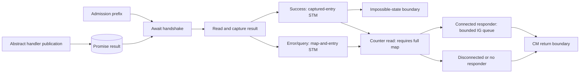

# Standalone connection-management model

This directory develops a source-derived CSP model of CM, IG, OG and Server
together. It is independent of `Cardano_network`, `GovernorWedge` and
`HotDemotion`.

The current executable layer covers **inbound admission and the CM handshake-result
consumer**, with map-lock and reference-preservation lemmas. It is not yet the
complete subsystem or a CSP process. Admission starts after accepted-socket
handoff. The consumer continues from an explicitly abstracted handler publication
to the CM return boundary, or an explicit impossible-state exception boundary.
The earlier admission-only witnesses remain available.

## Reading order

1. [DESIGN.md](DESIGN.md): target architecture, scenario, state design and gates.
2. [SourceLedger.md](SourceLedger.md): pinned source locations and coverage.
3. [Domain.agda](Domain.agda), [Store.agda](Store.agda), [State.agda](State.agda).
4. [CM primitives](Rules/CM.agda) and [admission prefix](Rules/Server.agda).
5. [Handshake consumer](Rules/Handshake.agda) and [handshake witnesses](Scenarios/Handshake.agda).
6. [Entry references](Properties/Entries.agda), [handshake preservation](Properties/Handshake.agda),
   [map-lock properties](Properties/MapLocks.agda),
   [admission witnesses](Scenarios/Admission.agda),
   [heap-rollback negative control](Negative/HeapRollback.agda), and
   [stale-handshake negative control](Negative/StaleHandshake.agda).

The [architecture review](../review/connection-management-architecture-review.md)
contains the seven source/runtime/semantic diagrams.

## Implemented behavior

- Distinct identity types; abstract address family/host/port; exact local/remote
  keys and unknown-local reservation keys.
- Source CM state constructors with separate handler and handle references.
- Nested remote/local map bindings separate from the mutable entry heap.
- Caller-owned map take, put and exception restoration; captured-entry writes
  can occur while the global map is taken.
- Source inbound-count projection and a separate hard-limit transaction.
- Fresh allocation, reserved/unnegotiated overwrite retaining entry identity,
  established-entry rejection, and fresh replacement of terminating/terminated
  entries.
- Separate promise allocation, entry commit, handler-fork record, map publication,
  post-publication counter read, and handshake-wait boundary.
- Rejection and modeled synchronous fork failure restore the map before closing
  the accepted socket. Previously committed entry writes are retained.

The handshake consumer additionally implements:

- Non-consuming promise reads, separate from the entry-update transaction.
- Every CM-state branch of the successful-result transaction, including explicit
  impossible-state outcomes and terminating/terminated disconnections.
- Error/query cleanup in one map-and-entry transaction, guarded by captured/current
  entry identity; a replacement binding and the old entry are both left untouched.
- A separate counter read followed by bounded IG notification in responder mode.
  The source queue depth is 100; a full queue retries. IG draining is not implemented.
- Explicit return continuations, with no automatic server closure or child cleanup.



`State` contains only resources used by these slices. Future IG/OG, protocol,
transport and supervision records are not represented by dummy fields. Worker
IDs supplied for the future handler are symbolic references for the source's lazy
`mfix` reference; recording the fork is separate from running the child. Handler
execution, handle/mux allocation, and evaluation of unresolved lazy references
after a failed fork are outside these slices, so fork-failure witnesses are not source-bug claims.

## Properties and witnesses

The general map-lock lemmas show that a taken map cannot be taken again, a
non-owner cannot put it, successful restoration preserves the current entry heap,
and a captured-entry write preserves map ownership. These are safety statements
about the primitives, not eventual-release or whole-system invariants.

Executable witnesses check admission through handshake wait, handler reference
publication, overwrite versus replacement, survival of old entries, exact-key
lookup without unknown-local fallback, established rejection, hard-limit rejection,
map-only restoration after a committed overwrite, and two callers retaining their
separate bindings. A second caller can block the first caller's counter read after
publication; this boundary is retained explicitly.

`Negative/HeapRollback.agda` intentionally restores the old heap as well as the
map and proves that it disagrees with correct restoration after a committed write.
It is a typechecking counterexample to a modeling shortcut, not a code defect.
`Negative/StaleHandshake.agda` similarly refutes deleting a replacement connection
by key alone when processing an old handshake result.

`MapReferences` expresses lookup validity through both levels of the connection
map, including unknown-local reservations. General lemmas show that entry overwrite
preserves all existing references, and every successful-result decision preserves
the map cell and any previously valid map references. These are local preservation
results, not a complete validity invariant for admission and cleanup.

Handshake witnesses cover normal admission-to-return, early publication before the
map is restored, non-consuming reads, duplicate-write exception outcomes, successful
entry commit under a competing map lock, blocked counters/error commits, source
error classification, full notification queues, and self-connection branches.
Replacement and self-connection state injections are **branch fixtures**, not
whole-source reachable race witnesses. The outbound-idle fixture preserves the
source distinction between the old flow stored in the entry and the negotiated flow
reported to IG. No source bug is claimed.

## Scope and fixture assumptions

- The network source pin is
  `96ee6e0e689770b5a3d664c59f2d13b05c5d9c4d`, from consensus
  `585a86117618ff86d7d5b541f9d23b03356d4c3a`.
- Fixtures have unique store keys, valid entry references, fresh identity supplies,
  distinct admission/child workers, and accepted sockets associated with their
  callers. The current witnesses meet these conditions; a general preservation
  invariant for the future combined machine is not proved.
- Association stores model exact lookup/update, not the source's ordered traversal
  or randomized remote-address selection. Those operations are not implemented.
- Addresses and exceptions have abstract carriers. Concrete source replay must
  instantiate valid addresses and admissible errors.
- `stepPrefix` and `stepHandshake` cover different continuations of the same state.
  There is no combined dispatcher yet. Keep `ResponderMode` fixed within a scenario.
  `publishBoundary` assumes the recorded child has reached `writePromise`; supplied
  handles and error classifications must be admissible source outcomes. Its success
  payload does not allocate or validate a mux/control bundle. It explicitly reports
  duplicate-write exceptions; neither those exceptions nor impossible-state outcomes
  have unwinding rules yet. It does not model `forcePromise`.
- Child execution/cleanup, IG consumption/registration, OG, timers, asynchronous
  exception delivery, general unwinding, server handling of CM returns, and
  accept-loop rate limiting remain absent. No enabled-step completeness,
  source refinement, deadlock, divergence, or liveness claim follows from it.
- `nothing` from a wrong-phase attempt means that attempt is unavailable. Helpers
  can also reject malformed fixture references/supplies; such results must not be
  interpreted as source blocking. The later explorer needs explicit validity and
  cutoff handling before reporting deadlocks.
- No capacity bounds are imposed on semantic identity allocation here. The finite
  explorer and cutoff handling described in the design are not implemented.
- No PTree renderer, machine/process correspondence, exporter, FDR search or Haskell
  replay has been added. The first combined lifecycle gate G2 is not complete.

## Validation

Run from the library root with Agda 2.8.0, one process at a time:

```sh
agda ConnectionManagement/State.agda
agda ConnectionManagement/Rules/Server.agda
agda ConnectionManagement/Scenarios/Admission.agda
agda ConnectionManagement/Negative/HeapRollback.agda
agda ConnectionManagement/Negative/StaleHandshake.agda
```

The negative-control endpoints import the admission/handshake witnesses and local
properties transitively. The new modules preserve `--guardedness` and contain no
postulates, holes or unsafe termination pragmas. This describes the local sources,
not a term-level audit of external dependencies. No existing network or historical
model was changed, and no heavy network proof rebuild is required.

Next: complete whole-state validity obligations and replace the handler-publication
boundary with allocation, mux execution, error/query timing and cleanup rules.
Then add IG batch/registration and outbound acquisition/OG workers under one
executable semantics before building the CSP rendering.
