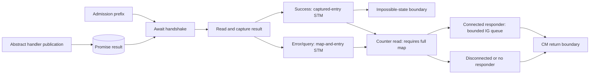
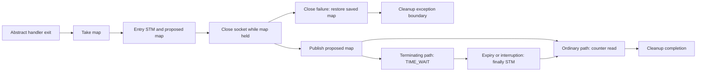

# Standalone connection-management model

This directory develops a source-derived CSP model of CM, IG, OG and Server
together. It is independent of `Cardano_network`, `GovernorWedge` and
`HotDemotion`.

The current model covers **inbound admission, the CM handshake-result consumer,
handler cleanup, and an initial IG registration prefix**, with a productive CSP interpretation, machine-wide lease
ownership and allocation-supply invariants, and local reference-preservation
lemmas. It is not yet the complete subsystem. Admission starts after accepted-socket
handoff. The consumer continues from an explicitly abstracted handler publication
to the CM return boundary, or an explicit impossible-state exception boundary.
Cleanup starts at a separate abstract handler-exit boundary and includes socket
close, map restoration, and the untimed TIME_WAIT finalizer. The earlier
admission-only witnesses remain available.

The [CSP layer](CSP/README.md) now supplies one dispatcher, raw and hidden processes,
machine/process trace correspondence, and concrete trace/refusal checks. The
subsystem remains open and partial; no source deadlock/liveness claim follows.

## Reading order

1. [DESIGN.md](DESIGN.md): target architecture, scenario, state design and gates.
2. [SourceLedger.md](SourceLedger.md): pinned source locations and coverage.
3. [Domain.agda](Domain.agda), [Store.agda](Store.agda), [State.agda](State.agda).
4. [CM primitives](Rules/CM.agda) and [admission prefix](Rules/Server.agda).
5. [Handshake consumer](Rules/Handshake.agda) and [handshake witnesses](Scenarios/Handshake.agda).
6. [Cleanup rules](Rules/Cleanup.agda), [cleanup witnesses](Scenarios/Cleanup.agda),
   [cleanup properties](Properties/Cleanup.agda), and
   [atomicity negative control](Negative/CleanupAtomicity.agda).
7. [Entry references](Properties/Entries.agda), [handshake preservation](Properties/Handshake.agda),
   [map-lock properties](Properties/MapLocks.agda),
   [admission witnesses](Scenarios/Admission.agda),
   [heap-rollback negative control](Negative/HeapRollback.agda), and
   [stale-handshake negative control](Negative/StaleHandshake.agda).

8. [Combined dispatcher](Machine.agda), [CSP guide](CSP/README.md),
   [renderer](CSP/Process.agda), [correspondence](CSP/Correspondence.agda),
   [hiding](CSP/Hiding.agda), and [CSP scenarios](CSP/Scenarios.agda).

The [architecture review](../review/connection-management-architecture-review.md)
contains the seven source/runtime/semantic diagrams. The subsequent
[progress review](../review/connection-management-progress-review.md) evaluates
the implemented coverage and prioritizes integrated IG/OG behavior over further
broad structural proofs.

The [information-channel kernel](Rules/InformationChannel.agda) provides FIFO
reads, whole-queue flush and capacity-100 writes, including atomic multi-message
bursts. The handshake enqueue uses this shared helper. The
[IG batch-selection kernel](Rules/IGBatch.agda) preserves ordered selection and
flush boundaries, with [executable checks](Scenarios/IGBatch.agda). Its general readiness
inputs remain parameters. The [first-batch IG prefix](IGRegistration.md) now
integrates queue draining and successful new-connection registration into the
machine/CSP process, specializing readiness to an initially empty registry.
The general IG loop, actual event union and mux/tracer runtime remain outstanding.

## Implemented behavior

- Distinct identity types; abstract address family/host/port; exact local/remote
  keys and unknown-local reservation keys.
- Source CM state constructors with separate handler and handle references.
- Nested remote/local map bindings separate from the mutable entry heap.
- Caller-owned map take, put and exception restoration; captured-entry writes
  can occur while the global map is taken.
- Source inbound-count projection and a separate hard-limit transaction.
- Fresh allocation, reserved/unnegotiated overwrite retaining entry identity,
  established-entry rejection, and fresh replacement of terminating/terminated
  entries.
- Separate promise allocation, entry commit, handler-fork record, map publication,
  post-publication counter read, and handshake-wait boundary.
- Rejection and modeled synchronous fork failure restore the map before closing
  the accepted socket. Previously committed entry writes are retained.

The handshake consumer additionally implements:

- Non-consuming promise reads, separate from the entry-update transaction.
- Every CM-state branch of the successful-result transaction, including explicit
  impossible-state outcomes and terminating/terminated disconnections.
- Error/query cleanup in one map-and-entry transaction, guarded by captured/current
  entry identity; a replacement binding and the old entry are both left untouched.
- A separate counter read followed by bounded IG notification in responder mode.
  The source queue depth is 100; a full queue retries. The first IG batch can drain it.
- Explicit return continuations, with no automatic server closure or child cleanup.



The cleanup slice preserves these source boundaries:



- Every entry-state constructor has a cleanup decision. Ordinary states become
  `Terminated Nothing`; already-terminated entries retain their stored error;
  terminating entries defer the write and purge until TIME_WAIT finishes.
- Map deletion checks **entry identity**. The captured entry can still be written
  when the map has a different replacement entry. Changing only its worker field
  does not change entry identity.
- The first heap write commits before socket close and map publication. A modeled
  close failure restores the saved map, retaining that write. Socket status becomes
  `closeUncertain`: a throwing close does not establish that the socket is closed.
- The finalizer's entry write and identity-guarded deletion are one STM operation.
  It uses the state captured before waiting. A taken map blocks the whole commit.
- TIME_WAIT expiry and interruption are explicit untimed environment events.
  Interruption still runs the finalizer and counter read before propagating its error.
- Cleanup neither fills a handshake promise nor removes its stored result. Once
  cleanup begins, the abstract publication boundary rejects later body publication.

`State` contains the CM resources and shared queue; `Configuration` additionally
contains the IG runtime. Future OG, protocol,
transport and supervision records are not represented by dummy fields. Worker
IDs supplied for the future handler are symbolic references for the source's lazy
`mfix` reference; recording the fork is separate from running the child. Handler
body execution, handle/mux allocation, and evaluation of unresolved lazy references
after a failed fork are outside these slices, so fork-failure witnesses are not source-bug claims.

## Properties and witnesses

The general map-lock lemmas show that a taken map cannot be taken again, a
non-owner cannot put it, successful restoration preserves the current entry heap,
and a captured-entry write preserves map ownership. These are safety statements
about the primitives, not eventual-release or whole-system invariants.

Executable witnesses check admission through handshake wait, handler reference
publication, overwrite versus replacement, survival of old entries, exact-key
lookup without unknown-local fallback, established rejection, hard-limit rejection,
map-only restoration after a committed overwrite, and two callers retaining their
separate bindings. A second caller can block the first caller's counter read after
publication; this boundary is retained explicitly.

`Negative/HeapRollback.agda` intentionally restores the old heap as well as the
map and proves that it disagrees with correct restoration after a committed write.
It is a typechecking counterexample to a modeling shortcut, not a code defect.
`Negative/StaleHandshake.agda` similarly refutes deleting a replacement connection
by key alone when processing an old handshake result.

`MapReferences` expresses lookup validity through both levels of the connection
map, including unknown-local reservations. General lemmas show that entry overwrite
preserves all existing references, and every successful-result decision preserves
the map cell and any previously valid map references. These are local preservation
results, not a complete validity invariant for admission and cleanup.

Handshake witnesses cover normal admission-to-return, early publication before the
map is restored, non-consuming reads, duplicate-write exception outcomes, successful
entry commit under a competing map lock, blocked counters/error commits, source
error classification, full notification queues, and self-connection branches.
Replacement and self-connection state injections are **branch fixtures**, not
whole-source reachable race witnesses. The outbound-idle fixture preserves the
source distinction between the old flow stored in the entry and the negotiated flow
reported to IG. No source bug is claimed.

Cleanup witnesses compose with admission and result consumption to cover competing
map ownership, close-before-publication, both sides of the cleanup/result race,
interrupted TIME_WAIT, and failed-close restoration. Direct fixtures test replacement
entry protection, same-entry worker changes, and the captured-state decision after
another actor changes an entry. These injections are not source-reachability claims.
`Negative/CleanupAtomicity.agda` refutes exposing the finalizer's entry write before
it can acquire the map. General lemmas establish identity-guarded purge, preservation
of the map cell and existing references during selection, and atomic blocking of
the finalizer. None proves eventual completion.

## Counter validity before interpreting refusals

[Properties/Counters.agda](Properties/Counters.agda) proves that
`countIncoming heap map` succeeds exactly when every stored map binding refers
to an existing heap entry. The structural predicate `CounterReferences` includes
both map levels and unknown-local keys. It implies the earlier lookup-based
`MapReferences` property and is preserved by entry updates. At an admission
`countPublished` continuation, a valid full map enables the counter step; a taken
map blocks it. Worker lookup remains a separate premise of the dispatcher.

[Properties/CounterState.agda](Properties/CounterState.agda) collects the full map,
admission leases, cleanup leases, and proposed cleanup maps. `CounterStateValid`
checks all these maps against the current heap, including while the global map
is taken. It is a reference-validity obligation, **not** a whole-state validity or
machine-preservation theorem. Unique keys, fresh supplies, ownership, other
references, and reachability still need separate obligations.

[Negative/CounterValidity.agda](Negative/CounterValidity.agda) checks initial,
handshake-wait, committed-result, cleanup and map-held snapshots. Its malformed
fixtures demonstrate two distinct hazards: a duplicate remote key can hide a
bucket from lookup while counter traversal still visits it; and a dangling
reference can produce a raw CSP singleton refusal even with a full map. A dangling
saved map is also rejected when the global cell is taken. These are negative
controls for model validity, not reachable source defects or global deadlocks.

## Store uniqueness and allocation freshness

[Properties/Stores.agda](Properties/Stores.agda) uses the standard library's
`AllPairs` to express unique store keys. Local `put` and `delete` preserve this
property and predicates on retained keys/values. Under uniqueness, properties of
all successful lookups hold for every stored binding.

[Properties/MapUniqueness.agda](Properties/MapUniqueness.agda) requires unique
remote keys and unique local keys in each bucket. Both `insertLocal` and
`deleteConnection` preserve this nested property. With it, the earlier
`MapReferences` predicate implies `CounterReferences`, closing the gap exposed
by the shadowed-bucket counterexample. Distinct keys may still alias an entry;
key uniqueness is not unique ownership of heap entries.

[Properties/Freshness.agda](Properties/Freshness.agda) bounds every stored ID's
serial strictly below the next supply. This proves the next ID is absent, and
allocation followed by supply increment preserves the bound. Applied to
`freshInbound`, unique heap keys and this bound guarantee a successful allocation
whose heap remains unique and bounded. The generic lemmas apply to typed ID
stores. The reachable allocation-bound proof below covers promise allocation and
the complete current dispatcher; whole-machine uniqueness is still separate.

[Negative/Freshness.agda](Negative/Freshness.agda) checks a unique heap containing
a future ID: the current ID is unused and one allocation succeeds, but the next
allocation collides. This rejects next-ID absence as a sufficient inductive
invariant. It also checks the maintained singleton map/heap premises and proves
the shadowed-map fixture violates uniqueness. These are model-validity controls,
not source defect claims.

## Reachable allocation bounds

[Properties/SupplyBounds.agda](Properties/SupplyBounds.agda) defines `SupplyBounds`:
every heap entry ID is strictly below `nextEntry`, and every allocated promise ID
is strictly below `nextPromise`. It proves that guarded entry updates preserve the
bound, fresh allocation advances it, and prepending a newly allocated promise
preserves the incremented promise bound.

[Properties/SupplyInvariant.agda](Properties/SupplyInvariant.agda) proves
preservation by **every `Machine.advance` action**, arbitrary finite executions,
and successful replay. It uses the
[admission](Properties/SupplyAdmission.agda),
[cleanup](Properties/SupplyCleanup.agda), and
[handshake](Properties/SupplyHandshake.agda) rule-family proofs. The only state
premise is initial `SupplyBounds`; ownership, unique keys and reference validity
are not assumed. Each potentially writing entry operation uses its actual
successful lookup, including cleanup selection, error-result handling and
TIME_WAIT finalization.

[CSP/SupplyInvariant.agda](CSP/SupplyInvariant.agda) transfers the invariant to
arbitrary finite raw CSP executions/traces, recovering bounded machine endpoints
without assuming renderer injectivity.
[Scenarios/SupplyInvariant.agda](Scenarios/SupplyInvariant.agda) establishes it
from the accepted-socket start, checks the existing race, lock and duplicate-write
paths, and proves both next IDs unused at every reachable state. The earlier
future-entry collision fixture is unreachable from that start.

These bounds concern entry and allocated-promise identities only. They do not
exclude duplicates already present in an arbitrary initial store/list, validate
references, bound worker/handle IDs, impose finite explorer capacities, or prove
whole-state validity or source correspondence. Remaining store-uniqueness and
reference-preservation obligations are separate.

## Exclusive map ownership

[Properties/Ownership.agda](Properties/Ownership.agda) collects lease claims from
all stored admission and cleanup continuations. `Ownership` requires no claim
when the map is full, and exactly one claim when it is taken. That claimant's
worker must equal both the map owner and the captured lease owner. This rejects
orphaned locks, duplicate claims (even for the same worker), and stale leases
retained after publication. It does not certify saved-map contents, socket
ownership, fresh IDs, or other references.

[Properties/OwnershipSteps.agda](Properties/OwnershipSteps.agda) proves preservation
through the **actual `Machine.advance` dispatcher** for `closeHandlerSocket` and
`failSocketClose`. These operations change socket status and cleanup continuation
while retaining the same lease. The proof handles handler/continuation lookup and
all disabled phase combinations, rather than assuming the intended branch ran.
The projection lemma works for the local store's first-match update; it does not
need unique store keys.

[Properties/OwnershipCensus.agda](Properties/OwnershipCensus.agda) proves the
list-context facts for adding a claim to an empty census and removing the sole
claim from a singleton census. [OwnershipMapSteps](Properties/OwnershipMapSteps.agda)
uses them for admission and cleanup continuation changes and the actual CM
`takeMap`/`putMap` outcomes. No uniqueness premise is added to these ownership
proofs; reference validity and store uniqueness remain separate obligations.

[Properties/OwnershipMapDispatcher.agda](Properties/OwnershipMapDispatcher.agda)
covers the six map-changing action families through `Machine.advance`: admission
`take`, `putMapBack`, `restore`, and cleanup `takeCleanupMap`, `publishCleanupMap`,
`restoreCleanupMap`. Coverage includes hard-limit publication, forbidden/fork-failed
restoration, and both counter and TIME_WAIT publication tails. Disabled phase
combinations are inverted explicitly.

[Properties/OwnershipInvariant.agda](Properties/OwnershipInvariant.agda) now
proves `advance-preserves` for **every action** of the current dispatcher, followed
by `exec-preserves` for arbitrary finite executions and `replay-preserves` for
successful replay. Its sole state premise is `Ownership` of the initial world;
there is no restriction to a selected action set or schedule. Supporting modules
[OwnershipNeutral](Properties/OwnershipNeutral.agda),
[OwnershipAdmission](Properties/OwnershipAdmission.agda),
[OwnershipCleanup](Properties/OwnershipCleanup.agda), and
[OwnershipHandshake](Properties/OwnershipHandshake.agda) cover the remaining
branches. Handler publication/exit retain their existing abstract-boundary semantics.

[CSP/Ownership.agda](CSP/Ownership.agda) retains the narrower action-family lemmas.
[CSP/OwnershipInvariant.agda](CSP/OwnershipInvariant.agda) transfers the complete
invariant to arbitrary finite raw CSP executions and traces. It recovers an owned
machine endpoint and a corresponding action sequence, without assuming that the
renderer is injective. These are safety statements about the current partial
machine. They do not prove eventual release, whole-state validity, source
refinement, or hidden-process liveness/divergence freedom.

[Negative/Ownership.agda](Negative/Ownership.agda) checks initial and handshake-wait
snapshots and both socket-close outcomes. Its negative controls reject a taken map
without a claimant, a full map with a retained lease, duplicate claimants, and a
mismatched lease owner. These are malformed-fixture controls, not source defects.
[Scenarios/MapOwnership.agda](Scenarios/MapOwnership.agda) checks enabled steps
and ownership at both endpoints for each map action, including hard-limit,
forbidden, fork-failure, TIME_WAIT and failed-close restoration branches. These
are local snapshots; source reachability is not established.
[Scenarios/OwnershipInvariant.agda](Scenarios/OwnershipInvariant.agda) instantiates
the invariant at the accepted-socket start state for every finite execution. It
applies to the two existing cleanup/result race paths, the map-lock refusal path,
and the duplicate-publication path. The four malformed ownership fixtures are
proved unreachable from that start state for every finite action sequence. This
is model unreachability, not a claim about Haskell source reachability or equality
of rendered processes.

## Scope and fixture assumptions

- The network source pin is
  `96ee6e0e689770b5a3d664c59f2d13b05c5d9c4d`, from consensus
  `585a86117618ff86d7d5b541f9d23b03356d4c3a`.
- Fixtures have unique store keys, valid entry references, fresh identity supplies,
  distinct admission/child workers, and accepted sockets associated with their
  callers. The current witnesses meet these conditions; a general preservation
  invariant for the future combined machine is not proved.
- Association stores model exact lookup/update, not the source's ordered traversal
  or randomized remote-address selection. Those operations are not implemented.
- Addresses and exceptions have abstract carriers. Concrete source replay must
  instantiate valid addresses and admissible errors.
- `Machine.advance` dispatches admission, handshake, cleanup and initial IG steps,
  with responder mode fixed in its configuration. The CSP process directly uses
  this dispatcher. The raw view exposes diagnostic scheduling labels; a separate
  view hides selected internal operations using the library's CSP operator.
  `publishBoundary` assumes the recorded child has reached `writePromise`; supplied
  handles and error classifications must be admissible source outcomes. Its success
  payload does not allocate or validate a mux/control bundle. It explicitly reports
  duplicate-write exceptions; neither those exceptions nor impossible-state outcomes
  have unwinding rules yet. It does not model `forcePromise`.
- `beginCleanupBoundary` assumes the registered handler body has exited, normally
  or exceptionally. The body outcome and its rethrow policy are not modeled;
  `cleanupDone cleanupNormal` describes the finalizer, not successful body execution.
  Ordinary tracing is assumed total/nonblocking; counter-read transactions remain
  explicit. Close outcomes are supplied by the environment. General tracer/IO
  exceptions, asynchronous delivery outside TIME_WAIT, and masking semantics are
  still outside the model. The cleanup continuation and lease must match the worker.
- IG registration is conditional on the successful responder-start contract in
  [IGRegistration.md](IGRegistration.md). Subsequent batches, the full event union,
  startup failure and mux/tracer behavior remain absent.
- Handler body execution, OG, timed scheduling, general
  asynchronous exception delivery/unwinding, server handling of CM returns, and
  accept-loop rate limiting remain absent. No enabled-step completeness,
  source refinement, deadlock, divergence, or liveness claim follows from it.
- `nothing` from a wrong-phase attempt means that attempt is unavailable. Helpers
  can also reject malformed fixture references/supplies; such results must not be
  interpreted as source blocking. The later explorer needs explicit validity and
  cutoff handling before reporting deadlocks.
- No capacity bounds are imposed on semantic identity allocation here. The finite
  explorer and cutoff handling described in the design are not implemented.
- Raw step/finite-trace correspondence is proved between the machine and its
  `PTree` rendering. This is not source correspondence or equivalence with a
  separate parallel architecture. No exporter, FDR search, Haskell replay or
  hidden-process divergence proof has been added. G2 is not complete.
- `CSP.Scope` reports selected incomplete continuations without adding tick or
  self-loop events. An empty offer set in this partial process is not evidence of
  a source deadlock. Absence of a scope diagnostic does not establish completeness.

## Validation

Run from the library root with Agda 2.8.0, one process at a time:

```sh
agda ConnectionManagement/State.agda
agda ConnectionManagement/Rules/Server.agda
agda ConnectionManagement/Scenarios/Admission.agda
agda ConnectionManagement/Negative/HeapRollback.agda
agda ConnectionManagement/Negative/StaleHandshake.agda
agda ConnectionManagement/Negative/CleanupAtomicity.agda
agda ConnectionManagement/Negative/CounterValidity.agda +RTS -M2G -RTS
agda ConnectionManagement/Negative/Freshness.agda +RTS -M2G -RTS
agda ConnectionManagement/Negative/Ownership.agda +RTS -M2G -RTS
agda ConnectionManagement/Scenarios/MapOwnership.agda +RTS -M2G -RTS
agda ConnectionManagement/Scenarios/OwnershipInvariant.agda +RTS -M2G -RTS
agda ConnectionManagement/Scenarios/SupplyInvariant.agda +RTS -M2G -RTS
agda ConnectionManagement/Scenarios/IGBatch.agda +RTS -M2G -RTS
agda ConnectionManagement/CSP/IGRegistration.agda +RTS -M2G -RTS
agda ConnectionManagement/CSP/Scenarios.agda +RTS -M2G -RTS
```

The negative-control endpoints import the admission/handshake witnesses and local
properties transitively, including cleanup. The new modules preserve
`--guardedness` and contain no
postulates, holes or unsafe termination pragmas. This describes the local sources,
not a term-level audit of external dependencies. No existing network or historical
model was changed, and no heavy network proof rebuild is required.

Next: extend the first-batch IG prefix with the actual event union and mux/tracer
runtime, determining responder-start outcomes from modeled state. Preserve atomic
tracer queue/counter effects and derive readiness for subsequent batches. Then add
inbound release and outbound acquisition/OG jobs. Keep the existing invariants as
regression checks; full reference/store validity remains an obligation. Strengthen
the observation alphabet and add bounded exploration/source replay before reporting
source defects or full-system refinement/failures/divergence claims.
