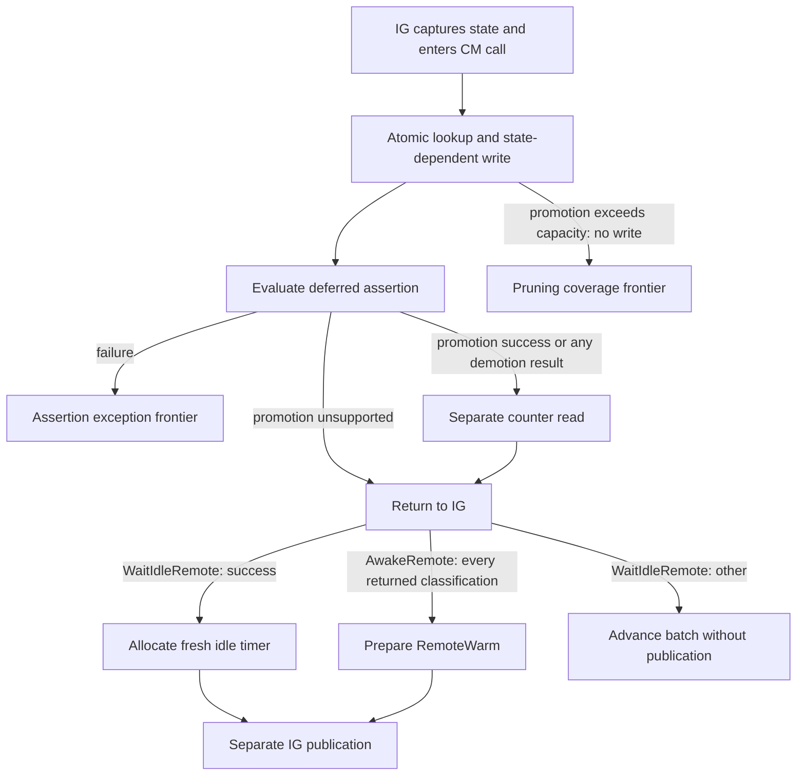

# IG remote promotion and demotion

`Rules/RemoteState.agda` implements `AwakeRemote` and `WaitIdleRemote` CM calls,
with promotion pruning left as an explicit coverage frontier. The authority is
network revision `96ee6e0e689770b5a3d664c59f2d13b05c5d9c4d`:
[promotion](https://github.com/IntersectMBO/ouroboros-network/blob/96ee6e0e689770b5a3d664c59f2d13b05c5d9c4d/ouroboros-network/framework/lib/Ouroboros/Network/ConnectionManager/Core.hs#L2061-L2252),
[demotion](https://github.com/IntersectMBO/ouroboros-network/blob/96ee6e0e689770b5a3d664c59f2d13b05c5d9c4d/ouroboros-network/framework/lib/Ouroboros/Network/ConnectionManager/Core.hs#L2253-L2355),
and [IG callers](https://github.com/IntersectMBO/ouroboros-network/blob/96ee6e0e689770b5a3d664c59f2d13b05c5d9c4d/ouroboros-network/framework/lib/Ouroboros/Network/InboundGovernor.hs#L464-L518).
Assertions are enabled; diagnostic tracers are total/nonblocking. The idle timeout
is enabled in this profile, with readiness supplied by an untimed expiry input.

## Mapping

| Current CM state | Promotion | Demotion |
| --- | --- | --- |
| Missing binding | Unsupported unknown | Unsupported unknown |
| Reserved, unnegotiated, outbound uni | Unsupported, deferred assertion | Unsupported, deferred assertion |
| Outbound duplex, either timeout flag | Duplex active, subject to capacity | Success unchanged |
| Outbound idle duplex | Inbound active duplex, subject to capacity | Success unchanged |
| Outbound idle unidirectional | Unsupported | Success unchanged |
| Inbound idle | Inbound active, preserving data flow | Success unchanged |
| Inbound active | Success unchanged, deferred assertion | Inbound idle, preserving data flow |
| Duplex active | Success unchanged | Outbound duplex ticking |
| Terminating or terminated | Unsupported | TerminatedConnection |

Writes use the requested connection key and preserve worker/handle identities.
Lookup and optional write are a single machine event. The stored result retains
the old concrete state; the source returns its abstract-state projection. This
internal representation is not a claim of API-alphabet equivalence.



A taken map blocks both the initial transaction and a later counter read. Assertion
failure prevents the counter read; already committed writes are not rolled back.
Promotion unsupported results can return without a counter read even when the map
has since been taken. Demotion unsupported and TerminatedConnection results must
still read counters before return. The source masks promotion but not demotion;
general asynchronous delivery and masking remain outside this model.

IG always prepares RemoteWarm after a returning promotion call. Successful demotion
enters `awaitRemoteIdle`; `registerIdleTimer` allocates the timer and prepares the
captured-state RemoteIdle update, then `commitDecision` publishes it. Other demotion
results advance the cursor without timer allocation or publication. Pending CM
calls prevent batch advancement. The shared `inCM` continuation does not spawn a
separate CM thread: these are caller-run operations in the authoritative dispatcher.

## Capacity and pruning boundary

Only outbound-duplex and outbound-idle-duplex promotion perform the capacity test.
They count current inbound entries and require `count + 1 ≤ promotionHardLimit`.
The machine configuration defaults this limit to 10, matching the ordinary
admission fixtures. This is a model profile, not a production default. Scenario
builders must keep admission request limits consistent with it; a global policy-
consistency invariant is not yet proved. All machine transitions preserve the
configuration field.

When the test fails, the model enters `requiresPruning` without modifying the
world, and `CSP.Scope.remoteFrontier` reports `promotionPruning`. This diagnostic
transition marks missing coverage; it is not a source STM commit or a waiting
condition that can be interpreted as a source deadlock.

The [source pruning helper](https://github.com/IntersectMBO/ouroboros-network/blob/96ee6e0e689770b5a3d664c59f2d13b05c5d9c4d/ouroboros-network/framework/lib/Ouroboros/Network/ConnectionManager/Core.hs#L720-L777)
builds an inbound candidate map including the prospective connection, splits the
random generator, invokes the configured pruning policy, and atomically writes
selected entries to Terminated. It writes the prospective promoted state only if
that connection was not selected. Afterward it delivers cancellations in map order
before the counter read. No arbitrary victim choice or successful promotion is
substituted for this missing behavior. Implementing the pinned policy, generator
semantics and cancellation sequence is the next slice.

## Evidence and limits

`CSP/RemoteState.agda` composes a raw CSP trace from accepted-socket admission,
registration and actual mux startup through AwakeRemote promotion and the following
hot event. It also supplies a hidden promotion trace. Demotion currently uses an
explicitly injected WaitIdleRemote fixture after that promotion; its trace is not
claimed to compose from responder completion yet.

Checks cover CM/IG publication separation, fresh idle-timer allocation, unsupported
promotion return while the map is taken, terminated demotion counter blocking,
assertion failure, and the exact-capacity versus pruning-required boundary. Existing
ownership and allocation-supply theorem statements remain unchanged and cover every
new action using the existing entry-edit preservation lemma and CSP lifts.

```sh
agda ConnectionManagement/CSP/RemoteState.agda +RTS -M2G -RTS
```

These are proofs about the partial Agda machine, not Haskell refinement, bounded
exploration, universal liveness or a source-code defect. Pruning, complete handler
unwinding, OG and source replay remain outstanding.
