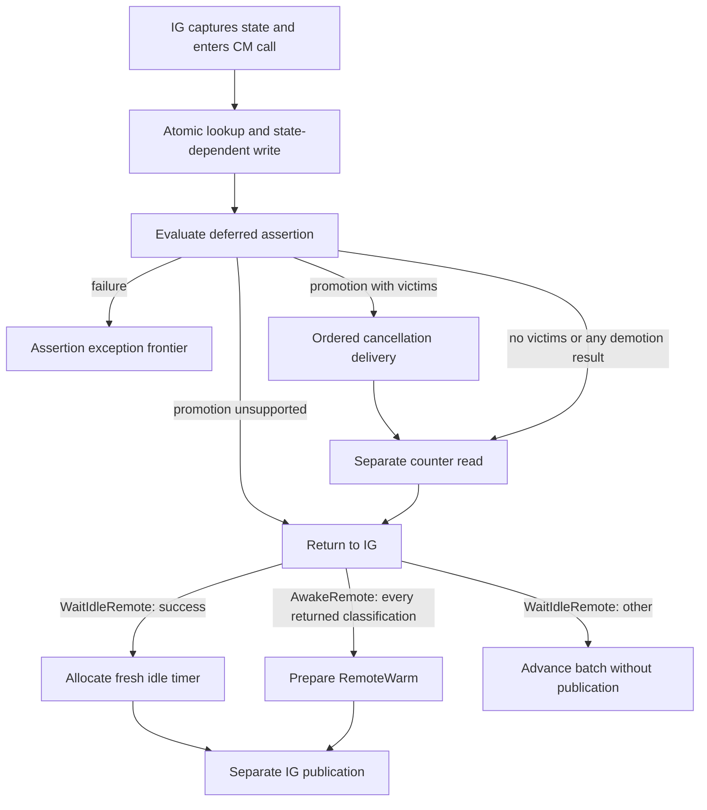

# IG remote promotion and demotion

`Rules/RemoteState.agda` implements `AwakeRemote` and `WaitIdleRemote` CM calls,
including over-limit promotion with [policy-driven pruning](Pruning.md). The authority is
network revision `96ee6e0e689770b5a3d664c59f2d13b05c5d9c4d`:
[promotion](https://github.com/IntersectMBO/ouroboros-network/blob/96ee6e0e689770b5a3d664c59f2d13b05c5d9c4d/ouroboros-network/framework/lib/Ouroboros/Network/ConnectionManager/Core.hs#L2061-L2252),
[demotion](https://github.com/IntersectMBO/ouroboros-network/blob/96ee6e0e689770b5a3d664c59f2d13b05c5d9c4d/ouroboros-network/framework/lib/Ouroboros/Network/ConnectionManager/Core.hs#L2253-L2355),
and [IG callers](https://github.com/IntersectMBO/ouroboros-network/blob/96ee6e0e689770b5a3d664c59f2d13b05c5d9c4d/ouroboros-network/framework/lib/Ouroboros/Network/InboundGovernor.hs#L463-L513).
Assertions are enabled; diagnostic tracers are total/nonblocking. The idle timeout
is enabled in this profile, with readiness supplied by an untimed expiry input.

## Mapping

| Current CM state | Promotion | Demotion |
| --- | --- | --- |
| Missing binding | Unsupported unknown | Unsupported unknown |
| Reserved, unnegotiated, outbound uni | Unsupported, deferred assertion | Unsupported, deferred assertion |
| Outbound duplex, either timeout flag | Duplex active, subject to capacity | Success unchanged |
| Outbound idle duplex | Inbound active duplex, subject to capacity | Success unchanged |
| Outbound idle unidirectional | Unsupported | Success unchanged |
| Inbound idle | Inbound active, preserving data flow | Success unchanged |
| Inbound active | Success unchanged, deferred assertion | Inbound idle, preserving data flow |
| Duplex active | Success unchanged | Outbound duplex ticking |
| Terminating or terminated | Unsupported | TerminatedConnection |

Writes use the requested connection key and preserve worker/handle identities.
Lookup and optional write are a single machine event. The stored result retains
the old concrete state; the source returns its abstract-state projection. This
internal representation is not a claim of API-alphabet equivalence.



A taken map blocks both the initial transaction and a later counter read. Assertion
failure prevents the counter read; already committed writes are not rolled back.
Promotion unsupported results can return without a counter read even when the map
has since been taken. Demotion unsupported and TerminatedConnection results must
still read counters before return. The source masks promotion but not demotion;
the separate [ServerIGExit](ServerIGExit.agda) adapter adds selected blocked
promotion-read/send receipts and unmasked demotion boundaries. Exact interrupted
frames and committed entry writes survive in the appropriate archive/shared
state, while the local call cursor is retired. General asynchronous delivery and
masking remain outside this selected profile.

IG always prepares RemoteWarm after a returning promotion call. Successful demotion
enters `awaitRemoteIdle`; `registerIdleTimer` allocates the timer and prepares the
captured-state RemoteIdle update, then `commitDecision` publishes it. Other demotion
results advance the cursor without timer allocation or publication. Pending CM
calls prevent batch advancement. The shared `inCM` continuation does not spawn a
separate CM thread: these are caller-run operations in the authoritative dispatcher.

## Capacity and pruning

Only outbound-duplex and outbound-idle-duplex promotion perform the capacity test.
They count current inbound entries and require `count + 1 ≤ promotionHardLimit`.
The machine configuration defaults this limit to 10, matching the ordinary
admission fixtures. This is a model profile, not a production default. Scenario
builders must keep admission request limits consistent with it; a global policy-
consistency invariant is not yet proved. All machine transitions preserve the
configuration field.

When the test fails, `transactPruning generation scores` constructs and scores
candidates, atomically marks victims Terminated and promotes only a surviving
self. The caller then checks assertions, delivers captured cancellations in key
order, reads counters and returns. See [Pruning.md](Pruning.md) for the pinned
policy, the score/generation abstraction and both source promotion branches.
No pruning frontier remains; a plain unscored `transact` is unavailable for an
over-limit call. The scored transaction is the enabled alternative.

## Evidence and limits

`CSP/RemoteState.agda` composes a raw CSP trace from accepted-socket admission,
registration and actual mux startup through AwakeRemote promotion and the following
hot event. It also supplies a hidden promotion trace. Demotion currently uses an
explicitly injected WaitIdleRemote fixture after that promotion; its trace is not
claimed to compose from responder completion yet.

The newer [ServerIGExitProtocolPrefix](Negative/ServerIGExitProtocolPrefix.agda)
does compose demotion from the real wrapper initializer, admission/handshake,
registration, mux startup, on-demand notifications, promotion and physical
responder completion. It consumes the resulting monitor notifications, including
the explicit DeltaQ callback boundary. Its cancellation suffix interrupts before
IG publishes the demotion decision: CM retains Idle while final tracing reads the
published Warm state. This extends the initialized evidence, without changing the
older CSP witness. See [Supervision increment 21](Supervision.md#twenty-first-increment-pending-ig-calls-and-nonempty-exit).

Checks cover CM/IG publication separation, fresh idle-timer allocation, unsupported
promotion return while the map is taken, terminated demotion counter blocking,
assertion failure, and exact-capacity versus scored-pruning transactions. Existing
ownership and allocation-supply theorem statements remain unchanged and cover every
new action using the existing entry-edit preservation lemma and CSP lifts.

```sh
agda ConnectionManagement/CSP/RemoteState.agda +RTS -M2G -RTS
```

These are proofs about the partial Agda machine, not Haskell refinement, bounded
exploration, universal liveness or a source-code defect. Concrete PRNG replay, complete handler
unwinding, OG and source replay remain outstanding.
