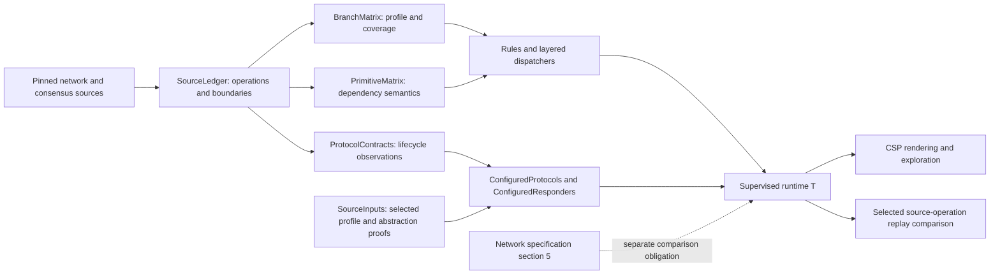
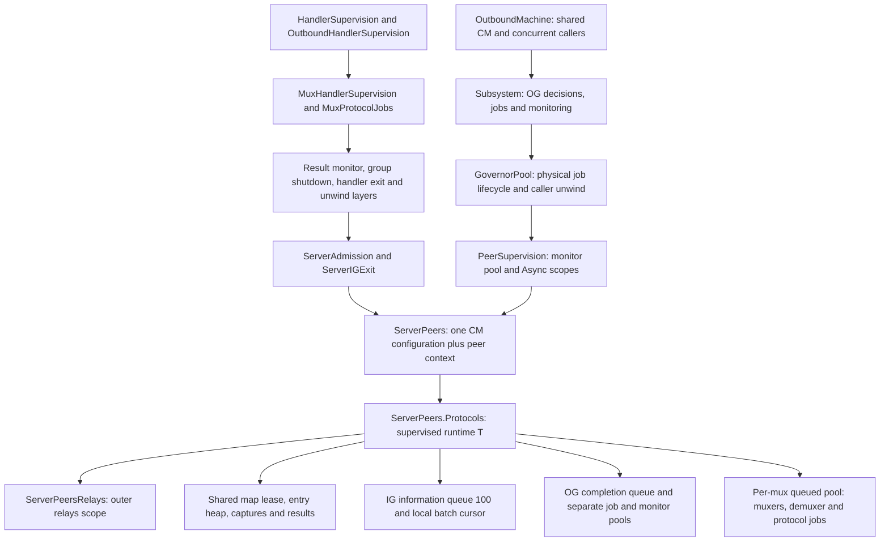
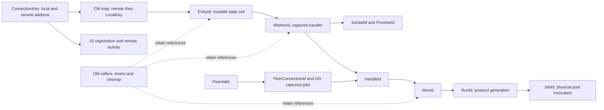
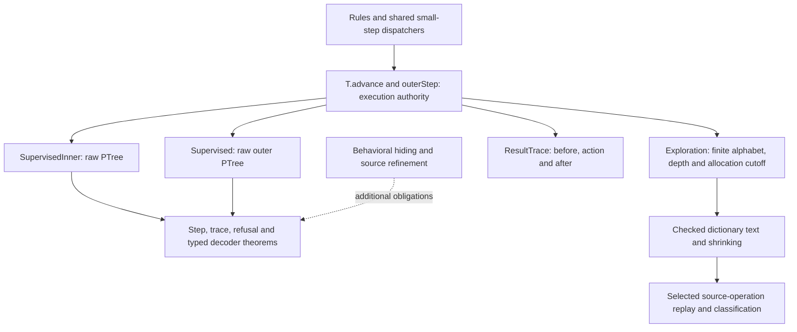
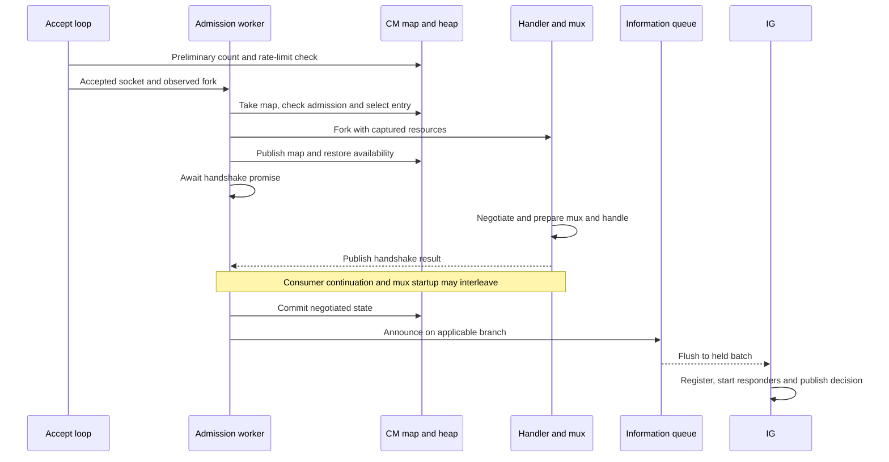
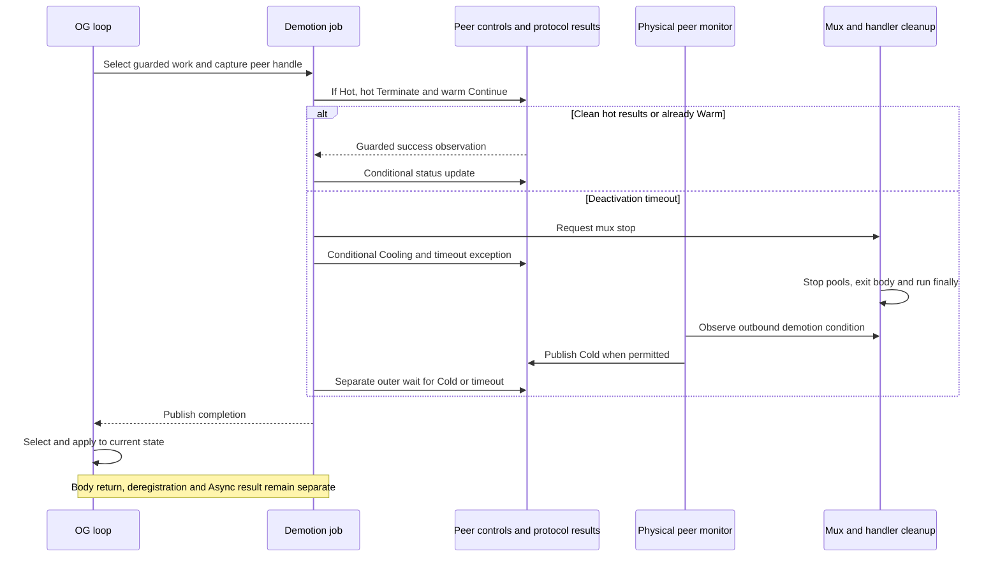
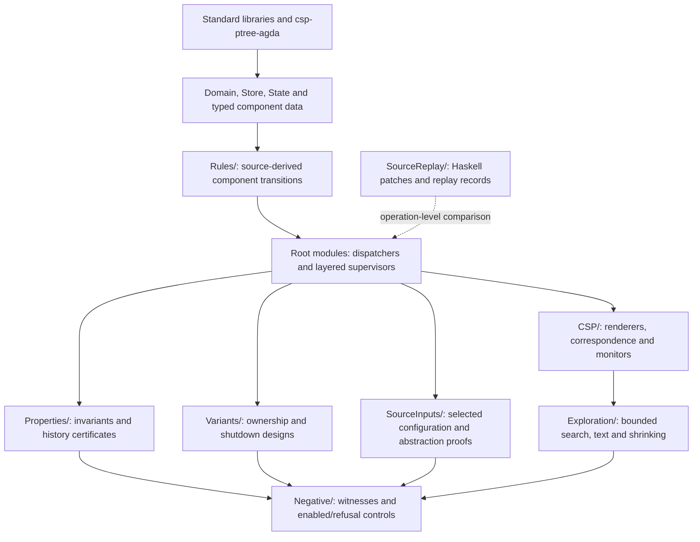

# CM, IG, OG and Server: updated architecture review

**16 November 2026 — implemented architecture and its evidence boundaries**

This updates the [October design review](connection-management-architecture-review.md)
for network `2f1c154f248659b89523d5679ca532f442e7ed2a`, pinned by consensus
`2e44d98a843168ba3b189e305820b79943ac7d1e`. These are fixed source authorities,
not a statement about current upstream heads. The [source ledger](../ConnectionManagement/SourceLedger.md)
and [migration profile](../ConnectionManagement/MigrationProfile.md) distinguish
the promoted baseline from historical evidence at network `96ee6e0` / consensus
`585a861`. CM Core, IG, Server and JobPool are unchanged between the network pins;
changed handler, mux, diffusion, governor and DB contracts were reconciled during
migration. Unchanged source alone does not revalidate an old replay.

The scope remains a standalone combined connection-management subsystem,
independent of `Cardano_network`, `GovernorWedge` and `HotDemotion`. This review
reads current module headers, dispatcher interfaces and evidence records. It
performs no Agda checks, native replay, builds or git commands.

The [17 November disparity review](#11-model-source-and-proof-disparities) checks
this account against the committed definitions, theorem statements, pinned
source and prototype. Its validation is recorded separately.

## 1. Review result and corrections

October's proposed small-step architecture is implemented. Modular rules now
cover admission, inbound and outbound CM calls, IG batches, ordinary-peer OG,
physical jobs and handlers, mux operation and layered shutdown. Productive CSP
renderings and bounded exploration interpret the same executable transitions.
The [gate audit](../ConnectionManagement/GateAudit.md) records G0–G5 as met at
their declared profile, semantic and finite-exploration scopes.

| October concern | Current architecture and correction |
| --- | --- |
| CM must execute on callers' stacks | Admission workers, peer jobs/monitors and IG retain their own CM continuations over shared state. There is no CM service thread or request queue. |
| IO map ownership must differ from STM | Map take/body/put/restoration, atomic entry transactions and captured references are explicit. Restoring a saved map preserves committed heap changes and already-forked children. |
| OG and handler supervision were proposed | Separate governor and peer-monitor pools, physical protocol jobs, handler results, Server/IG exit and outer relays are implemented. Completion publication, deregistration and Async availability are different events. |
| Trace correspondence was insufficient | Full raw supervised step/trace, stable-refusal and typed-decoder theorems now exist. Hidden behavioral divergence and Haskell refinement remain separate obligations. |
| The initial slice and bundle were plans | Initialized lifecycle/concurrency witnesses and six-protocol inbound/outbound contract wrappers now exist, including KeepAlive `StartOnDemandAny`. Source-input modules instantiate or justify abstraction of the selected finite profile. |
| Shutdown and resource bounds needed precision | SI5 certifies a reached shutdown endpoint for collected handlers. Late admission and detached/self-purged handlers expose its coverage boundary; ownership/registry variants address endpoint safety. Search cutoff is distinct from source blocking. |

The implementation also adds checked trace transport/shrinking, classified
source-operation replays and an isolated Haskell ownership/registry prototype.
These additions do not establish universal shutdown progress or complete
source-to-CSP refinement. Some introductory documents retain dated “next slice”
language; current definitions and later acceptance records determine implemented
scope.

## 2. Diagram A — source-to-model mapping

| Mapping document | Responsibility and current accounting |
| --- | --- |
| [SourceLedger](../ConnectionManagement/SourceLedger.md) | Source operation, caller, transaction/IO boundary, captures and exceptions. Its original expanded/family labels are historical design classifications. |
| [BranchMatrix](../ConnectionManagement/BranchMatrix.md) | All 49 original ledger families plus split/additional branches: **99 rows, 67 implemented, 19 contracted, 13 excluded, zero missing**. Implemented means a selected rule has a fixture or theorem; it does not mean every branch has an initialized whole-system execution. |
| [PrimitiveMatrix](../ConnectionManagement/PrimitiveMatrix.md) | **90/90 selected primitive rows** have rules and paired enabled/refusal controls: locks, promises, queues, fork/registration, cancellation, masking, timers and result observation. Supplied blocking/IO observations remain contracts. |
| [ProtocolContracts](../ConnectionManagement/ProtocolContracts.md) | Three executable lifecycle kernels for CS/BF/shared registration, TxSubmission2/KeepAlive, and Notify/Fetch/shared Leios resources. Ordering guards are implemented; payload, driver, DB and private-resource operations retain reviewed contracts. These rows remain contracted in the branch inventory. |

The selected `LocalLifecycle` profile begins after infrastructure setup: empty
CM, one listener, two ordinary known peers and known/established/active targets
2/2/1. Hot protocols are ChainSync 2, BlockFetch 3, TxSubmission2 4, LeiosNotify
18 and LeiosFetch 19; warm is empty; established is KeepAlive 8. Initiators start
eagerly; responders retain descriptor demand/grouped-Any behavior. Peras,
PeerSharing, roots, discovery, churn and big-ledger policy are outside this profile.

[SourceInputs](../ConnectionManagement/SourceInputs/Policy.agda) supplies source
retry/clearing values 5/120, selected V15/version data and explicit Tx V2 for the
configured runs. Older fixtures deliberately retain 5/60. Seed/history proofs
cover the reached finite selections, including STM rollback/restart, under fixed
eligible sets, clock/order and outcomes. There is no executable model PRNG or
distribution theorem, and no claim about arbitrary policy selections.

## 3. Diagram B — runtime architecture and shared state

The arrows below show assembly and execution/access paths, not additional CSP
rendezvous. Layer names are existing modules; they are not one thread per module.

[Machine](../ConnectionManagement/Machine.agda) delegates inbound/IG/cleanup
actions to rule families. [OutboundMachine](../ConnectionManagement/OutboundMachine.agda)
adds concurrent acquire/release frames and results. [Subsystem](../ConnectionManagement/Subsystem.agda)
adds governor private/public state, guarded selection, jobs, peer statuses and
monitoring. [GovernorPool](../ConnectionManagement/GovernorPool.agda) backs jobs
with physical pool history and actual CM caller unwind;
[PeerSupervision](../ConnectionManagement/PeerSupervision.agda) adds physical PSA
monitors and ordered Async scopes. Temporary logical monitor work and the
physical monitor registry have distinct lifetimes.

The Server branch wraps physical handler/mux execution in
[ServerAdmission](../ConnectionManagement/ServerAdmission.agda) and
[ServerIGExit](../ConnectionManagement/ServerIGExit.agda).
[ServerPeers](../ConnectionManagement/ServerPeers.agda) stores the sole CM
configuration on that branch and a CM-free peer context; it assembles peer views
over the same source state. Its `Protocols` module, called **T** by the semantic
bridge, couples PSA requests and result reads to captured physical protocol jobs.
The outer [ServerPeersRelays](../ConnectionManagement/ServerPeersRelays.agda)
scope adds the optional pool-relays thread and join.

Handler layers grow from observed inbound/outbound forks through handshake,
publication, mux startup and physical protocol jobs.
[MuxResultMonitor](../ConnectionManagement/MuxResultMonitor.agda),
[MuxGroupShutdown](../ConnectionManagement/MuxGroupShutdown.agda) and
[MuxHandlerExit](../ConnectionManagement/MuxHandlerExit.agda) preserve result
selection, group drain, whole-pool close, buffer exit and CM finally separately.
Startup, post-mux, DeltaQ, catch and pre-publication unwind layers retain the
actual exceptional boundary; they do not invent a promise or final result.

At the promoted pin, mux readiness includes a batch already held outside its
queue. Plain and scheduled layouts distinguish Unscheduled, Direct, Slice and
ranked lanes. Egress rules expose gate/grant waits, shared buckets, refresh
timers, write-lock ownership, charging and cancellation; grant order, rank and
token availability retain abstract inputs. Governor active tenure is tracked
and published, without claiming to implement the rank policy. Protocol contracts
also preserve the newer synchronous DB-completion wait rather than equating
request submission with completion. These migration changes are mapped in the
[source ledger](../ConnectionManagement/SourceLedger.md).

Runtime actors are accept/admission workers, the IG loop, OG loop/action jobs,
PSA monitors, handlers and mux/protocol workers. CM is shared closures/state.
Its map can be full or leased; captured entry TVars remain accessible according
to their source operations while the map is taken. IG has a capacity-100 channel,
an active flag, published registration state and a separate held batch/cursor.
OG completion FIFO, governor pool, monitor pool and per-mux queued pools must
not be merged. Body return, pool removal, local result publication and physical
Async availability are distinct milestones.

## 4. Diagram C — identities and independent state dimensions

[Domain](../ConnectionManagement/Domain.agda) uses indexed natural-number IDs,
including separate entry, worker, socket, mux, promise, run, timer, job, handle
and peer-connection kinds. Addresses carry family, host and port. The CM map is
nested by remote address and `LocalKey`, permitting an unknown-local outbound
reservation; IG uses the complete local/remote connection key.

These arrows denote references, not bijections. Same-entry overwrite and
fresh-entry replacement differ. Old handlers and cleanup can retain an entry
after replacement; a protocol number does not identify a particular physical
invocation. T's call records retain peer, owner, mux, descriptor, generation and
eventual physical job identity. Historical evidence survives newer generations
without proving that an old resource is still live.

| State dimension | Implemented distinction |
| --- | --- |
| Origin and negotiated capability | Inbound/outbound provenance; unidirectional/duplex flow. Capability permits reuse without asserting both directions execute. |
| CM state | `reservedOutbound`, `unnegotiated`, `outboundUni`, `outboundDup` with Ticking/Expired, `outboundIdle`, `inboundIdle`, `inboundActive`, `duplexActive`, `terminating`, `terminated`; map absence is separate. |
| IG remote state | Idle/Cold/Warm/Hot, registration, held event and pending CM continuation. |
| PSA and OG | Peer Warm/Hot/Cooling/Cold versus known/established/active sets, in-progress jobs, retry/backoff and active tenure. |
| Execution and results | Handler/mux phase, protocol control and generation, local result, pool membership and Async outcome. |

Diagnostic provenance does not add an identity guard where the source resolves
only a key. This remains essential for overlap and stale-target analysis.

## 5. Diagram D — semantics and correspondence

The executable authority is the layered pure small-step dispatcher. A committed
STM operation contains its complete guarded effect; retry supplies no completion
edge. IO map ownership spans distinct take/body/put or restore actions. Calls
advance caller frames, forks preserve parent/child gaps, and cancellation has
request, permitted receipt, unwind and join boundaries.

[SupervisedInner](../ConnectionManagement/CSP/SupervisedInner.agda) renders every
T event; [Supervised](../ConnectionManagement/CSP/Supervised.agda) renders every
outer action. Both instantiate [Dispatcher](../ConnectionManagement/CSP/Dispatcher.agda),
without copying transition rules. `step-intro`/`step-inv` and run/trace
introduction/inversion preserve actual endpoints. `refusal-exact` and stable
failure inversion equate refused raw events with disabled machine actions, for
arbitrary states and event sets. Typed encoding/decoding covers every visible
raw label, including disabled actions and nested payloads. Ambient tick is
rejected; this process supplies no termination tick.

[ResultTrace](../ConnectionManagement/CSP/ResultTrace.agda) retains before/action/
after observations, including results. Raw diagnostic labels expose scheduling;
their refusal is not automatically a behavioral deadlock. Existing hiding does
not supply a compact value-bearing API process, hidden-divergence theorem,
failures-divergences refinement or independently composed parallel model.

[Exploration](../ConnectionManagement/Exploration/README.md) enumerates the same
dispatcher over an explicit finite decoded event list. Soundness/completeness is
relative to that alphabet, depth and visited-state allocation cutoff. Alphabet
exhaustion is not global deadlock. Large witness-membership proofs do not claim
that their complete search trees were computed. Checked dictionary-relative text
round-trips and shrinking preserve execution and the selected violation; there
is no global-minimality claim, general Haskell log decoder or FDR result.

## 6. Key flows

### Diagram E — inbound admission and publication

Admission is asynchronous relative to accept. Its locked hard-limit check is
separate from preliminary rate limiting. The handshake wait follows map
publication; result publication does not establish mux attachment or execution.
Scheduled muxes require the egress rule/rank setup before publication. Queue
flush frees channel capacity without completing IG's held work.

IG release performs a fresh key lookup and atomic state effect, then separate
counter read, cancellation, assertion and return. The implemented
[inbound physical receipt](../ConnectionManagement/MuxHandlerExit.agda) couples
the actual pending release to mux-owner cancellation or interruption at unmasked
TIME_WAIT; an already-finished target requires an available physical result.
Receipt neither returns the caller nor acknowledges CM shutdown nor publishes a
handler result. IG publication/unregistration follows the call's actual return.
The clean inbound witness therefore has normal responder/mux completion but an
asynchronous handler result after TIME_WAIT cancellation.

### Outbound acquire/release and Diagram F — hot demotion

Outbound acquisition reserves/selects under source guards, opens/configures the
socket, forks or reuses a captured handler, waits for negotiation and establishes
the peer. Release traverses protocol results and the actual CM continuation;
duplex reuse can retain inbound service. Map restoration, socket-open failure,
pruning and captured-target cancellation have separate branches. See
[Outbound](../ConnectionManagement/Outbound.md) for the operation mapping.

Timeout permits stop/Cooling; it does not make a peer immediately Cold or finish
cleanup. The production-owned timeout witness uses mux stop and handler finally,
without an invented foreign release caller or required TIME_WAIT detour. A
successful deactivation completion may instead originate from entry already
Warm. Concurrent monitoring and current-state checks remain significant.

### Shutdown sequence and the SI5 boundary

Peer supervision closes its inner scopes, governor job pool and physical monitor
pool. Server handles action completion or interruption, stops/joins accept,
observes the action result, then cancels/joins IG before entering CM finally.
IG exit can interrupt a pending caller-run CM operation at a permitted observed
site; it deactivates, drains, snapshots/traces published entries and exits.
Draining at exit does not consume later producer writes.

CM shutdown snapshots map entries, reads them later, requests captured handler
cancellation and collects results at a distinct closing wait. Server return
precedes optional outer relays cancellation/join. The
[SI5 coordinator theorem](../ConnectionManagement/Properties/ServerShutdownCoordinator.agda)
derives closed scopes/pools, drained coordinator snapshot and actual collected
handler-result observations from an initialized outer run reaching finished
relays. It is safety at that endpoint, not eventual shutdown or coverage of every
historical handler.

Two issues sit precisely outside map-snapshot coverage: an unjoined admission
worker can run after teardown, and a handler can remove its map binding before
its physical result exists. Self-purge is replay-confirmed at direct CM/tracer scope, and a pristine
full-Server control also observes the missing wait. The combined late
Server-worker/include race remains unconfirmed on pristine
source, with its halves replayed separately. Foreign residual CM frames are an
environment over-approximation. Current source and prototype classifications
are maintained in the [issues summary](connection-management-identified-issues-summary.md).

## 7. Design variants on the same architecture

The [design contract](../ConnectionManagement/DesignContract.md) keeps proposed
changes separate from the pinned source model. Variants reuse its rules and
physical observations, with explicit restriction/erasure results.

| Variant | Architectural change and boundary |
| --- | --- |
| [OwnedCallers](../ConnectionManagement/Variants/OwnedCallers.agda) | Restricts foreign acquire/release starts, including aliases. Initialized executions reaching finished relays have no residual acquire/release frames. It adds an ownership contract, not a source shutdown flag. |
| [ServerOwnedWorkers](../ConnectionManagement/Variants/ServerOwnedWorkers.agda) | Retains accepted admission Asyncs and joins results **without cancellation** before CM shutdown. Blocks late admission but still permits detached/self-purged handlers without results. |
| [ServerOwnedHandlers](../ConnectionManagement/Variants/ServerOwnedHandlers.agda) | Combines owned callers, worker joins and a historical physical-handler registry independent of the live map. A second cancellation/result sweep gates closure. Initialized boundary/quiescence theorems exclude late forks and cover historical handlers. |

Cancel-and-join admission workers was rejected: interruption between child fork
and map publication can restore the old map while retaining the child. Joining
the worker then fails to cover that handler. Joining workers without cancelling
them preserves admission execution; the independent handler registry addresses
detachments that worker ownership alone cannot cover.

The later [Haskell prototype record](../ConnectionManagement/SourceReplay/README.md#quiescent-shutdown-prototype-increment-100)
implements retention/joins and historical registration at the pin. Recorded
IOSim checks include exceptional teardown routes, rollback and Server self-purge.
It also retains failed-progress tests for blocked cleanup, unpublished promises
and post-IG queue saturation. Thus the design has implementation evidence, while
unconditional termination and full source correspondence remain open.

## 8. Properties and evidence map

The companion summaries own the detailed property and issue inventories; this
review supplies their architectural context.

| Architectural question | Maintained evidence pointer |
| --- | --- |
| Which source behaviors and initialized lifecycles execute? | [Verified properties: source behaviors](connection-management-verified-properties-summary.md#source-behaviours-reproduced) |
| Which invariants and shutdown certificates hold, under which initializers? | [Verified properties: model guarantees](connection-management-verified-properties-summary.md#guarantees-of-the-source-derived-model) |
| What does the semantic/exploration bridge establish? | [Verified properties: semantics and exploration](connection-management-verified-properties-summary.md#semantic-and-exploration-guarantees) |
| What extra guarantees belong to the design variants/prototype? | [Verified properties: design evidence](connection-management-verified-properties-summary.md#additional-design-guarantees-and-implementation-evidence) |
| Which defects, candidates and artefacts have source evidence? | [Identified issues: findings](connection-management-identified-issues-summary.md#findings-and-evidence) |
| Which changes corrected the model rather than Haskell? | [Identified issues: model corrections](connection-management-identified-issues-summary.md#distinguish-source-findings-from-model-corrections) |

## 9. Diagram G — module boundaries and organisation

This diagram groups responsibilities; it is not an exhaustive import DAG.
Root modules assemble state views and adapters. `Rules/` owns component
transitions; `Properties/` keeps preservation, provenance and endpoint facts in
small layers. `Negative/` includes positive initialized witnesses as well as
counterexamples and refusal controls; its name does not imply failed checks.
`Variants/` keeps design guards/registries separate from source semantics.
`CSP/` interprets dispatchers, and `Exploration/` adds finite carriers and checked
transport without changing runtime rules. `SourceInputs/` instantiates selected
source values or proves their observational abstraction. `SourceReplay/` retains
native patches and classified operation tests; it is not an Agda refinement layer.

Generic process semantics come from `csp-ptree-agda`. Historical GovernorWedge
and HotDemotion techniques informed identities, barriers and trace lifting;
their models/theorems are not imported as combined-subsystem guarantees.

## 10. Gates and remaining limits

[GateAudit](../ConnectionManagement/GateAudit.md) is the acceptance record:
G0 domain/source mapping and G2 combined lifecycle are met for the reviewed
finite profiles; G1 for selected primitive contracts; G3 for initialized
concurrency histories; G4 for the complete raw supervised rendering; G5 for
declared finite exploration, checked shrinking and classified replay scopes.
These scopes are complementary and do not jointly imply whole-source refinement.

Remaining limits are architectural obligations:

- Relate the reviewed operation contracts to broader Haskell executions; retain
  explicit transport, protocol, tracer, registry and DB observations.
- Extend beyond one listener, post-setup initialization, ordinary known peers
  and the selected applications/policy histories before broadening node claims.
- Supply the behavioral observation/hiding argument before transferring raw
  refusals to API deadlock claims or asserting hidden divergence properties.
- Establish progress assumptions or repairs for no-cancel worker joins and
  registry sweeps: scheduling, publication, queue capacity, interruptible
  cancellation and terminating cleanup are not discharged by endpoint safety.
- Complete broader detachment/deployment coverage and the combined pristine
  late-admission replay; bounded negatives do not prove unreachability.

Relative links were checked, and the seven Mermaid blocks were manually checked
for syntax and agreement with the prose; diagram rendering was not performed.
Historical proof/replay results are reported from their records; none was rerun
for this update.

## 11. Model, source and proof disparities

17 November 2026, branch `kangfeng/connection_manager`, reviewed model commit
`687463c`. The source comparison uses pristine network `2f1c154` and consensus
`2e44d98`. The increment 100 patch is a separate implementation experiment.
[Source authority and operation mapping](../ConnectionManagement/SourceLedger.md).

| Boundary | Evidence and consequence |
| --- | --- |
| Startup and workload | `LocalLifecycle` begins after setup with an empty CM, one listener, two ordinary known peers and 2/2/1 targets. The full configured runs execute all six protocol numbers in each selected direction. The outbound run leaves the second establishment job registered at `begin`. Use the separate initialized G3 histories for two executing peers and same-key overlap. Peer sharing, topology discovery, root/big-ledger policy, churn decisions and broader application configurations remain outside the exercised profile. [Branch matrix](../ConnectionManagement/BranchMatrix.md), [gate audit](../ConnectionManagement/GateAudit.md). |
| Source inputs and time | The source-configured witnesses use V15, explicit Tx V2 and retry/clearing inputs 5/120. Older 5/60 fixtures keep their own endpoints. The selection proof fixes the actual eligible sets, quotas, order, clock samples and outcomes at four reached decisions, then makes their results independent of seed/split/comparator and finite STM history under those conditions. Arbitrary selections, probability distributions, physical time and deadline claims require separate evidence. [Source-policy modules](../ConnectionManagement/SourceInputs), [increment 96](../ConnectionManagement/Supervision.md#ninety-sixth-increment-source-policy-profile-and-seed-history-abstraction). |
| Primitive and application contracts | The 90 primitive rows account for selected executable dependency contracts. The 99 branch rows account for 67 implemented, 19 contracted and 13 excluded source boundaries. Readiness and success observations require the corresponding source operation to return or commit. Driver, payload, DB, tracer and transport observations leave genuine blocking and fault possibilities. The one-listener Server covers selected exit routes with abstracted trace/exception observations. `serverReturned` can represent the end of source unwind before the exception propagates. The omitted accept rate-limit hard-wait guard also permits earlier handoffs in the model. [Primitive matrix](../ConnectionManagement/PrimitiveMatrix.md), [protocol contracts](../ConnectionManagement/ProtocolContracts.md), [branch matrix](../ConnectionManagement/BranchMatrix.md), [SI4 source audit](../ConnectionManagement/SourceLedger.md#si4-source-coverage-audit-10-november-2026). |
| Resource and caller invariants | Exclusive map ownership and uniqueness have their own initial predicates and execution lifts. CM-I4c's `Frontend.from-initial` applies to finite `Runs` from successful `T.initialize (O.initial c₀) g`. The unrestricted initializer can preload a continuation that forks with an absent entry and an unallocated promise. A valid historical handler reference can outlive the live map, an open socket or IG registration. [Handler validity](../ConnectionManagement/HandlerValidity.md), [counterexample](../ConnectionManagement/Properties/LiveTrackerReferencesCounterexample.agda). |
| Pinned shutdown and SI5 | The baseline reads a map snapshot and later reads its captured entries to collect handlers. SI5 proves closure and a physical wait for the **collected** set at finished relays. IG c1 covers pending IG calls. The restated c2 additionally assumes `O.initial` and classifies surviving acquire/release frames as foreign and resultless. The separate OwnedCallers theorem rules out those frames in its guarded runtime. Raw admissions and historical detached handlers can escape baseline shutdown. [Verified theorem scopes](connection-management-verified-properties-summary.md#guarantees-of-the-source-derived-model). |
| Agda design and Haskell prototype | The Agda variant requires both joined admissions and inherited IG join at `closingCM`, and permits a historical sweep during `closingCM` before coordinator closure. The Haskell bracket normally joins admissions inside the IG callback before that scope unwinds, and runs a concurrent historical sweep after the existing CM finalizer exits. The patch relies on caller scope and still admits a deliberately escaped API call. The variant's endpoint theorems and the prototype's selected IOSim results therefore have different premises and ordering. [Exact comparison](../ConnectionManagement/DesignContract.md#model-and-prototype-ordering). |
| CSP observation and exploration | G4 is a two-way correspondence between the dispatcher and its raw CSP rendering, including disabled-action refusal, stable failures and lossless state snapshots. The action alphabet exposes scheduler/diagnostic choices. The legacy projection erases result values. G5 text offsets need a named dictionary, and enumeration coverage is relative to each alphabet and bound. A refused action or exhausted search frontier gives no source deadlock conclusion. [CSP interpretation](../ConnectionManagement/CSP/README.md), [exploration](../ConnectionManagement/Exploration/README.md). |
| Source-problem classification | M6 retested the reservation, over-limit release and publication findings at the promoted pin. Direct-CM replay observes a pending self-purged handler after return, and a pristine full-Server control observes the missing wait. The pristine late-admission evidence still separates a delayed Server worker from direct post-shutdown include. The foreign-frame trace tests a permissive environment, and the older IG wedge retains its own source pin and observation scope. [Issues summary](connection-management-identified-issues-summary.md). |

The correct-design objective still needs a terminal-publication or recovery
contract and a terminating notification policy after IG exits. The prototype
exposes both failures before CM shutdown, and blocked cleanup prevents the
physical result wait from returning. A correspondence argument must account for
the different join/sweep order, exceptional finalization, caller scope and the
remaining detachment cases. [Design acceptance](../ConnectionManagement/DesignContract.md),
[prototype progress experiments](../ConnectionManagement/SourceReplay/README.md#progress-findings-and-limits).

### Review validation

- Verified the network pin in the consensus `cabal.project`, compared CM Core,
  IG, Server and JobPool blobs at both CM pins, and ran `git apply --check`
  for the prototype on files extracted from the pristine promoted pin.
  Native builds and IOSim replays retain their recorded validation dates.
- Agda 2.8.0 passed 13 serial checks with `+RTS -M12G -A128m -RTS`.
  `CSP/Dispatcher`, `Exploration/Bounded` and `Exploration/Minimise` were
  freshly checked at the endpoint with dependency interfaces reused.
  The other ten checks used cached endpoint interfaces:
  `LiveTrackerInitialized`, `ServerShutdownCoordinator`, `OwnedCallers`,
  `ServerOwnedHandlers` (properties), `CSP/Supervised`, `ShrunkLate`,
  `ShrunkPurge`, `ShrunkForeign`, `SourcePolicyOutbound` and
  `SourcePolicyInbound`. All returned exit 0 without warnings.
- A syntactic scan of the 1,164 tracked CM Agda modules found no explicit holes,
  postulate declarations or scanned trust/unsafe-check patterns. Imported
  dependencies were outside that scan. The byte checker matched all twelve
  retained trace artifacts to their certificate literals.
- The CM documentation link check covered 48 pages and 2,252 local targets
  with no errors. The separate GovernorWedge
  README retains nine known missing historical inputs. [Artifact provenance](../GovernorWedge/README.md#design-artifact-provenance).
