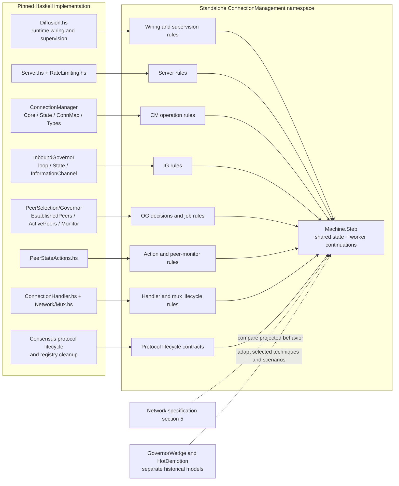
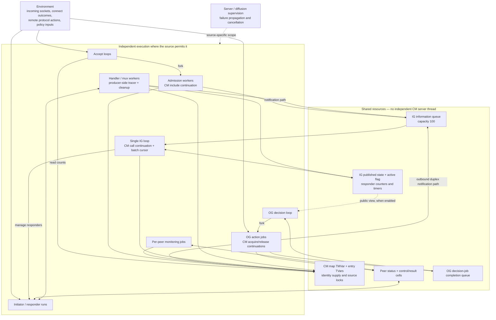
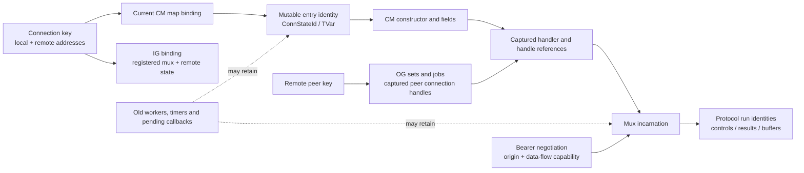
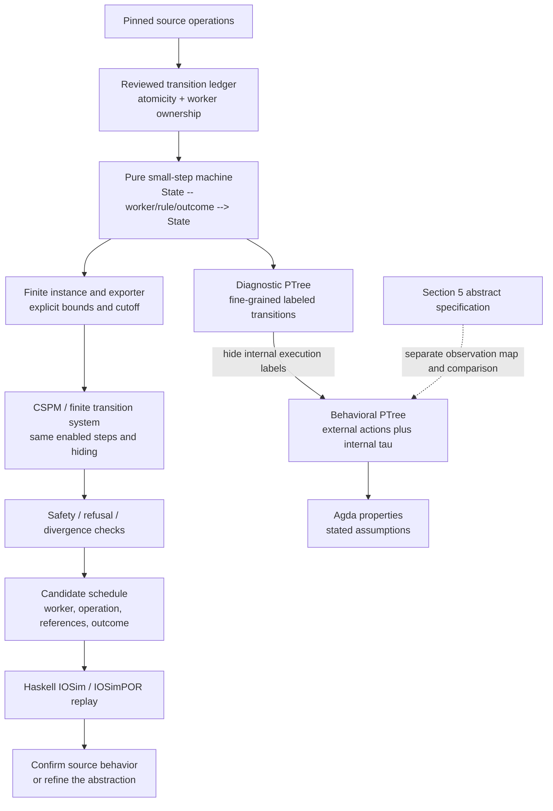
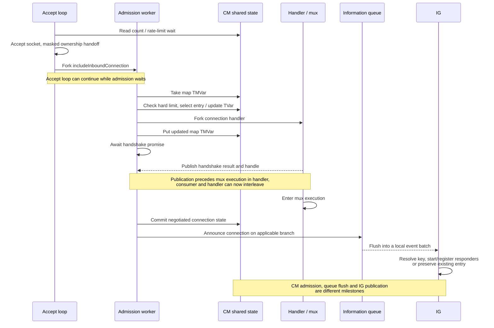
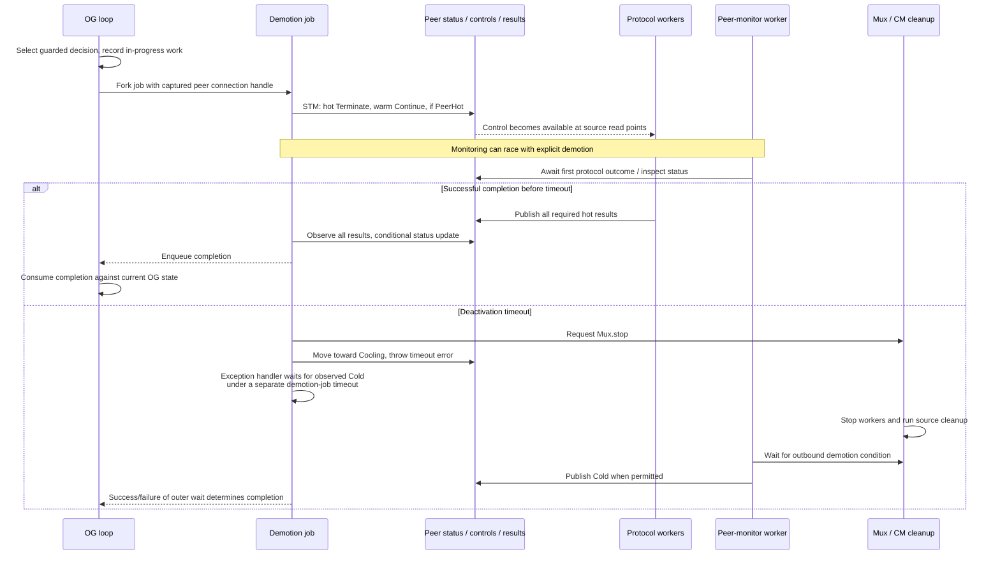
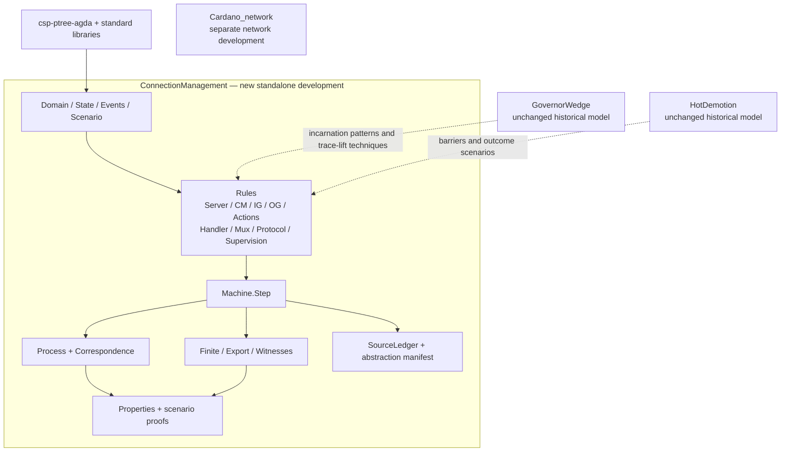

# CM, IG, OG and Server: architecture review

**14 October 2026 — proposal for discussion, not an implemented or verified model**

Next: [implementation design](../ConnectionManagement/DESIGN.md) and
[initial source ledger](../ConnectionManagement/SourceLedger.md) turn this review
into types, worker frames, transition boundaries and implementation gates.

This reviews and sharpens the [design study](connection-manager-study.md). The objective is a standalone CSP model of the **combined connection-management subsystem**, close enough to the implementation to discover source-code problems. It includes CM, IG, OG and the accepting Server, their workers, and the resources that couple them. It does not depend on `Cardano_network`, its protocol assembly, or `linkConfig`.

The implementation baseline remains consensus `585a86117618ff86d7d5b541f9d23b03356d4c3a` and its network dependency `96ee6e0e689770b5a3d664c59f2d13b05c5d9c4d`. This review inspected the existing pinned checkout; it does not claim to have refreshed the moving branch. Historical `GovernorWedge` and `HotDemotion` revisions remain separate. The existing PowerPoint/PDF deck predates this review and is not the authoritative architecture.

## 1. Review result and corrections

The standalone scope is appropriate, but the previous design was not yet precise enough about **execution ownership, synchronization, and semantic correspondence**. The following changes are needed before implementation.

| Priority | Finding | Design correction |
|---|---|---|
| Essential | CM is an API over shared state, not a dedicated thread accepting serialized requests. | Run CM operation continuations inside the calling admission worker, OG action worker or IG thread; keep handler/cleanup workers distinct. |
| Essential | `modifyTMVar` and `modifyTMVarSTM` have different atomicity. | Model the global CM map as full or taken. The IO helper takes it, executes IO, and puts it back in separate transactions, with exception restoration. |
| Essential | OG is larger than its main decision loop. | Include asynchronous decision jobs, their completion queue, and the separate peer-state monitoring jobs. |
| Essential | Queue draining does not complete IG work. | Model the bounded information queue, IG's current batch/cursor, timer-generated events, and per-event state publication separately. |
| Essential | The earlier decomposition did not state how multi-variable STM becomes CSP. | Define one authoritative small-step machine with atomic transaction rules; render it as a process tree. Do not distribute a transaction into independent variable rendezvous. |
| Essential | Trace correspondence alone does not justify refusal or divergence claims. | Separate diagnostic and behavioral alphabets, and give stronger correspondence obligations for failures/divergence analyses. |
| High | Shutdown can change the blocking graph. | Include IG's active flag and final queue drain, server supervision, worker cancellation, and cleanup. A suspended IG is not an exited IG. |
| High | A timeout is not immediately Cold or complete. | Preserve deactivation timeout, mux-stop request, peer-monitoring progress, outer demotion-job timeout and eventual OG completion. |
| High | A single connection identity hides replacement races. | Distinguish address key, mutable CM entry, handler/mux and protocol-run identity; preserve captured references. |
| High | A small model can accidentally manufacture a deadlock. | Distinguish resource-bound cutoff from source blocking; retain queue capacity 100 and declare all other bounds. |

These are findings about the **proposed model**, not new code-defect claims. Source support is detailed below. The review checked the relevant implementation paths and the existing model definitions; it did not perform a complete branch-by-branch audit of the entire diffusion subsystem.

## 2. Diagram A — source-to-model mapping

[Open the rendered diagram (SVG)](diagrams/01-source-mapping.svg)

Solid arrows below mean “derive behavior from this source.” Dashed arrows mean a separate comparison or reuse obligation. The model modules are proposed names, not existing files.



### Source ledger to implement first

| Source location | Model responsibility | Important boundary |
|---|---|---|
| [Diffusion.hs, initiator/responder wiring][diffusion] | Select actual component wiring and feature gates | IG public-state input to OG is conditional; auxiliary providers and churn have explicit scenario contracts |
| [Server.with and acceptLoop][server] | Accept loops, socket handoff, asynchronous admission, supervision | Accepted socket exists before CM admission; admission is not performed inline by the accept loop |
| [runConnectionRateLimits][rate] | Count read, soft delay, hard-limit wait and minimum elapsed delay | The preliminary rate-limit read does not replace CM's later admission check |
| [CM API construction][cm-api] | Shared operations called from several workers | No invented CM request queue |
| [includeInboundConnectionImpl][cm-admit] | Map exclusion, duplicate branches, handler fork, handshake-result wait | Reserved/unnegotiated overwrite retains the entry; terminating/terminated replacement allocates a new entry |
| [modifyTMVar / modifyTMVarSTM][cm-lock] | Lock acquisition, IO body, restoration versus one STM transaction | Map lock ownership and retained per-entry TVars are distinct |
| [IG setup and batch selection][ig-batch] | Active flag, shutdown drain, batch acquisition, maturity and idle events | First-to-finish branch behavior and prefixed timer events affect event order |
| [IG event handling][ig-events] | Registration, responder start/restart, CM calls and mux waits | Preserve key-only lookup and per-event publication |
| [IG mux tracer][ig-trace] | Producer-side counter reads/writes and notification transactions | Blocking occurs in the producing handler/mux context |
| [OG loop][og] and [Monitor.jobs/connections][og-monitor] | Guarded decisions, view updates, job launch, application of completions | Completion is interpreted against the governor's current state, not a snapshot replacing it |
| [EstablishedPeers jobs][og-established] and [ActivePeers jobs][og-active] | Promotion/demotion eligibility, jobs and exception completions | Preserve in-progress sets, source guards, retries/backoff and captured handles for selected scenarios |
| [PeerStateActions monitoring][actions-monitor] and [deactivation/close][actions-close] | Shared peer status, controls, result waits and asynchronous demotions | Per-peer monitoring is concurrent with explicit governor action jobs |
| [ConnectionHandler][handler] and [Network.Mux][mux] | Handshake promise, handle publication, mux startup, stop and completion | A published handle does not imply that the mux run loop has already started |

Each executable rule needs: source SHA and range; caller/worker; program counter; guard; read/write set; lock ownership; captured references; events/results; exception behavior; and the justification for any collapsed operations. Helper implementations such as `FirstToFinish`, `JobPool`, promises, and timeout combinators are part of that audit, not uninterpreted labels whose semantics can be guessed.

The specification uses some older names, such as `requestOutboundConnection` and `unregisterInboundConnection`; the pinned API uses `acquireOutboundConnection` and `releaseInboundConnection`. Record this mapping explicitly. Specification state names are an abstraction of implementation state, not a source transcription. [Section 5][spec], [CM Types][cm-types]

## 3. Diagram B — runtime architecture and shared state

[Open the rendered diagram (SVG)](diagrams/02-runtime-architecture.svg)

This diagram shows execution and access paths. Arrows do **not** imply CSP rendezvous or an extra queue. Only the two explicitly drawn queues are queues; other synchronization follows the relevant source operation.



The CM API is a record of closures over shared variables. Its operations execute in the callers. For example, IG remains occupied while its release continuation waits; this is not a request delegated to a free-running CM actor. [CM API][cm-api]

CM's map TMVar is a real source lock. While an IO `modifyTMVar` owns its contents, another worker reading the map can block. A worker holding an already captured entry reference can still access that entry's TVar when its own source operation allows it. Therefore “CM locked” must not freeze every connection worker indiscriminately. [CM lock helpers][cm-lock]

Exception restoration puts back the saved **map value**, whose entries contain references. It does not roll back earlier committed writes to those referenced TVars, undo a fork, or reverse other IO effects. Keep the saved map and the mutable heap separate; a whole-state rollback would introduce behavior absent from the source.

There are two different uses of job infrastructure: the OG's decision jobs produce governor completions, while `withPeerStateActions` starts per-peer monitoring jobs in its own job pool. Do not merge their completion routing or lifetimes. The monitor can call deactivation/close while an OG job is doing related work. [Peer monitoring][actions-monitor]

For the first scenario, model one listening address, two remote connection keys and bounded overlapping incarnations. Add dual-listener scenarios explicitly: two accept loops can pass preliminary checks against the same shared count, making the subsequent locked admission check important. Keep the exact equality relationships of addresses, reservations and reused keys.

## 4. Diagram C — identities and independent state dimensions

[Open the rendered diagram (SVG)](diagrams/03-identities.svg)



The arrows describe references, not one-to-one cardinalities. In particular, one mutable entry can be overwritten to point at a new handler while an old handler still references it. A new mutable entry may replace an old map binding while old cleanup still exists. IG and OG may temporarily refer to different lifecycle stages. A single universal “generation” field would hide these distinctions.

Keep these state dimensions separate:

| Dimension | Examples | Update authority |
|---|---|---|
| Transport origin | Accepted inbound; connected outbound | Establishment path |
| Negotiated capability | Unidirectional; duplex | Handshake result |
| CM bookkeeping | Reserved, unnegotiated, outbound/inbound use, duplex, terminating | Source CM operation and cleanup rules |
| IG remote activity | RemoteIdle, RemoteCold, RemoteWarm, RemoteHot | IG processing and referenced timer/counter behavior |
| Outbound peer status | Warm, Hot, Cooling, Cold, with source distinctions | Action and monitoring workers |
| OG selection state | Known/established/active membership and in-progress work | Governor decisions and completion handling |
| Mux/protocol execution | Not started, running, stopping, result available | Handler/mux/protocol lifecycle |

Do not collapse negotiated `Duplex` and `DuplexState`: capability permits reuse; current CM state describes current use and lifecycle. The source constructors to account for are `ReservedOutboundState`, `UnnegotiatedState`, `OutboundUniState`, `OutboundDupState` (including its timeout flag), `OutboundIdleState`, `InboundIdleState`, `InboundState`, `DuplexState`, `TerminatingState`, and `TerminatedState`. Absence from the map is another condition. [CM State][cm-state]

An identity in a diagnostic label is permitted to explain provenance. It must not become a runtime check where the implementation has only a connection key. Monitors may detect a stale target; they must not prevent it by construction.

## 5. Diagram D — CSP semantics and correspondence

[Open the rendered diagram (SVG)](diagrams/04-csp-semantics.svg)



### Authoritative executable model

Use modular rule definitions over a product state. In schematic notation:

```text
State = shared heap × thread table × resources × timers × supervision
Step  : State → RuleLabel → State → Proposition

Enabled(s) = all source-permitted transitions from s
Diagnostic(s) = offer each enabled diagnostic label and continue at its successor
Behavior(s) = Diagnostic(s) with internal execution labels hidden
```

This is design notation, not typechecked Agda. `RuleLabel` includes enough worker/rule/outcome information to distinguish successors. If a coarse observation has several successors, retain that nondeterminism rather than forcing a deterministic `Maybe State` function for the coarse label.

A product state does not make an entire CM operation atomic. It makes **one rule application** atomic, at the boundary specified by the source. Separate workers retain separate program counters, captured references and masking states. An eligible worker may take the next step; there is no invented scheduler thread whose refusal can block execution.

The first implementation should use this machine as the executable authority. A later explicit CSP parallel decomposition is useful for component proofs, but it must be shown equivalent at the intended semantic strength. We should not maintain a hand-written parallel model and a separate product machine whose agreement is only assumed.

### Atomicity and synchronization rules

1. **Committed STM transaction:** one transition containing its full read/guard/write effects. `retry` offers no completion step; throwing rolls back writes and enters the appropriate exception continuation. Preserve branch priority when alternatives are combined by the source STM semantics.
2. **IO `modifyTMVar`:** distinct take/body/put steps, including its exception-restoration path. Do not confuse it with the STM helper, whose take and put commit together.
3. **Function call:** advance the caller into the callee's continuation; do not introduce a queue or actor boundary. A call/return label is instrumentation, not an additional blocking handshake.
4. **Fork and result:** preserve the point at which the child becomes runnable, parent continuation, promise publication, result observation and joins.
5. **Queue:** one enqueue or batch flush has its source transaction semantics. Capacity constrains enqueue commits, not processing of a batch already removed.
6. **Cancellation:** model request, masking/interruptibility, delivery and cleanup. `throwTo` can block its sender. Repeated cancellation and exception restoration need explicit scenario coverage.
7. **Timeouts:** distinguish timer readiness, branch selection, cancellation, stop request and later worker completion. A ready timer does not force the scheduler to take it without stated progress assumptions.

### What the correspondence must establish

| Claim | Required evidence |
|---|---|
| A diagnostic process trace represents a machine run | Both directions of the run/trace correspondence, as in the existing small models |
| A finite exporter preserves the selected instance | Initial-state, successor and enabled-event agreement, including multiple outcomes, errors, termination and cutoff |
| Stable refusal/deadlock results carry across renderings | Matching stable offers/refusals; trace equality alone is insufficient |
| Hidden divergence results carry across renderings | Matching internal transitions and divergence, using an appropriate bisimulation or failures-divergences argument |
| A counterexample is a source defect | Source-valid schedule plus Haskell replay, or an explicit source-level justification if replay cannot be performed |

Keep execution labels visible for diagnosis, then hide the internal subset for behavioral claims. An environment must not be able to suppress an internal cleanup merely by declining a diagnostic event. Conversely, hiding infinitely recurring KeepAlive, timer or reconnect activity can introduce divergence. Classify expected background divergence separately from harmful component starvation; do not assert global divergence freedom without analyzing the hiding set.

The generic library already supplies process-tree nodes with visible and silent alternatives, parallel/hiding operators, trace and failure semantics, divergence-respecting bisimulation and LTL. Reuse those foundations. A finite exporter and source correspondence remain new work, not capabilities supplied automatically by the library.

## 6. Diagram E — inbound admission and concurrent publication

[Open the rendered diagram (SVG)](diagrams/05-inbound-admission.svg)

This is a normal successful **inbound branch**. Failure, duplicate rejection, query handshake and cleanup paths are additional ledger branches. It illustrates ordering obligations rather than claiming all actions below are single atomic steps.



The exact source branch controls when notification occurs and whether the result is connected or disconnected. The diagram's display order after promise publication is not an extra cross-thread constraint: mux startup and the admission continuation can interleave. [CM admission][cm-admit], [ConnectionHandler][handler], [IG][ig-events]

The server holds a socket before CM has accepted it. The preliminary rate-limit step and later locked hard-limit check are separate. The source `modifyTMVar` lock spans IO, but the handshake wait occurs after it has been restored. These facts are essential for admission/reuse and cleanup races.

## 7. Diagram F — OG hot demotion and asynchronous monitoring

[Open the rendered diagram (SVG)](diagrams/06-hot-demotion.svg)



The normal success branch shown is not a promise that every returning deactivation makes the peer Warm: the source checks the current peer status, and concurrent monitoring can have changed it. Completion updates must retain those checks. The error branch's outer wait may itself time out; that case has different OG bookkeeping. [Deactivation][actions-close], [jobDemoteActivePeer][og-active], [Peer monitoring][actions-monitor]

This prevents importing the historical `HotDemotion` shortcut “timeout then Cold” into a subsystem model where the intermediate behavior matters. Its abstraction was aimed at a single outcome analysis; it is not a detailed model of concurrent cleanup.

## 8. Component properties and investigation matrix

Do not begin with one universal “no deadlock” assertion. Expected idle waits and uncooperative remote peers make that a poor first specification. Express ownership, enabledness and scoped progress separately.

| Area | Safety / finite witness | Conditional progress or failure analysis |
|---|---|---|
| Server | Accepted socket is accounted for by accept-loop handoff, admission, handler or cleanup obligation | A permitted admission eventually returns or releases ownership under stated handshake/cancellation assumptions |
| CM | Map restoration obeys ownership; cleanup cannot delete a different entry where the code checks identity | A held map lock is eventually released, or an explicit source-valid blocking dependency is exhibited |
| IG | Event provenance versus resolved target; source-consistent registration/restart/removal | Work for a second key is not permanently obstructed by the first under the scenario assumptions |
| OG | Jobs and in-progress sets agree at defined milestones; completion uses current state and retained handle | Promotions/demotions settle or take a specified failure branch under explicit local scheduling and timer assumptions |
| Peer actions | All-results success is justified by the relevant protocol-run results | Separate voluntary Warm completion from timeout-driven Cooling/Cold paths |
| Shared queues | FIFO/batch order, atomic burst capacity, no invented drops | Backpressure dependency cycles with live versus terminated IG |
| Supervision | Cancellation scope and exception restoration match source | Cleanup progress after a governing thread exits; no assumption that shutdown cures a live wedge |

Ownership predicates must account for transitional and shared references; “every socket has exactly one reference” is not the required invariant. A successful pure return from a mini-protocol body is also not necessarily the final result observed after bracket cleanup.

Priority scenarios:

1. **Baseline reachability:** accepted and outbound connections, unidirectional and duplex negotiation, clean promotion/demotion and clean shutdown. These show the model is not trivially blocking everything.
2. **Admission versus acquisition:** same-key simultaneous open, reserved/unnegotiated overwrite, shared entry versus new entry, map-lock restoration on exceptions.
3. **IG delay and replacement:** key-only notifications, batch processing, split release, retained handles, queue saturation; re-establish historical traces at the current pin rather than assuming them.
4. **OG versus peer monitor:** explicit demotion concurrent with first protocol completion/error, delayed job completion, repeated policy changes and attempted repromotion.
5. **Backpressure versus shutdown:** a live blocked IG compared with an exiting IG that clears its active flag and drains; a producer that already sampled the old flag needs its own continuation state.
6. **Resource limits:** two accept loops, count-read/admission windows, pruning, delayed reclamation and restored map availability.
7. **Protocol cleanup:** Notify full pipeline/quit, Fetch draining, ChainSync/BlockFetch registry dependencies and shared Leios peer-state deletion.

A safety monitor reports after a source transition or reads ghost state; it must not participate in a rendezvous that prevents the bad transition. Progress monitors state their fairness and environmental premises. An untimed timeout only supplies a possible branch, not a 300-second guarantee.

## 9. Diagram G — module boundaries and selective reuse

[Open the rendered diagram (SVG)](diagrams/07-module-boundaries.svg)



Solid arrows denote proposed dependency direction; dashed arrows denote design reuse, **not imports**. `Cardano_network` has no dependency edge. The source ledger is documentation associated with rules, not an executable dependency on documentation.

Concrete reuse decisions:

- From `GovernorWedge`, adapt the separation of key and incarnation, pure-step witnesses, and process-step correspondence techniques. Do not copy its fused handshake/notification, atomic release, one-key scope or unbounded queue as the new execution semantics. Inspect the actual `Steps.agda` correspondence rather than assuming a product model and parallel composition agree automatically.
- From `HotDemotion`, adapt protocol-result barriers and outcome-focused scenarios. Its `SysAt` is generated from a product step function and its `Lift` module proves trace correspondence. Do not inherit frozen post-timeout protocols, missing registry waits or assumptions about old Notify termination behavior.
- Keep historical proof modules unchanged. A reimplemented scenario must establish its own reachability and property in the new model; a matching name is not a theorem transfer.
- Use generic semantics and laws from `csp-ptree-agda`. Any generic extraction is a separate dependency change, not a reason to couple the three application models.

Local evidence: [GovernorWedge model](../GovernorWedge/Model.agda), [steps](../GovernorWedge/Steps.agda), [limitations](../GovernorWedge/README.md); [HotDemotion model](../HotDemotion/Model.agda), [trace lifting](../HotDemotion/Lift.agda), [assumptions and deviations](../HotDemotion/README.md).

## 10. Implementation scope and review gates

**First executable slice:** one local node, one listener, two remote keys; all four components present; explicit CM map ownership, admission/acquisition, handshake promise, IG queue/batch, OG decision jobs and peer monitors; a declared minimal protocol lifecycle bundle. Empty or abstracted protocol groups must match the scenario manifest rather than being advertised as the full Leios node.

Keep numeric bounds separate from source constants. Queue capacity 100 is a source constant. The number of allocated identities is a search bound; if exhausted, mark a cutoff and exclude that path from source-deadlock claims. Do not recycle IDs while outstanding references remain. Pipeline depth reductions require a witness-lifting argument or replay at the configured depth.

Policy inputs may be fixed initially, but the OG decisions consuming them remain modeled. Cardano-specific peer-selection hooks, root/ledger discovery, churn and peer sharing need a manifest stating: modeled, fixed configuration, abstract environment, or deferred. The first slice is a combined lifecycle model, not a claim to model all peer-selection policy.

Each protocol lifecycle contract must also say which source executions it admits and excludes. An over-approximation can produce spurious counterexamples; fixing an environment or removing source branches can miss real ones. A universal result transfers only under an appropriate abstraction argument. A candidate trace still requires source validation. The implementation's branch guards must not be weakened merely to recover a historical witness.

| Gate | Required review evidence |
|---|---|
| 1. Source coverage | Every selected path has a source ledger entry; helper semantics and feature gates identified |
| 2. Execution fidelity | Lock ownership, transaction boundaries, exception paths, worker captures and queue/batch distinctions reviewed |
| 3. Semantic fidelity | Machine/process correspondence; explicit internal/external alphabet; exporter checks if used |
| 4. Non-vacuity and monitors | Ordinary lifecycle traces succeed; intentionally perturbed rules trigger the intended monitors |
| 5. Defect evidence | Minimized trace, bounds and assumptions, source-operation explanation, Haskell replay or justified source-level analysis |

The design is ready for discussion at these boundaries. It is **not yet** a completed source-to-CSP refinement, an executable model, or evidence of new defects. This review changed documentation only; no Agda/Haskell builds or model-checker runs were performed.

## Pinned source references

[spec]: https://ouroboros-network.cardano.intersectmbo.org/pdfs/network-spec/network-spec.pdf
[diffusion]: https://github.com/IntersectMBO/ouroboros-network/blob/96ee6e0e689770b5a3d664c59f2d13b05c5d9c4d/ouroboros-network/lib/Ouroboros/Network/Diffusion.hs#L625-L825
[server]: https://github.com/IntersectMBO/ouroboros-network/blob/96ee6e0e689770b5a3d664c59f2d13b05c5d9c4d/ouroboros-network/framework/lib/Ouroboros/Network/Server.hs#L134-L254
[rate]: https://github.com/IntersectMBO/ouroboros-network/blob/96ee6e0e689770b5a3d664c59f2d13b05c5d9c4d/ouroboros-network/framework/lib/Ouroboros/Network/Server/RateLimiting.hs#L68-L139
[cm-api]: https://github.com/IntersectMBO/ouroboros-network/blob/96ee6e0e689770b5a3d664c59f2d13b05c5d9c4d/ouroboros-network/framework/lib/Ouroboros/Network/ConnectionManager/Core.hs#L412-L523
[cm-admit]: https://github.com/IntersectMBO/ouroboros-network/blob/96ee6e0e689770b5a3d664c59f2d13b05c5d9c4d/ouroboros-network/framework/lib/Ouroboros/Network/ConnectionManager/Core.hs#L778-L1040
[cm-lock]: https://github.com/IntersectMBO/ouroboros-network/blob/96ee6e0e689770b5a3d664c59f2d13b05c5d9c4d/ouroboros-network/framework/lib/Ouroboros/Network/ConnectionManager/Core.hs#L2364-L2400
[cm-types]: https://github.com/IntersectMBO/ouroboros-network/blob/96ee6e0e689770b5a3d664c59f2d13b05c5d9c4d/ouroboros-network/framework/lib/Ouroboros/Network/ConnectionManager/Types.hs#L577-L655
[cm-state]: https://github.com/IntersectMBO/ouroboros-network/blob/96ee6e0e689770b5a3d664c59f2d13b05c5d9c4d/ouroboros-network/framework/lib/Ouroboros/Network/ConnectionManager/State.hs#L181-L217
[ig-batch]: https://github.com/IntersectMBO/ouroboros-network/blob/96ee6e0e689770b5a3d664c59f2d13b05c5d9c4d/ouroboros-network/framework/lib/Ouroboros/Network/InboundGovernor.hs#L182-L280
[ig-events]: https://github.com/IntersectMBO/ouroboros-network/blob/96ee6e0e689770b5a3d664c59f2d13b05c5d9c4d/ouroboros-network/framework/lib/Ouroboros/Network/InboundGovernor.hs#L278-L620
[ig-trace]: https://github.com/IntersectMBO/ouroboros-network/blob/96ee6e0e689770b5a3d664c59f2d13b05c5d9c4d/ouroboros-network/framework/lib/Ouroboros/Network/InboundGovernor.hs#L625-L735
[og]: https://github.com/IntersectMBO/ouroboros-network/blob/96ee6e0e689770b5a3d664c59f2d13b05c5d9c4d/ouroboros-network/lib/Ouroboros/Network/PeerSelection/Governor.hs#L497-L725
[og-monitor]: https://github.com/IntersectMBO/ouroboros-network/blob/96ee6e0e689770b5a3d664c59f2d13b05c5d9c4d/ouroboros-network/lib/Ouroboros/Network/PeerSelection/Governor/Monitor.hs#L97-L150
[og-established]: https://github.com/IntersectMBO/ouroboros-network/blob/96ee6e0e689770b5a3d664c59f2d13b05c5d9c4d/ouroboros-network/lib/Ouroboros/Network/PeerSelection/Governor/EstablishedPeers.hs
[og-active]: https://github.com/IntersectMBO/ouroboros-network/blob/96ee6e0e689770b5a3d664c59f2d13b05c5d9c4d/ouroboros-network/lib/Ouroboros/Network/PeerSelection/Governor/ActivePeers.hs#L961-L1080
[actions-monitor]: https://github.com/IntersectMBO/ouroboros-network/blob/96ee6e0e689770b5a3d664c59f2d13b05c5d9c4d/ouroboros-network/lib/Ouroboros/Network/PeerSelection/PeerStateActions.hs#L600-L855
[actions-close]: https://github.com/IntersectMBO/ouroboros-network/blob/96ee6e0e689770b5a3d664c59f2d13b05c5d9c4d/ouroboros-network/lib/Ouroboros/Network/PeerSelection/PeerStateActions.hs#L985-L1107
[handler]: https://github.com/IntersectMBO/ouroboros-network/blob/96ee6e0e689770b5a3d664c59f2d13b05c5d9c4d/ouroboros-network/framework/lib/Ouroboros/Network/ConnectionHandler.hs#L324-L455
[mux]: https://github.com/IntersectMBO/ouroboros-network/blob/96ee6e0e689770b5a3d664c59f2d13b05c5d9c4d/network-mux/src/Network/Mux.hs
