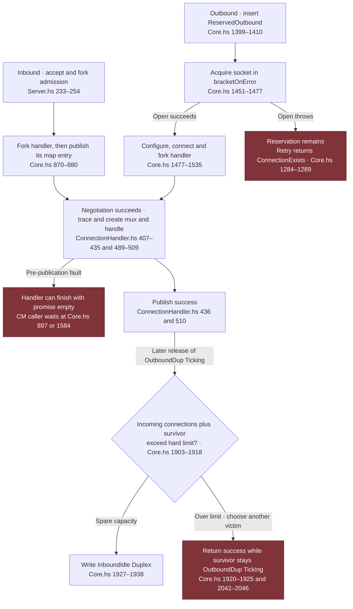
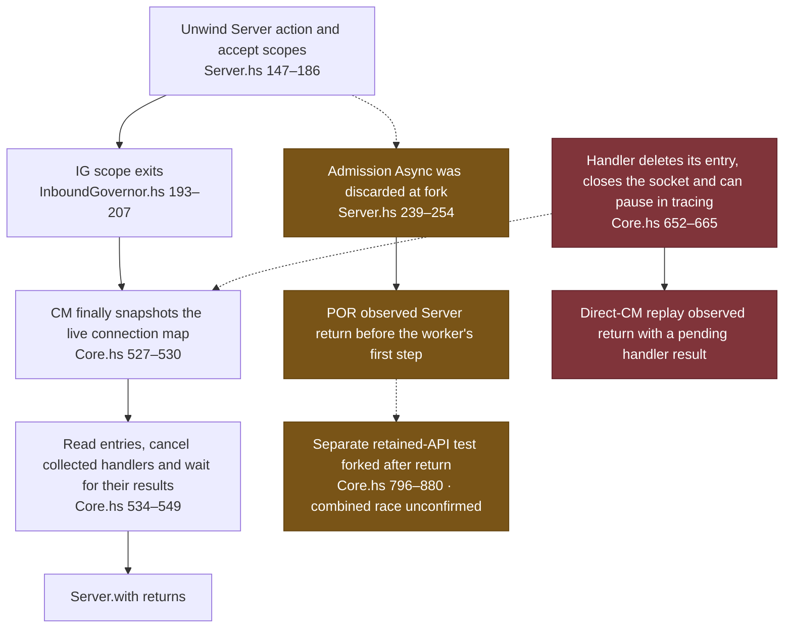
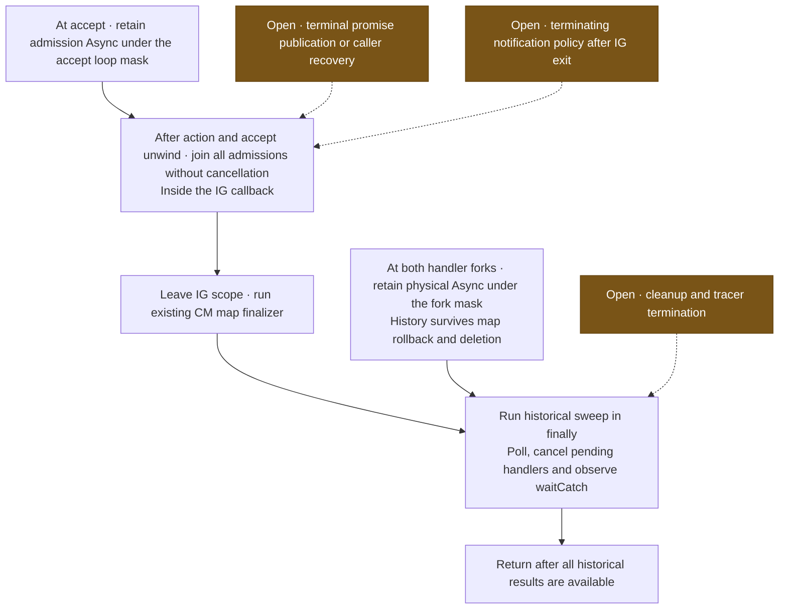
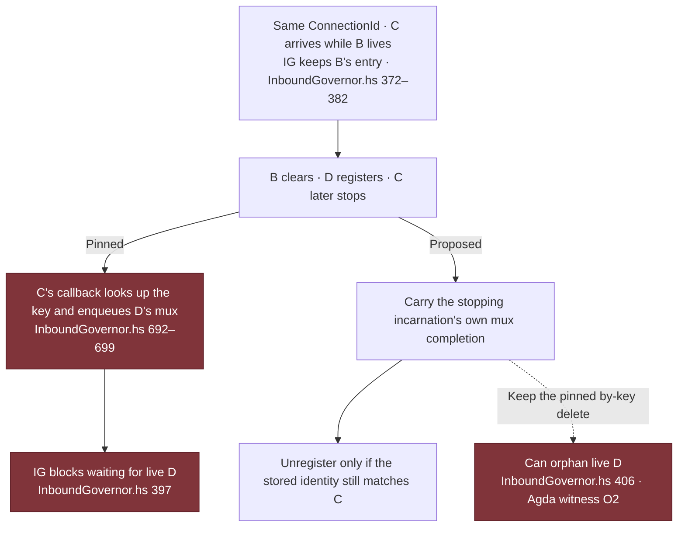

# Connection management findings and repair workflows

18 November 2026. The main workflows use Ouroboros Network
`2f1c154f248659b89523d5679ca532f442e7ed2a`, selected by Ouroboros Consensus
`2e44d98a843168ba3b189e305820b79943ac7d1e`. `Core.hs` is
`Ouroboros.Network.ConnectionManager.Core`. CM means connection manager, IG means
inbound governor, and an `Async` result records a thread’s physical completion.
The prototype evidence is from increment 100. The historical IG wedge uses its
own pin in the last section. [Consensus dependency][consensus-pin],
[source ledger](../ConnectionManagement/SourceLedger.md),
[findings inventory](connection-management-identified-issues-summary.md),
[architecture review](connection-management-architecture-review-2026-11.md).

## Pinned connection lifecycle

The acquisition paths converge on a handshake-result promise. The release branch
shows the later decision for a successfully acquired ticking duplex connection.
Arrows to red boxes show the failure paths and their consequences.

| Finding | Pinned action and evidence |
| --- | --- |
| **Socket-open failure leaves a reservation** | CM commits the unknown-local reservation before `openToConnect`. The bracket’s resource cleanup begins after acquisition succeeds. IOSim observes one failed open, a retained reservation and `ConnectionExists` on retry. The configuration-failure control clears the reservation after successful open. [Reservation][core-reserve], [retry][core-retry], [socket bracket][core-socket], [replay](../ConnectionManagement/SourceReplay/README.md#socket-open-reservation-replay). |
| **Unpublished promise can strand a caller (CM-PUB1)** | The handshake catch covers negotiation. Success tracing and mux/handle creation precede publication. With injected faults in that interval, actual CM callers were still blocked on STM after the handler finished and purged its entry. A Server probe observed admission workers blocked after `Server.with` returned. [Outbound handler][handler-out], [inbound handler][handler-in], [CM probe](../ConnectionManagement/SourceReplay/README.md#actual-cm-caller-and-cleanup-replay-for-cm-pub1), [Server probe](../ConnectionManagement/SourceReplay/README.md#actual-server-admission-worker-lifetime-replay). |
| **Over-limit release misses the surviving connection’s transition** | The branch discards `mkPruneAction`’s self-pruned flag. The prune operation writes only to selected victims. When the victim is another peer, `OperationSuccess` accompanies a surviving `OutboundDup Ticking`. The replay checks this post-state and the self-pruning and spare-capacity controls. [Release decision][core-release], [success return][core-release-return], [prune writes][core-prune], [replay](../ConnectionManagement/SourceReplay/README.md#verified-over-limit-outbound-release-replay). |

M6 re-tested all three findings at `2f1c154`. The CM and Server publication
probes use a plain mux and injected faults. [M6 revalidation](../ConnectionManagement/SourceReplay/README.md#m6-revalidation-at-network-2f1c154-9-november-2026).

## Pinned shutdown and missing work

The solid vertical path is the scope order. The dotted arrows mark a coverage
gap or link observations made in separate test runs.

- **Late admission.** The pristine IOSimPOR run exhausted 628 schedules at the
  recorded 20,000-schedule and 20-branch bounds. It observed Server return with
  an unstarted admission worker. The direct API test separately forked a handler
  after return through an escaped CM handle. The combined pristine trace would
  require observing Server’s own delayed worker subsequently include and fork in
  that same run. [Accept loop][server-fork], [include path][core-include],
  [late-admission replay](../ConnectionManagement/SourceReplay/README.md#late-admission-after-the-cm-shutdown-10-november-2026).
- **Self-purge.** Direct CM returned while the actual handler result was pending
  with the masked cleanup-counter tracer paused. The pristine full-Server
  control observed return while the gate was closed, then opened it before
  sampling the final handler result. The [source model’s SI5 certificate](../ConnectionManagement/Properties/ServerShutdownCoordinator.agda)
  concerns collected results at finished relays. [Self-purge source][core-purge],
  [snapshot and wait][core-shutdown],
  [direct-CM replay](../ConnectionManagement/SourceReplay/README.md#handler-self-purge-before-the-cm-returns-12-november-2026),
  [full-Server control](../ConnectionManagement/SourceReplay/README.md#controls-and-physical-observations).
- **Caller scope.** Residual foreign callers in the raw model are an environment
  artefact. The corresponding replay explicitly creates an external caller.
  [Increment 99 classification](../ConnectionManagement/SourceReplay/README.md#reduced-cleanup-candidates-increment-99).

## Proposed shutdown and supporting evidence

The solid arrows follow the Haskell prototype. The dotted arrows mark open
progress obligations at the wait they can block.

| Change or obligation | Evidence and boundary |
| --- | --- |
| **Retain and join admissions** | The prototype observes joins before `TrShutdown` on normal return, action error, IG-first, accept error and external cancellation. The escaped-handle control still accepts a late direct include, so registry closure relies on caller ownership. Cancelling workers was rejected because interruption between handler fork and map publication can restore the old map with the child still alive. [Server patch](../ConnectionManagement/SourceReplay/QuiescentShutdownPrototype.patch#L192), [test cases](../ConnectionManagement/SourceReplay/QuiescentShutdownPrototype.patch#L335), [rejected designs](../ConnectionManagement/DesignContract.md#4-rejected-designs-and-retained-counterexamples). |
| **Keep handler history and wait for physical results** | IOSim observes the prototype waiting through CM and full-Server self-purge and collecting the child after pre-publication rollback. Agda’s `no-late-admission` and `no-late-fork` cover initialized runs at `closingCM` or `serverReturned`. `quiescence` and `registry-si5` cover initialized runs reaching finished relays, with the explicit `O.initial` premise. [Historical sweep](../ConnectionManagement/SourceReplay/QuiescentShutdownPrototype.patch#L48), [handler registration](../ConnectionManagement/SourceReplay/QuiescentShutdownPrototype.patch#L91), [test observations](../ConnectionManagement/SourceReplay/README.md#controls-and-physical-observations), [Agda boundary](../ConnectionManagement/Properties/ServerOwnedHandlers.agda#L267), [Agda endpoint](../ConnectionManagement/Properties/ServerOwnedHandlers.agda#L336). |
| **Make the waits terminate** | Prototype tests observe failure to progress with a permanently blocked cleanup tracer, an unpublished promise, and 101 admissions writing after IG exit to a capacity-100 queue. IG disables mux-tracer writes and drains once at exit. CM’s successful admission writes `NewConnection` separately. Acceptance needs terminal publication or caller recovery, a terminating policy for late notifications, and validated cleanup contracts. [IG exit][ig-exit], [CM notification][core-notify], [queue capacity][ig-channel], [progress tests](../ConnectionManagement/SourceReplay/README.md#progress-findings-and-limits). |

In Agda, admissions may join on either side of IG exit, with both required by
entry to `closingCM`. The historical sweep can interleave with map-based
shutdown. In Haskell the sweep starts when the map finalizer exits, including
exceptional exit. A blocked map finalizer therefore delays the sweep. The
proofs establish safety at reached model endpoints. Eventual shutdown and a
correspondence proof for the prototype remain open. [Model and prototype ordering](../ConnectionManagement/DesignContract.md#model-and-prototype-ordering).

Two local repair candidates follow from the lifecycle replays. At socket
acquisition, roll back the matching reservation when open fails and check that
a retry reaches a fresh open. At over-limit release, use the self-pruned flag
to commit `InboundIdle` for a survivor and preserve the self-pruning outcome.
These are repair inferences from the branch and control pairs. Acceptance
evidence for both repairs is open. [Socket controls](../ConnectionManagement/SourceReplay/README.md#socket-open-reservation-replay),
[release controls](../ConnectionManagement/SourceReplay/README.md#verified-over-limit-outbound-release-replay).

## Historical inbound-governor wedge

The field reconstruction and Agda witnesses use network
`4b3ab7664f609a1aee0f0c24dcfcfd0ab899fc42`. The two branches below compare the
callback and unregister actions at that pin with the proposed changes. The
historical study has its own premises and release abstraction.
[Field reconstruction](../GovernorWedge/README.md#2-the-bug-path-in-the-field),
[model assumptions](../GovernorWedge/README.md#4-assumptions-and-simplifications).

`W1f-reach` checks the reconstructed wedge. `F2id-safe` and `F2id-no-orphan`
check the own-mux and identity fix. `RL4` checks the modeled atomic release path.
The timeout and own-mux-only variants have orphan counterexamples. The CM
duplicate guard blocks the reconstructed field path in its scope, while the
never-run mux witness and the modeled release path expose its limits. The wedge
study has no revalidation at `2f1c154`. [Pinned callback][wedge-callback],
[pinned wait and unregister][wedge-wait],
[witnesses and alternatives](../GovernorWedge/README.md#5-what-is-proved).

Source line references were checked against local pinned Git objects. Test and
proof claims refer to the linked evidence records.

[consensus-pin]: https://github.com/IntersectMBO/ouroboros-consensus/blob/2e44d98a843168ba3b189e305820b79943ac7d1e/cabal.project#L98-L105
[server-fork]: https://github.com/IntersectMBO/ouroboros-network/blob/2f1c154f248659b89523d5679ca532f442e7ed2a/ouroboros-network/framework/lib/Ouroboros/Network/Server.hs#L233-L254
[core-reserve]: https://github.com/IntersectMBO/ouroboros-network/blob/2f1c154f248659b89523d5679ca532f442e7ed2a/ouroboros-network/framework/lib/Ouroboros/Network/ConnectionManager/Core.hs#L1399-L1410
[core-retry]: https://github.com/IntersectMBO/ouroboros-network/blob/2f1c154f248659b89523d5679ca532f442e7ed2a/ouroboros-network/framework/lib/Ouroboros/Network/ConnectionManager/Core.hs#L1284-L1289
[core-socket]: https://github.com/IntersectMBO/ouroboros-network/blob/2f1c154f248659b89523d5679ca532f442e7ed2a/ouroboros-network/framework/lib/Ouroboros/Network/ConnectionManager/Core.hs#L1451-L1477
[handler-out]: https://github.com/IntersectMBO/ouroboros-network/blob/2f1c154f248659b89523d5679ca532f442e7ed2a/ouroboros-network/framework/lib/Ouroboros/Network/ConnectionHandler.hs#L387-L439
[handler-in]: https://github.com/IntersectMBO/ouroboros-network/blob/2f1c154f248659b89523d5679ca532f442e7ed2a/ouroboros-network/framework/lib/Ouroboros/Network/ConnectionHandler.hs#L470-L513
[core-release]: https://github.com/IntersectMBO/ouroboros-network/blob/2f1c154f248659b89523d5679ca532f442e7ed2a/ouroboros-network/framework/lib/Ouroboros/Network/ConnectionManager/Core.hs#L1903-L1939
[core-release-return]: https://github.com/IntersectMBO/ouroboros-network/blob/2f1c154f248659b89523d5679ca532f442e7ed2a/ouroboros-network/framework/lib/Ouroboros/Network/ConnectionManager/Core.hs#L2042-L2046
[core-prune]: https://github.com/IntersectMBO/ouroboros-network/blob/2f1c154f248659b89523d5679ca532f442e7ed2a/ouroboros-network/framework/lib/Ouroboros/Network/ConnectionManager/Core.hs#L759-L777
[core-include]: https://github.com/IntersectMBO/ouroboros-network/blob/2f1c154f248659b89523d5679ca532f442e7ed2a/ouroboros-network/framework/lib/Ouroboros/Network/ConnectionManager/Core.hs#L796-L880
[core-purge]: https://github.com/IntersectMBO/ouroboros-network/blob/2f1c154f248659b89523d5679ca532f442e7ed2a/ouroboros-network/framework/lib/Ouroboros/Network/ConnectionManager/Core.hs#L641-L668
[core-shutdown]: https://github.com/IntersectMBO/ouroboros-network/blob/2f1c154f248659b89523d5679ca532f442e7ed2a/ouroboros-network/framework/lib/Ouroboros/Network/ConnectionManager/Core.hs#L524-L550
[ig-exit]: https://github.com/IntersectMBO/ouroboros-network/blob/2f1c154f248659b89523d5679ca532f442e7ed2a/ouroboros-network/framework/lib/Ouroboros/Network/InboundGovernor.hs#L193-L207
[core-notify]: https://github.com/IntersectMBO/ouroboros-network/blob/2f1c154f248659b89523d5679ca532f442e7ed2a/ouroboros-network/framework/lib/Ouroboros/Network/ConnectionManager/Core.hs#L982-L990
[ig-channel]: https://github.com/IntersectMBO/ouroboros-network/blob/2f1c154f248659b89523d5679ca532f442e7ed2a/ouroboros-network/framework/lib/Ouroboros/Network/InboundGovernor/InformationChannel.hs#L35-L54
[wedge-callback]: https://github.com/IntersectMBO/ouroboros-network/blob/4b3ab7664f609a1aee0f0c24dcfcfd0ab899fc42/ouroboros-network/framework/lib/Ouroboros/Network/InboundGovernor.hs#L692-L699
[wedge-wait]: https://github.com/IntersectMBO/ouroboros-network/blob/4b3ab7664f609a1aee0f0c24dcfcfd0ab899fc42/ouroboros-network/framework/lib/Ouroboros/Network/InboundGovernor.hs#L395-L407
