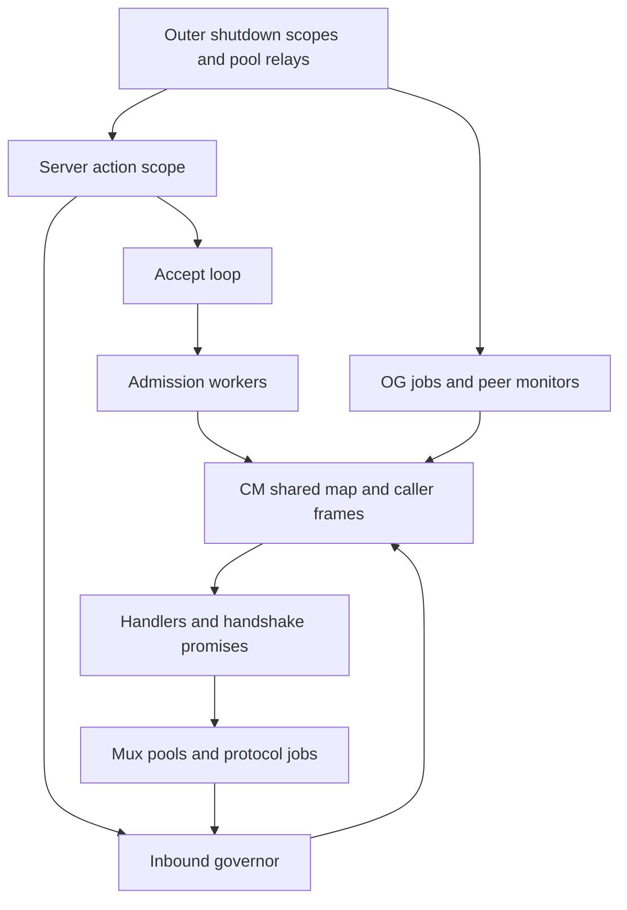
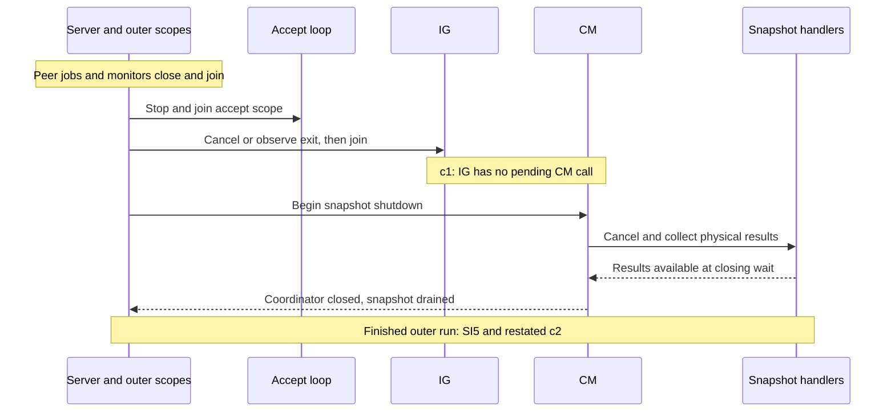
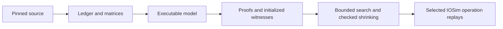

# What the connection-management model establishes

Summary updated 16 November 2026 from recorded source audits, proofs, initialized
witnesses and replays through Supervision increment 100. This is the positive-results
companion to the [issues summary](connection-management-identified-issues-summary.md).
Evidence was read for this update; no Agda checks, native replays, builds or git
commands were run.

## Model and source boundary

The model covers a selected CM/IG/OG/Server subsystem of network
`2f1c154f248659b89523d5679ca532f442e7ed2a`, pinned by consensus
`2e44d98a843168ba3b189e305820b79943ac7d1e`. The
[source ledger](../ConnectionManagement/SourceLedger.md) maps operations to that
revision and retains historical pins. Source mapping and selected implementation
replays connect the model to Haskell; there is no full Haskell refinement theorem.

CM is shared state operated on callers' stacks, rather than a service thread.
The [architecture](../ConnectionManagement/DESIGN.md) separates connection entries,
sockets, promises, handlers, muxes and protocol invocations. IO map take/body/restore,
atomic STM commits, cancellation receipt, cleanup and physical Async results remain
distinct. Layered supervisors assemble these operations on one state; CSP and
exploration interpret the same dispatcher.

The reviewed `LocalLifecycle` profile starts after listener/governor setup, with
an empty CM, one listener and two ordinary known peers; targets are known 2,
established 2, active 1. Transport, protocol, tracer and application outcomes have
explicit contracts. Expirations are untimed inputs, even where sampled clock
values are retained. This is a subsystem profile, not a whole-node boot model.

## Source behaviours reproduced

| Coverage | Established result and evidence kind |
| --- | --- |
| Primitive operations | **90/90 selected contracts** have executable rules and paired enabled/refusal controls: map leases/restoration, STM retry/rollback, fork/registration, promises, queues, results, masking, cancellation and timers. [Primitive matrix](../ConnectionManagement/PrimitiveMatrix.md); [increment 80](../ConnectionManagement/Supervision.md#eightieth-increment-g1-primitive-runtime-closure). This is model contract coverage, not equivalence of IO and IOSim. |
| Source branches | The inventory accounts for **99 rows: 67 implemented, 19 contracted, 13 excluded, zero missing**. “Contracted” retains a reviewed source-operation boundary; “excluded” contributes no behaviour claim. [Branch matrix](../ConnectionManagement/BranchMatrix.md), reconciled by [GateAudit](../ConnectionManagement/GateAudit.md). These counts are an inventory, not universal branch execution. |
| Configured bundles | Hot ChainSync/BlockFetch/TxSubmission2/LeiosNotify/LeiosFetch, empty warm, established KeepAlive; eager initiators and demand/grouped-Any responders. Coupled contracts preserve captured jobs, control reads, pipeline draining and shared-resource cleanup. [Protocol contracts](../ConnectionManagement/ProtocolContracts.md); [increments 88–94](../ConnectionManagement/Supervision.md#eighty-eighth-increment-g0-chainsync-blockfetch-and-registry-contracts). |
| Source-policy instantiation | Full outbound **381 contract inputs/322 frontend events** and inbound **246/208** runs use source retry/clearing values **5/120**, selected V15/version data and explicit Tx V2. [SourcePolicyOutbound](../ConnectionManagement/SourceInputs/SourcePolicyOutbound.agda), [SourcePolicyInbound](../ConnectionManagement/SourceInputs/SourcePolicyInbound.agda), `initialized-contracts`/`initialized-frontend`. [Increment 96](../ConnectionManagement/Supervision.md#ninety-sixth-increment-source-policy-profile-and-seed-history-abstraction) proves seed/split/comparator independence for the reached finite decision histories, including rollback/restarts. It fixes eligible sets, clocks/order and outcomes; it does not cover arbitrary selections or random distributions. |

The six G2 obligations are **finite initialized witnesses**, each proving that
an enabled lifecycle exists under its supplied observations:

| Lifecycle | Witness and endpoint |
| --- | --- |
| Clean inbound | [InboundCleanLifecycle](../ConnectionManagement/Negative/InboundCleanLifecycle.agda), 109 events; extended to six responders by [InboundConfiguredWitness](../ConnectionManagement/Negative/InboundConfiguredWitness.agda). Protocols finish normally; handler cancellation at unmasked TIME_WAIT yields `asyncException 42`, with cleanup/result and IG unregistration. |
| Clean outbound | [OutboundCleanLifecycle](../ConnectionManagement/Negative/OutboundCleanLifecycle.agda), 156 events; [FullConfiguredWitness](../ConnectionManagement/Negative/FullConfiguredWitness.agda) extends through all six initiators, release, cleanup and Cold. The second selected establishment job remains registered but unentered. |
| Duplex reuse | [ServerPeers.Protocols](../ConnectionManagement/Negative/ServerPeers.agda), `initialized-to-start`: actual admission, publication and IG registration precede outbound acquisition of the existing bearer, under `canInitiate`. |
| Handshake failure | [SupervisedHandshakeFailure](../ConnectionManagement/Negative/SupervisedHandshakeFailure.agda), `initialized-to-cleanup`: 40 events through observed deadline failure, promise publication, disconnected caller return, socket/map cleanup and handler result. |
| Successful hot demotion | [GovernorLifecycle](../ConnectionManagement/CSP/GovernorLifecycle.agda), `path`; [ServerPeersDeactivation](../ConnectionManagement/Properties/ServerPeersDeactivation.agda), `origin-success`, separates actual clean hot-result waiting from entry already Warm. |
| Timeout/Cooling | [TimeoutCoolingOwned](../ConnectionManagement/Negative/TimeoutCoolingOwned.agda), `initialized-to-completion`: 145 events through PSA timeout, mux/pool shutdown, direct handler cleanup and monitor Cold. The production-caller path requires neither foreign CM release nor TIME_WAIT. |

For G3, [ConcurrentLifecycles](../ConnectionManagement/Negative/ConcurrentLifecycles.agda)
certifies 294 events for two executing peers, including child-before-registration
and job/monitor interleavings. [OverlapInitialized](../ConnectionManagement/Negative/OverlapInitialized.agda)
certifies 303 events with three same-key incarnations while another key remains
present; old TIME_WAIT finalizers preserve the newer bindings. Both histories
execute under OwnedCallers. [Increment 85](../ConnectionManagement/Supervision.md#eighty-fifth-increment-g3-initialized-concurrency-histories)
records controls and budgets. The overlap endpoint intentionally retains live
handlers; these are not exhaustive schedule or universal completion results.

Pinned-source controls also reproduce successful cleanup: configuration failure
after socket open closes the socket and removes the reservation; release with
spare capacity changes the connection to inbound-idle; self-pruning removes only
the selected connection. These are **finite actual-CM IOSim observations**, with
synthetic transport/handshake inputs, revalidated by
[M6](../ConnectionManagement/SourceReplay/README.md#m6-revalidation-at-network-2f1c154-9-november-2026).
The same record reports production-handler publication/setup ordering and
LeiosDB write-await controls; the latter uses real SQLite rather than IOSim.
They validate selected operation contracts, not all source executions.

## Guarantees of the source-derived model

Each row states a model theorem, not an unconditional property of the pinned
Haskell implementation. “Every run” means every finite execution admitted by
the named layer and premises, without imposing explorer depth bounds.

| Guarantee | Premises, scope and theorem |
| --- | --- |
| Exclusive map ownership | Given initial `Ownership`, every machine step preserves exactly one matching lease claimant for a taken map, none for a full map: [OwnershipInvariant](../ConnectionManagement/Properties/OwnershipInvariant.agda), `advance-preserves`. [SubsystemOwnership](../ConnectionManagement/Properties/SubsystemOwnership.agda), `from-initial`, lifts this through initialized OG/CM execution. |
| Map/key uniqueness | Given valid initial maps, [SubsystemMapUnique](../ConnectionManagement/Properties/SubsystemMapUnique.agda), `from-initial`, preserves map uniqueness through every subsystem execution. [OwnedFramesExecution](../ConnectionManagement/Properties/OwnedFramesExecution.agda) and its runtime lift preserve caller-table and peer ownership/key invariants. These are distinct from arbitrary whole-store validity. |
| CM-I4c handler/reference validity | [LiveTrackerInitialized](../ConnectionManagement/Properties/LiveTrackerInitialized.agda), `Frontend.from-initial`: every `Runs` state from successful `initialize (O.initial c₀) g` satisfies `FullValidity`, with no additional invariant/history premise. It combines physical resources/captures, phase/cleanup agreement, handle/mux/promise chains, failure snapshots, control/PC/ticket/job coverage, pool contents and saved-call ownership. [HandlerValidity](../ConnectionManagement/HandlerValidity.md) distinguishes this from legacy trace checks and the false unrestricted-initializer claim. |
| SI5 shutdown certificate | [ServerShutdownCoordinator](../ConnectionManagement/Properties/ServerShutdownCoordinator.agda), `Protocols.complete`: successful initialization plus an outer run from initial relays to **finished relays** gives returned Server, closed peer pools/scopes, snapshot job results and joined relays; CM is closed with no unread snapshot entries. Its actual closing wrapper wait observed every collected handler result. [Increments 71–72](../ConnectionManagement/Supervision.md#seventy-first-increment-derived-shutdown-certificate-for-the-outer-composition-si5a). |
| Residue c1 | Same finished-outer-run premises: [IGPendingQuiet](../ConnectionManagement/Properties/IGPendingQuiet.agda), `Protocols.ig-quiet`, gives exited/inactive IG with neither pending inbound-release nor remote CM call. |
| Restated residue c2 | Additionally initialize via `O.initial`: [ForeignFrames](../ConnectionManagement/Properties/ForeignFrames.agda), `Protocols.foreign-frames`, proves any remaining acquire/release frame has no result and belongs to neither a peer job nor a monitor. Thus library-owned callers leave no such residue; foreign callers remain an explicit environment over-approximation. |

This shows the guarantee boundaries, not every winner's exact unwind order.
SI5 covers the collected snapshot, not all historical handlers or raw admission
workers. It is conditional on reaching the endpoint, not a termination theorem.

## Semantic and exploration guarantees

| Evidence | Exact guarantee |
| --- | --- |
| CSP correspondence | [Supervised](../ConnectionManagement/CSP/Supervised.agda) / [SupervisedInner](../ConnectionManagement/CSP/SupervisedInner.agda): `step-intro`/`step-inv`, `trace-intro`/`trace-inv` relate actual dispatcher executions and raw process traces. [Dispatcher](../ConnectionManagement/CSP/Dispatcher.agda), `refusal-exact`, equates stable refusal with disabled actions at every state; no initialization or finite-alphabet premise. This is representation correspondence, not Haskell refinement. |
| Bounded exploration | [Bounded](../ConnectionManagement/Exploration/Bounded.agda), `enabled-sound`/`enabled-complete`, `reach-sound`/`reach-complete`: exact enabled edges and all runs within the declared finite alphabet, depth and visited-state allocation cutoff. Six witness-membership certificates use completeness rather than materializing six exhaustive searches. [Exploration scope](../ConnectionManagement/Exploration/README.md) separates cutoff, alphabet exhaustion and deadlock. |
| Checked transport/shrinking | [Text](../ConnectionManagement/Exploration/Text.agda), `round-trip`/`check-sound`, preserves actions and initialized endpoints; [Minimise](../ConnectionManagement/Exploration/Minimise.agda), `reduction-sound`/`coarse-sound`, preserves execution and the same violation. Three certified reductions are 50→46, 85→82, 192→183 events; no global minimality claim. |

The pipeline provides traceable evidence, not an automatic source-refinement proof.
[Replay records](../ConnectionManagement/SourceReplay/README.md) retain operation
controls and classifications; the combined late Server race remains unconfirmed.

## Additional design guarantees and implementation evidence

The [design contract](../ConnectionManagement/DesignContract.md) adds owned callers,
retained admission workers joined **without cancellation**, and a historical
handler registry independent of the live map.

| Design evidence | Additional guarantee |
| --- | --- |
| Owned-callers proof | [OwnedCallers](../ConnectionManagement/Properties/OwnedCallers.agda), `Protocols.no-frames`: explicit `O.initial` initialization and guarded variant execution to finished relays imply **no acquire/release frames**, the original c2. |
| Combined registry proof | [ServerOwnedHandlers](../ConnectionManagement/Properties/ServerOwnedHandlers.agda): `no-late-admission`/`no-late-fork` give joined admission results and refuse admission take/fork at closingCM/returned boundaries. Under initialized variant execution to finished relays, `quiescence`/`historical-quiescence` give results for every physical handler, including earlier registry members; `si5` retains the original certificate. These are endpoint safety guarantees. |
| Haskell prototype | [Increment 100 replay](../ConnectionManagement/SourceReplay/README.md#quiescent-shutdown-prototype-increment-100): the pinned prototype passes 18 IOSim checks, including five teardown routes, Server self-purge, rollback and POR (597 schedules/property within 20,000/20 bounds). Four positive quiescence assertions fail on pristine source. Four passing negative tests expose failed progress from blocked cleanup, unpublished promises and post-IG queue saturation. |

No result proves eventual shutdown, deadlines, fairness or universal delivery.
Multiple listeners, arbitrary application bundles, deployment callback contracts,
full phase-C detachment coverage and source refinement remain outside acceptance.
The [issues summary](connection-management-identified-issues-summary.md) records
remaining defects, candidates and model corrections alongside these positive results.
