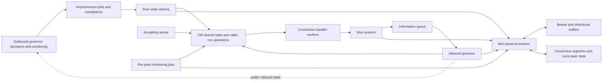

# Standalone CSP model of connection management and governors

**Design study for review — updated 14 October 2026; source baseline checked 13 October 2026**

**Architecture review:** [CM, IG, OG and Server: source mapping, execution architecture, and seven diagrams](connection-management-architecture-review.md). That review sharpens the execution and correspondence design below; the earlier slide deck predates these revisions.

**Objective:** model the implementation closely enough to use CSP to discover problems in the source code. This document records the source study and a proposed design. The investigation targets below are hypotheses to test, not newly established defects.

**Recommendation:** build an executable model of concurrent connection-management operations, including their shared state, blocking behavior, and transaction boundaries. Use network specification section 5 as a separate comparison specification. Start with one local node, two remote connection keys, and overlapping incarnations, including the accepting server and both governors from the outset; then deepen protocol lifecycle scenarios.

## 1. Source baseline and scope

The study examined section 5 of the network specification, including its diagrams and operation tables, and followed the current Leios consensus branch through its network dependency into connection management, inbound governance, mux lifecycle, outbound peer-state actions, and protocol shutdown. It also compared those mechanisms with the existing Agda models.

| Reference | Revision or date |
|---|---|
| Network specification | 1 October 2026 edition, section 5 |
| `ouroboros-consensus/leios-prototype`, checked 13 October | `585a86117618ff86d7d5b541f9d23b03356d4c3a` |
| Network dependency pinned by that consensus revision | `96ee6e0e689770b5a3d664c59f2d13b05c5d9c4d` |
| Network revision underlying the local wedge/demotion studies | `4b3ab7664f609a1aee0f0c24dcfcfd0ab899fc42` |
| Consensus revision underlying the local demotion study | `27fa649ffedcb2a6427144692b00a84ccce68318` |

The consensus branch explicitly pins `96ee6e0…`. The network branch head was different when checked, so the dependency pin is the implementation baseline for this proposal. Historical revisions should remain separate regression configurations. [S1]

The user-linked consensus directory contains the prototype protocol definitions. The integration with the network bundle also requires inspecting `ouroboros-consensus-diffusion/.../Ouroboros/Consensus/Network/NodeToNode.hs` and the pinned `ouroboros-network` repository.

This was a source and model study. No Agda or Haskell implementation, build, model-checking run, or replay establishes the proposed properties yet.

## 2. Architectural reading of section 5

Section 5 treats a bearer as a shared resource whose use can change between outbound, inbound, and duplex. It separates the connection manager, accepting server, outbound governor, and inbound protocol governor. Transport establishment direction does not determine the continuing mini-protocol roles. [S0]

For the proposed model, retain that decomposition and use the source to define executable behavior. The model should expose differences between the abstract connection states and the actual states of muxes, sockets, notification queues, and workers. A legal abstract CM transition can still participate in a harmful concurrent execution.

The standalone model defines its own connection and protocol-run identities. It distinguishes transport origin, negotiated unidirectional/duplex capability, current local/remote use, and message direction. It does not inherit `Link`, `Dir`, or `linkConfig` from `Cardano_network`.

## 3. Source findings that determine the model

### 3.1 Connection identity has several layers

`ConnMap` is indexed first by remote address and then by local address. Outbound reservation can use an unknown-local-address entry. Acquisition searches by remote address, while inbound operations and cleanup can use a full `ConnectionId`. One entry per peer would lose part of the implementation's behavior. [S2]

The mutable CM entry also has a `ConnStateId`. This is distinct from a particular handler or mux. The current inbound admission code can overwrite reserved or unnegotiated state while retaining the mutable entry. For established states it rejects duplicate admission, while terminating or terminated entries admit a fresh mutable state. These branches must appear individually in the model. [S3], [S4]

### 3.2 CM termination and mux termination are separate

Inbound release performs an STM update to `TerminatingState` before delivering cancellation. Cleanup can close a socket, wait for the configured interval, and remove an entry later. It checks mutable-entry identity before deleting the map entry, protecting a replacement in those cleanup paths. [S4]

The model must distinguish:

- a CM entry marked terminating;
- a cancellation request and its delivery;
- a mux reporting failed or stopped;
- a closed physical socket;
- a removed CM entry;
- an IG entry that still exists.

A single atomic `close` transition would conceal the ordering that needs investigation.

### 3.3 Inbound-governor processing can block globally

`MuxFinished` contains a connection key. During handling, the IG looks up the currently registered mux and calls `Mux.stopped` on that mux. This takes place inside sequential processing of a gathered event batch. A blocked handler can therefore prevent subsequent events in that batch from being processed. `NewConnection` preserves an existing IG entry for the same key. [S5]

The code contains a possible mechanism for stale-key behavior. Establishing a defect requires a reachable execution under the exact current admission, cancellation, and notification rules.

The model should preserve both the bounded queue and the batch already removed from it. Removing a message from the queue is not the same as completing its handler. Batch selection can prefix maturity or idle-commit events to flushed notifications. On IG exit the source disables tracer production through an active flag and drains the queue; a tracer that has already sampled the flag retains that captured value. An exited IG and a live blocked IG are different scenarios. [S26]

### 3.4 Notification tracing affects execution

The inbound-governor mux tracer runs in the connection-handler/mux context. Its STM queue writes can block. The information queue has capacity 100. A responder-completion transaction can enqueue `MiniProtocolTerminated`, `RemoteDemotedToWarm`, and `WaitIdleRemote` together. [S6], [S7]

This has two consequences:

1. Queue backpressure can obstruct the thread that produces lifecycle progress or cleanup.
2. A reduced queue capacity of one or two produces artificial deadlocks because an atomic three-message enqueue can never fit, even in an empty queue.

The current tracer also retries a responder-start notification while the tracked `RemoteIdle` timeout has expired, allowing the IG to resolve the pending commit first. This guard and its shared-state dependencies belong in the model. [S6]

### 3.5 Hot demotion waits for protocol completion

`deactivatePeerConnection` writes `Terminate` to the hot control variable and `Continue` to the warm control variable. It waits for all hot results before recording a successful warm state. Timeout requests mux shutdown and moves the peer toward cooling. The source default deactivation timeout is 300 seconds. Closing a connection waits on all temperature groups and uses a distinct timeout. [S8], [S9]

`Mux.stop` merely enqueues a shutdown command. Mux shutdown, protocol cancellation, result publication, and thread completion are later actions. `Mux.stopped` retries while the mux is ready or stopping. [S10]

### 3.6 Current Leios Notify addresses an older shutdown gap

The current Notify client checks termination in STM even when its pipeline is full. It can send `MsgQuit` with replies outstanding. The server reads ahead, sets its quit flag, supplies cancellation replies for deferred work, drains sends, and sends `MsgDone`. The current configured Notify pipeline depth is 1000 and Fetch depth is 150. [S11], [S13]

Fetch still has blocking collection paths and drains outstanding replies before sending its terminating message. A model must retain where the client rechecks control and where it waits for a response. [S12]

The older `HotDemotion` analysis explicitly recorded uncertainty about Notify termination at full pipeline depth. The current source resolves that code-reading uncertainty. It does not automatically establish a new theorem about the complete current demotion path.

### 3.7 Protocol registry lifetimes matter

BlockFetch registration and cleanup interact with ChainSync and KeepAlive registries. In particular, cleanup can wait for the associated ChainSync client. Independent abstract protocol processes that simply return at will would omit those dependencies. [S14]

`bracketLeiosPeer` shares peer variables among ChainSync, Notify, and Fetch. It has no reference count. Cleanup deletes the peer entry and refunds outstanding fetch requests. Its comment relies on hot protocols tearing down together. Staggered exits, delayed cleanup, and subsequent allocation should be explicit investigation cases. [S15]

## 4. Proposed process decomposition



The modeled system comprises **CM, IG, OG, and Server together**, plus the workers and shared resources through which they interact. Here OG denotes the outbound peer-selection governor, including its decision loop and asynchronous jobs; it is not synonymous with `PeerStateActions`. The decomposition follows source execution responsibilities, not a claim that each box is a single Haskell thread.

| Component | Pinned implementation | Required execution detail |
|---|---|---|
| Connection manager (CM) | `ConnectionManager/Core.hs`, `State.hs`, `ConnMap.hs` | Reservation, admission, acquisition/release, duplex reuse, pruning, entry identity and cleanup |
| Inbound governor (IG) | `InboundGovernor.hs`, `State.hs`, `InformationChannel.hs` | Registered entries, gathered batches, notification handling, responder lifecycle, CM calls and blocking waits |
| Outbound governor (OG) | `PeerSelection/Governor.hs` and its `EstablishedPeers`, `ActivePeers`, `Monitor`, and `Types` modules | Known/established/active peer state, targets, in-progress work, decisions, job launch, job completion, monitoring and wakeups |
| Accepting server | `Server.hs`, `Server/RateLimiting.hs` | Listening/accept loops, rate-limit waits, socket ownership, masked handoff, asynchronous admission, errors and closure |
| Outbound action workers | `PeerSelection/PeerStateActions.hs` | Establish, activate, deactivate and close operations, control/result variables, timeout and cancellation behavior |

The existing CM/IG study is supplemented by direct inspection of the pinned server accept loop and OG decision/job loop. This is an architectural source map; a complete branch-by-branch transition ledger for those modules remains implementation work. [S4], [S5], [S8], [S20], [S21], [S22], [S23]

### 4.1 Server execution and socket ownership

`Server.hs` runs accept loops with a shared inbound governor. Before accepting, a loop runs connection rate limiting against CM connection counts. After acceptance, it obtains the local address and starts an asynchronous `includeInboundConnection` worker. Masking protects the interval between accepting a socket and handing it to that worker. Disconnection results and exception paths close the socket. Aborted accepts have a delayed retry branch; other accept errors propagate. Preserve these phases and ownership obligations rather than representing acceptance as one atomic CM insertion. [S20]

### 4.2 OG decisions, jobs, and completions

The OG evaluates guarded decisions, monitors connections and job completions, updates its state/view, and forks the selected jobs. Timed wakeups race with eligible decision actions. Establishment and activation/demotion jobs call the peer-state actions; their completion is distinct from the governor consuming the result. The model must preserve the relevant guard ordering, in-progress bookkeeping, captured connection handles, result handling, and failure paths. Replacing OG with arbitrary externally issued CM calls would omit this behavior. [S21], [S22], [S23]

The separate per-peer monitoring jobs in `PeerStateActions` can race with explicit OG jobs. The source has a decision-job completion queue and a separate peer-monitoring job pool; their lifetimes and completion routing must remain distinct. Deactivation timeout requests mux stop and raises an error; the OG job error handler then has its own timed wait for Cold. Neither timeout is an atomic transition to complete cleanup. [S8], [S23], [S24]

Small scenarios may fix peer discovery inputs, targets, and policy choices. Such simplifications must be declared and retain the selected source branches. The OG itself remains an executable component. Likewise, the environment supplies incoming transport outcomes, but the accepting server remains inside the model.

Each actual worker can progress independently where the source permits it. CM operation steps execute in the caller; the diagram shows access paths, not one thread per box. Shared transactions synchronize their effects. The logical decomposition need not force one enormous nested CSP expression: a pure product-state transition system can represent the same workers and shared state, with a proof connecting that representation to its process execution.

The first scope is the combined local CM/IG/OG/Server lifecycle subsystem with a controlled remote environment and at least two remote connection keys. This is sufficient to investigate whether a failure on one key blocks work for another. Subsequent scenarios compose two explicit endpoint implementations.

## 5. State and identity design

| Model object | Source behavior preserved |
|---|---|
| Remote peer address | Outbound acquisition and peer-selection key |
| Full connection key | Local/remote address pair, including ports |
| Mutable CM entry identity | `ConnStateId` and entry-reference equality |
| Handler and mux identities | Particular running incarnations |
| Protocol-run identity | Successive responder restarts and their results |
| Physical bearer state | Connected, reset, closed, and pending I/O outcomes |
| CM state | Source constructors and associated fields |
| CM map ownership | Full/taken TMVar, owning worker, saved map and exception restoration |
| IG entry and remote state | Governor bookkeeping independent of CM state |
| OG state and outstanding jobs | Peer sets, targets, in-progress promotions/demotions, completions and wakeups |
| Server state and accepted sockets | Accept-loop position, rate-limit waits, ownership and admission workers |
| Worker program counter | Next operation, captured references, and blocking wait |
| Control/result variables | Established, warm, and hot groups |
| Queue and current batch | Waiting notifications and gathered but unprocessed events |
| Timers and cancellation | Armed/expired timers, masking, and delivery phases |

Old handlers and muxes must remain representable after a map points elsewhere. A peer reset can free the transport tuple before the local mux notices failure. Handshake success, handle publication, and entry into the mux run loop are distinct phases.

Incarnation identities can appear in diagnostic observations and monitors. They must not improve implementation behavior: an operation that receives only a key in Haskell must resolve by key in the model. A ghost origin tag can explain an old callback, but cannot become an extra guard preventing it.

A model must also distinguish a local endpoint's mux identity from the mux identity at the other endpoint. The physical session connects them without requiring equal local identifiers.

## 6. Small-step semantics and source correspondence

Use a pure transition relation or step function, a productive `PTree` rendering, and correspondence lemmas between pure runs and process traces. The local `GovernorWedge` development provides an established pattern for this.

An inbound release should expose these separate phases:

```text
IG chooses CommitRemote
CM commits the release transaction
Cancellation is requested and delivered according to masking rules
The CM operation returns its actual result
IG handles CommitTr, KeepTr, or UnsupportedState
IG publishes its updated state
```

Other workers may run between phases where the source permits scheduling. The model must not assume cancellation is instantaneous or that a CM update and IG update form one transaction.

Rules for the executable semantics:

- A committed STM transaction forms one atomic transition, including every write and queue insertion.
- IO `modifyTMVar` is not one transaction: take, IO body, exception restoration and put are separate phases. Its STM counterpart commits take/body/put together. Retain captured entry TVars even when the global map is taken. [S25]
- CM function calls remain in the caller thread; forks, promises and asynchronous jobs introduce separate execution only where the source does.
- `retry` disables transaction completion. It does not create a hidden busy loop.
- Separate IO operations and separate `atomically` calls retain their ordering and scheduling opportunities.
- Worker states retain previously captured references, including references to replaced entries.
- `throwTo`, mux stop, protocol completion, socket close, and notification delivery remain distinct.
- STM branch choice follows the implementation, including `orElse` ordering where relevant.
- Exception masking and interruptible waits constrain cancellation delivery.
- Assertion-enabled and assertion-disabled builds are separate configurations. The studied consensus Cabal configuration enables assertions. [S16]

Use the product machine as the executable authority, with modular rule families. A parallel CSP decomposition requires correspondence evidence rather than an assumed equivalence. Diagnostic labels support replay; internal execution labels must be hidden for behavioral claims so an environment cannot refuse internal cleanup. Trace correspondence alone does not transfer stable refusals or divergence properties.

Maintain a source ledger for each rule: revision, function, source location, worker, guard, reads, writes, lock ownership, captured references, exception behavior, emitted events, and potential blocking. This ledger is the basis for reviewing source fidelity and replaying counterexamples.

## 7. Protocol lifecycle and the current bundle

| Temperature | Protocols in the current construction |
|---|---|
| Hot | ChainSync, BlockFetch, TxSubmission2, with conditional Peras protocols |
| Hot, added by consensus | LeiosNotify and LeiosFetch |
| Warm | Empty in the base construction |
| Established | KeepAlive and conditional PeerSharing |

The exact bundle depends on the source's feature/version negotiation and configuration. The first Leios scenario should explicitly state whether Peras and PeerSharing are enabled. [S13], [S17]

Initially abstract message content while preserving each protocol's lifecycle:

- the points where it reads its control variable;
- blocking receives and application operations;
- outstanding pipeline requests and completion variables;
- return, exception, and bracket-cleanup phases;
- dependencies on other protocol registries.

Payload abstraction should preserve predicates that affect lifecycle behavior. For example, whether an awaited reply or application object exists can matter even when its full contents do not.

## 8. Standalone model boundary

Use a separate top-level namespace, provisionally `ConnectionManagement/`, for the combined CM/IG/OG/Server model. It depends on generic `csp-ptree-agda` semantics and standard Agda libraries, not on `Cardano_network` or its network assembly. There is no `linkConfig` dependency and no network-integration stage in the present scope.

A static scenario specifies finite address domains, supported protocol capabilities, policy inputs and exploration bounds. Runtime state specifies allocated connections, negotiated capabilities, active uses, workers and buffers. A fixed universe of slots can represent dynamic allocation through inactive/active worker states. Reuse must retain old referenced incarnations until source cleanup permits reclamation; bounded exhaustion must not masquerade as an implementation deadlock.

IG, OG, accept loops and their workers have distinct state and program counters. CM is an API over shared state: its operation continuations execute in the calling workers, not in an invented CM server thread. Their calls, shared transactions, notifications, jobs and completion results connect them. Protocol lifecycle stubs initially represent controls, pending work, completion and failure; richer Notify/Fetch behavior can be added within this standalone model. Persistent application resources and session-scoped resources are distinguished where their lifetimes affect these operations.

Generic trace, interrupt, renaming, parallel, iteration and divergence laws should come from `csp-ptree-agda`. Missing generic laws belong in a separate dependency change.

## 9. Reuse without mixing existing models

`GovernorWedge`, `HotDemotion`, and the new model remain separate developments. Neither existing model is imported wholesale or silently retargeted to the new source revision.

| Development | Candidate reuse | Boundary |
|---|---|---|
| `GovernorWedge` | Incarnation discipline, pure-step construction, trace correspondence techniques, regression scenarios | Historical source pin, atomic release abstraction, omitted outbound/duplex detail |
| `HotDemotion` | Completion barriers, outcome monitors, protocol blockers, shutdown scenarios | Historical protocol assumptions and simplified cleanup |

For each reused item, record its original assumptions and whether it is an independent utility, an adapted definition, a proof technique, or a scenario to re-establish. Recheck its validity against the pinned implementation. Historical witnesses do not automatically become reachable executions of the combined model. [L1], [L2]

The earlier comparisons with pipelined Notify and Leios safety/liveness developments remain background references, not implementation dependencies or transferred theorems. [L3], [L4], [L5]

## 10. Properties for finding problems

Whole-system deadlock is insufficient. Timers, remote actions, or a healthy connection can keep the system moving while the IG remains blocked. Include component progress, refusal, and ownership monitors.

| Property | Counterexample of interest |
|---|---|
| Server socket ownership | Accepted socket has no tracked handoff or cleanup obligation |
| CM map restoration | Lock remains taken along a source-valid exception or blocking path |
| OG completion bookkeeping | Late completion or monitoring races invalidate in-progress/peer state |
| IG progress across keys | One key prevents unrelated queued work from being handled |
| Callback/reference consistency | An old callback waits on, restarts, or removes another incarnation |
| Responder ownership | A usable mux loses registration needed for responder management |
| Completion barriers | Demotion succeeds too early or waits on an obsolete result |
| Release-result consistency | CM updates and IG bookkeeping disagree across operation boundaries |
| Resource accounting | Resources become detached from tracking or cleanup |
| Leios peer-state lifetime | Cleanup removes state needed by another live protocol run |
| Session separation | Old-session traffic or results affect a replacement |
| Timer freshness | An obsolete timeout acts on a later lifecycle |
| Assertion reachability | An assertion fails under a permitted schedule |

Monitors must allow legitimate transient states. A connection awaiting registration is not automatically an orphan. Define the point at which the registration obligation should have completed, or express a conditional eventual-registration property with explicit scheduling premises.

CM counters, physical sockets, and resources awaiting cleanup need separate accounting. The inbound hard limit is not a universal bound on all sockets the node owns. Pruning updates CM state before later cancellation, so logical removal and resource reclamation are separate events.

Distinguish safety, deadlock freedom, divergence freedom, conditional progress, and universal delivery. A possible successful trace establishes non-vacuity, not universal liveness.

## 11. Initial investigation campaigns

1. **Release, replacement, and delayed callbacks.** Preserve the current admission checks, key-only `MuxFinished`, batching, and split release sequence. Revisit historical witnesses against the new pin.
2. **Queue backpressure.** Preserve atomic notification bursts and investigate blocked producers, mux completion, and cleanup.
3. **Hot demotion.** Exercise Notify quit with outstanding requests, Fetch draining, ChainSync waits, and registry cleanup.
4. **Leios peer-state cleanup.** Explore staggered exits followed by allocation or request assignment.
5. **Duplex reuse and pruning.** Explore acquisition/release, remote activity, reservations, and the two-stage prune procedure.
6. **Server and map ownership.** Explore concurrent accept loops, admission limits, same-key acquisition, IO map-lock windows and exception restoration.
7. **OG job/monitor races.** Explore explicit demotion versus peer monitoring, delayed completion, outer error-handler timeout and repromotion.
8. **Supervision.** Compare a live blocked IG with IG shutdown, disabled tracing, final queue drain and cancellation of surrounding workers.

These campaigns define questions for the model. The source study alone does not establish new reachable defects.

## 12. Finite CSP checking and Haskell replay

The proposed workflow is:

1. Pin source and configuration, then write the source ledger.
2. Implement the lifecycle machine and its Agda `PTree` rendering.
3. Generate a finite CSPM representation from the same transition description, with correspondence checks to prevent drift.
4. Explore bounded instances using FDR where available.
5. Minimize each counterexample and translate it into a source-operation schedule.
6. Reproduce the schedule in Haskell using the existing `IOSim`/`IOSimPOR` infrastructure.
7. Compare a proposed fix with the original behavior and retain a regression trace.

The network test suite already checks abstract CM transitions, and the mutable-state tracing comments specifically discuss preserving atomic transition observations for `IOSimPOR`. This provides a useful replay foundation. It does not automatically validate a new CSP abstraction. [S18], [S19]

The criterion for calling a result a source-code problem should be a source-valid counterexample followed by Haskell replay, or an equally explicit source-level justification when replay is impractical. A failed replay prompts inspection of abstraction and scheduling assumptions.

## 13. Bounds, time, and abstraction discipline

Vary connection keys, simultaneous incarnations, protocol runs, buffers, and pipeline depths. Record every bound in the result. A bounded search with no counterexample is not a general proof.

Never report finite identity-pool exhaustion as a source deadlock. Do not recycle an identity while a worker, queue entry, timer, or result still refers to it. A reduced model must preserve the source's relevant address equalities and map-selection behavior.

Keep queue capacity 100 initially. Smaller capacities can help diagnosis, but a three-event enqueue requires room for the entire transaction, and any candidate defect requires validation at the source capacity. Pipeline reductions similarly require demonstrating the relevant order at actual configured depths.

Begin with explicit untimed expiration events for race exploration. Add clock-constrained scenarios for deadline claims. An enabled timeout provides an available escape; it does not establish a bound on elapsed time. Preserve timer arming, cancellation, and freshness even in an untimed model.

State scheduling premises when proving progress. Do not introduce fairness that forces a remote peer to reply or forces a live replacement to fail. KeepAlive, time passage, and reconnect activity also affect what can be hidden without introducing divergence.

## 14. Proposed implementation stages and review decisions

| Stage | Reviewable result |
|---|---|
| A. Source ledger | Pinned modules, transaction boundaries, blocking operations, identity map |
| B. Combined lifecycle core | One local node, two remote keys, CM/IG/OG/Server, jobs, handlers, muxes and overlapping incarnations |
| C. First searches | Replacement and queue-backpressure counterexamples or bounded results |
| D. Replay | Haskell schedules and regression tests for surviving candidates |
| E. Protocol lifecycle | Demotion, result barriers, Notify/Fetch pipelines, registry cleanup |
| F. Broader standalone scenarios | Two endpoint implementations, policy variations and additional source branches |

Recommended decisions for the first implementation:

- Use consensus `585a861…` and its network pin `96ee6e0…` as the baseline.
- Begin with CM, IG, OG and Server together, using two remote keys.
- Keep the new model independent of `Cardano_network`, `GovernorWedge` and `HotDemotion`; document selective reuse.
- Preserve the actual queue capacity and source transaction boundaries.
- Keep prototype payloads abstract until they affect lifecycle decisions.
- Treat FDR export and Haskell replay as proposed tooling work, with explicit correspondence obligations.
- Review the first source ledger and minimized schedules before expanding the standalone scenarios.

## Source references

All GitHub references below use the revisions studied. Local links point to the current library and may evolve.

[S0]: https://ouroboros-network.cardano.intersectmbo.org/pdfs/network-spec/network-spec.pdf
[S1]: https://github.com/IntersectMBO/ouroboros-consensus/blob/585a86117618ff86d7d5b541f9d23b03356d4c3a/cabal.project#L98-L109
[S2]: https://github.com/IntersectMBO/ouroboros-network/blob/96ee6e0e689770b5a3d664c59f2d13b05c5d9c4d/ouroboros-network/framework/lib/Ouroboros/Network/ConnectionManager/ConnMap.hs
[S3]: https://github.com/IntersectMBO/ouroboros-network/blob/96ee6e0e689770b5a3d664c59f2d13b05c5d9c4d/ouroboros-network/framework/lib/Ouroboros/Network/ConnectionManager/State.hs
[S4]: https://github.com/IntersectMBO/ouroboros-network/blob/96ee6e0e689770b5a3d664c59f2d13b05c5d9c4d/ouroboros-network/framework/lib/Ouroboros/Network/ConnectionManager/Core.hs
[S5]: https://github.com/IntersectMBO/ouroboros-network/blob/96ee6e0e689770b5a3d664c59f2d13b05c5d9c4d/ouroboros-network/framework/lib/Ouroboros/Network/InboundGovernor.hs#L278-L413
[S6]: https://github.com/IntersectMBO/ouroboros-network/blob/96ee6e0e689770b5a3d664c59f2d13b05c5d9c4d/ouroboros-network/framework/lib/Ouroboros/Network/InboundGovernor.hs#L625-L725
[S7]: https://github.com/IntersectMBO/ouroboros-network/blob/96ee6e0e689770b5a3d664c59f2d13b05c5d9c4d/ouroboros-network/framework/lib/Ouroboros/Network/InboundGovernor/InformationChannel.hs#L35-L54
[S8]: https://github.com/IntersectMBO/ouroboros-network/blob/96ee6e0e689770b5a3d664c59f2d13b05c5d9c4d/ouroboros-network/lib/Ouroboros/Network/PeerSelection/PeerStateActions.hs#L986-L1107
[S9]: https://github.com/IntersectMBO/ouroboros-network/blob/96ee6e0e689770b5a3d664c59f2d13b05c5d9c4d/ouroboros-network/lib/Ouroboros/Network/Diffusion/Policies.hs
[S10]: https://github.com/IntersectMBO/ouroboros-network/blob/96ee6e0e689770b5a3d664c59f2d13b05c5d9c4d/network-mux/src/Network/Mux.hs
[S11]: https://github.com/IntersectMBO/ouroboros-consensus/blob/585a86117618ff86d7d5b541f9d23b03356d4c3a/ouroboros-consensus/src/ouroboros-consensus/LeiosDemoOnlyTestNotify.hs#L529-L723
[S12]: https://github.com/IntersectMBO/ouroboros-consensus/blob/585a86117618ff86d7d5b541f9d23b03356d4c3a/ouroboros-consensus/src/ouroboros-consensus/LeiosDemoOnlyTestFetch.hs#L591-L687
[S13]: https://github.com/IntersectMBO/ouroboros-consensus/blob/585a86117618ff86d7d5b541f9d23b03356d4c3a/ouroboros-consensus-diffusion/src/ouroboros-consensus-diffusion/Ouroboros/Consensus/Network/NodeToNode.hs
[S14]: https://github.com/IntersectMBO/ouroboros-network/blob/96ee6e0e689770b5a3d664c59f2d13b05c5d9c4d/ouroboros-network/lib/Ouroboros/Network/BlockFetch/ClientRegistry.hs#L75-L193
[S15]: https://github.com/IntersectMBO/ouroboros-consensus/blob/585a86117618ff86d7d5b541f9d23b03356d4c3a/ouroboros-consensus-diffusion/src/ouroboros-consensus-diffusion/Ouroboros/Consensus/Network/NodeToNode.hs#L1808-L1855
[S16]: https://github.com/IntersectMBO/ouroboros-consensus/blob/585a86117618ff86d7d5b541f9d23b03356d4c3a/cabal/asserts.cabal
[S17]: https://github.com/IntersectMBO/ouroboros-network/blob/96ee6e0e689770b5a3d664c59f2d13b05c5d9c4d/cardano-diffusion/lib/Cardano/Network/NodeToNode.hs#L250-L322
[S18]: https://github.com/IntersectMBO/ouroboros-network/blob/96ee6e0e689770b5a3d664c59f2d13b05c5d9c4d/ouroboros-network/framework/sim-tests/Test/Ouroboros/Network/ConnectionManager.hs
[S19]: https://github.com/IntersectMBO/ouroboros-network/blob/96ee6e0e689770b5a3d664c59f2d13b05c5d9c4d/ouroboros-network/framework/tests-lib/Test/Ouroboros/Network/ConnectionManager/Utils.hs
[L1]: ../GovernorWedge/README.md
[L2]: ../HotDemotion/README.md
[L3]: ../Cardano_network/Parametric/Leios/LeiosNotifyPipelined.agda
[L4]: ../Cardano_network/Parametric/Leios/README.md
[L5]: ../Cardano_network/Parametric/Leios/NoLivelock/NoLivelockL.agda

Reference key: S0 specification; S1 dependency pin; S2–S4 CM maps, states, and core; S5–S7 IG and notification queue; S8–S10 peer actions, policies, and mux; S11–S13 Leios protocols and integration; S14–S15 registries; S16 assertion configuration; S17 base bundle; S18–S19 simulator tests; S20–S23 Server and OG; S24–S26 peer monitoring, map-lock semantics and IG batch/shutdown. L1–L5 identify the local developments discussed above.

[S20]: https://github.com/IntersectMBO/ouroboros-network/blob/96ee6e0e689770b5a3d664c59f2d13b05c5d9c4d/ouroboros-network/framework/lib/Ouroboros/Network/Server.hs
[S21]: https://github.com/IntersectMBO/ouroboros-network/blob/96ee6e0e689770b5a3d664c59f2d13b05c5d9c4d/ouroboros-network/lib/Ouroboros/Network/PeerSelection/Governor.hs
[S22]: https://github.com/IntersectMBO/ouroboros-network/blob/96ee6e0e689770b5a3d664c59f2d13b05c5d9c4d/ouroboros-network/lib/Ouroboros/Network/PeerSelection/Governor/EstablishedPeers.hs
[S23]: https://github.com/IntersectMBO/ouroboros-network/blob/96ee6e0e689770b5a3d664c59f2d13b05c5d9c4d/ouroboros-network/lib/Ouroboros/Network/PeerSelection/Governor/ActivePeers.hs

[S24]: https://github.com/IntersectMBO/ouroboros-network/blob/96ee6e0e689770b5a3d664c59f2d13b05c5d9c4d/ouroboros-network/lib/Ouroboros/Network/PeerSelection/PeerStateActions.hs#L600-L855
[S25]: https://github.com/IntersectMBO/ouroboros-network/blob/96ee6e0e689770b5a3d664c59f2d13b05c5d9c4d/ouroboros-network/framework/lib/Ouroboros/Network/ConnectionManager/Core.hs#L2364-L2400
[S26]: https://github.com/IntersectMBO/ouroboros-network/blob/96ee6e0e689770b5a3d664c59f2d13b05c5d9c4d/ouroboros-network/framework/lib/Ouroboros/Network/InboundGovernor.hs#L182-L280
